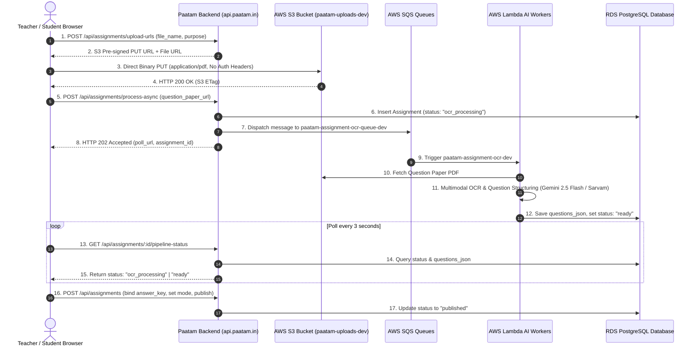
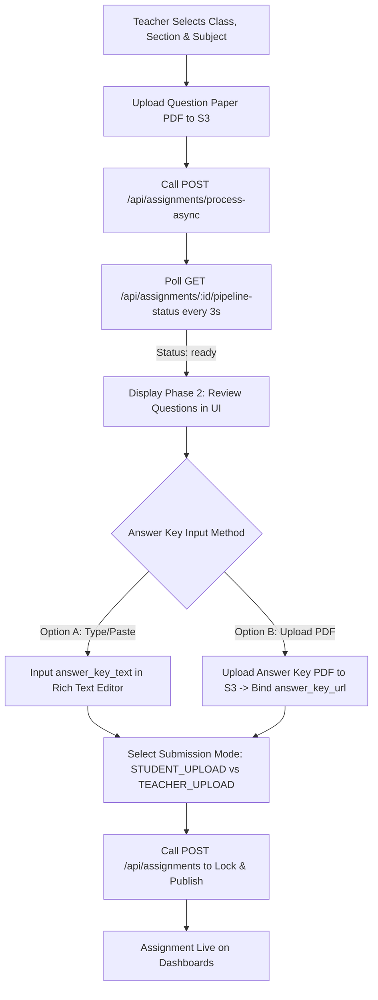
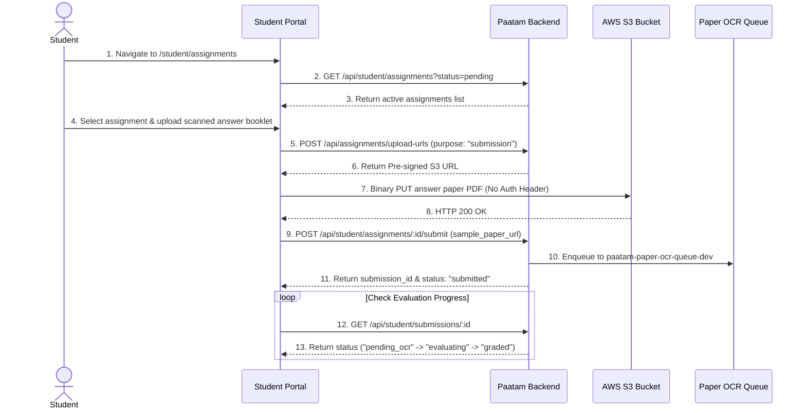
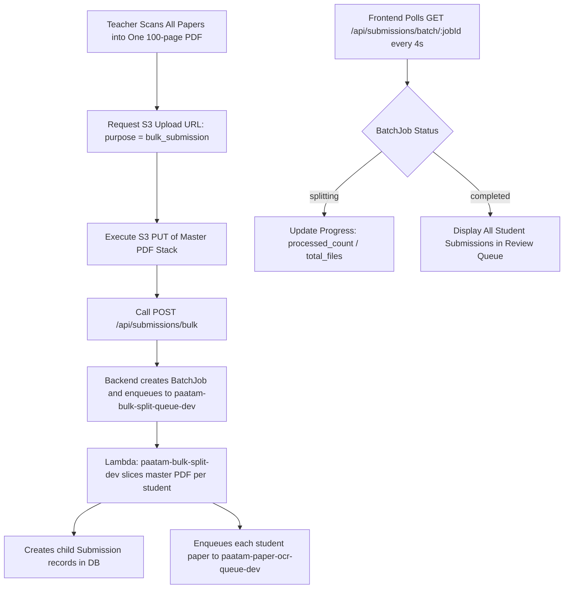

# Paatam Backend - API Documentation

This document maintains a comprehensive list of all available API endpoints, their expected request formats, responses, and potential error codes.

---

## 1. Global Cursor Pagination
All endpoints that return a list of items support **Cursor Pagination**.
- **Query Parameters:**
  - `cursor` (string, optional): The ID of the last item received.
  - `limit` (number, optional): Max items to return. Hardcapped at `10`. Defaults to `10`.
- **Response Format:**
  Every paginated endpoint returns a `meta` object alongside the `data` array:
  ```json
  "meta": {
    "nextCursor": "931281239128", // Pass this to the next ?cursor= query
    "hasNextPage": true // True if there are more items to fetch
  }
  ```

---

## 2. Corporate Entities

### `GET /api/corporate/lookup/:registrationNo`
Looks up a Corporate entity by its registration number. Useful for the first step of the login flow.

- **URL Params:** `registrationNo` (string, required)
- **Authentication Required:** No
- **Success Response (200 OK):**
  ```json
  {
    "status": "success",
    "data": {
      "corporateId": "1",
      "name": "Acme Corp",
      "registration_no": "REG-123"
    }
  }
  ```
- **Error Responses:**
  - `404 Not Found`: "Corporate entity not found"

---

### `POST /api/corporate/create`
Creates a new Corporate entity and its first Corporate Admin. Requires a pre-registration OTP verification token.

- **Authentication Required:** No
- **Request Body:**
  ```json
  {
    "name": "Acme Corp",
    "registration_no": "REG-12345",
    "verificationToken": "<JWT_FROM_OTP_VERIFY>",
    "admin": {
      "name": "John Doe",
      "email": "john@acme.com",
      "mobile": "9876543210"
    }
  }
  ```
- **Success Response (201 Created):**
  ```json
  {
    "status": "success",
    "data": {
      "id": "1",
      "name": "Acme Corp",
      "registration_no": "REG-12345",
      "created_at": "2023-10-04T12:00:00.000Z"
    }
  }
  ```
- **Error Responses:**
  - `400 Bad Request`: Validation errors (Zod)
  - `401 Unauthorized`: "Invalid or expired verification token."
  - `409 Conflict`: Unique constraint violation (e.g., registration number already exists)

---

### `POST /api/corporate/addAdmin/:corporateId`
Adds a new Corporate Admin to an existing corporate entity.

- **Authentication Required:** Yes (Requires valid Access Token in Header)
- **Role Required:** `CORPORATE_ADMIN`
- **URL Params:** `corporateId` (string, required)
- **Request Body:**
  ```json
  {
    "name": "Jane Doe",
    "email": "jane@acme.com",
    "mobile": "1234567890",
    "verificationToken": "<JWT_FROM_OTP_VERIFY>"
  }
  ```
- **Success Response (201 Created):**
  ```json
  {
    "status": "success",
    "message": "Admin added successfully",
    "data": {
      "id": "2",
      "corporate_id": "1",
      "name": "Jane Doe",
      "email": "jane@acme.com",
      "mobile": "1234567890"
    }
  }
  ```
- **Error Responses:**
  - `400 Bad Request`: "Verification token is required. Please verify OTP first."
  - `401 Unauthorized`: "Invalid or expired verification token."
  - `403 Forbidden`: "Forbidden: You do not have permission to add admins to this corporate entity." (Fails tenancy check)

---

### `GET /api/corporate/admins/all`
Fetches a paginated list of Corporate Admins belonging to the logged-in Corporate Admin's entity. Only basic identifying information is returned.

- **Authentication Required:** Yes (Access Token)
- **Role Required:** `CORPORATE_ADMIN`
- **Query Params:** `cursor`, `limit`
- **Success Response (200 OK):**
  ```json
  {
    "status": "success",
    "data": [
      {
        "id": "1",
        "name": "Jane Doe",
        "email": "jane@acme.com",
        "mobile": "1234567890"
      }
    ],
    "meta": { "nextCursor": null, "hasNextPage": false }
  }
  ```

---

### `GET /api/corporate/admin-profile/:adminId`
Fetches the full profile details for a specific Corporate Admin. Includes a tenancy check.

- **Authentication Required:** Yes (Access Token)
- **Role Required:** `CORPORATE_ADMIN`
- **URL Params:** `adminId` (string, required)
- **Success Response (200 OK):**
  ```json
  {
    "status": "success",
    "data": {
      "id": "1",
      "corporate_id": "1",
      "name": "Jane Doe",
      "email": "jane@acme.com",
      "mobile": "1234567890",
      "created_at": "..."
    }
  }
  ```
- **Error Responses:**
  - `403 Forbidden`: "Corporate admin not found or access denied"

---

## 3. Authentication & OTP

### `POST /api/auth/send-otp`
Requests a pre-registration OTP for verifying an email or mobile number. Deletes any existing OTPs for the provided contact and generates a new one valid for 5 minutes.

- **Authentication Required:** No
- **Request Body:**
  ```json
  {
    "email": "john@acme.com",
    "mobile": "9876543210"
  }
  ```
  *(Note: At least one of email or mobile is required)*
- **Success Response (200 OK):**
  ```json
  {
    "status": "success",
    "message": "OTP sent successfully",
    "data": { "otp": "123456" } // Only present in non-production environments
  }
  ```

---

### `POST /api/auth/verify-otp`
Verifies a pre-registration OTP. If valid, deletes the OTP and returns a signed Verification Token valid for 15 minutes.

- **Authentication Required:** No
- **Request Body:**
  ```json
  {
    "email": "john@acme.com",
    "mobile": "9876543210",
    "otp": "123456"
  }
  ```
- **Success Response (200 OK):**
  ```json
  {
    "status": "success",
    "message": "OTP verified successfully",
    "data": {
      "verificationToken": "eyJhbGciOiJIUz..."
    }
  }
  ```
- **Error Responses:**
  - `400 Bad Request`: "Invalid or expired OTP"

---

### `POST /api/auth/corporate/login`
Initiates the login flow for a Corporate Admin by generating and dispatching an OTP. Requires the `corporateId` to ensure the user belongs to the correct tenant.

- **Authentication Required:** No
- **Request Body:**
  ```json
  {
    "email": "john@acme.com",
    "corporateId": "1"
  }
  ```
- **Success Response (200 OK):**
  ```json
  {
    "status": "success",
    "message": "Login OTP sent successfully"
  }
  ```
- **Error Responses:**
  - `400 Bad Request`: "corporateId is required for login"
  - `404 Not Found`: "Corporate Admin not found in this corporate entity"

---

### `POST /api/auth/corporate/verify`
Finalizes the login flow by verifying the OTP. Issues an Access Token and sets an `httpOnly` Refresh Token cookie.

- **Authentication Required:** No
- **Request Body:**
  ```json
  {
    "email": "john@acme.com",
    "corporateId": "1",
    "otp": "123456"
  }
  ```
- **Success Response (200 OK):**
  *Headers:* `Set-Cookie: refreshToken=...; HttpOnly; Max-Age=2592000`
  ```json
  {
    "status": "success",
    "message": "Login successful",
    "data": {
      "accessToken": "eyJhbG...",
      "user": {
        "id": "1",
        "name": "John Doe",
        "email": "john@acme.com",
        "role": "CORPORATE_ADMIN",
        "corporateId": "1"
      }
    }
  }
  ```
- **What is stored in the Access Token?**
  - `userId`: String representation of the BigInt ID.
  - `role`: e.g., "CORPORATE_ADMIN"
  - `corporateId`: String representation of the Corporate ID.
  - `iat`: Issued At timestamp.
  - `exp`: Expiration timestamp (15 minutes).
- **Error Responses:**
  - `400 Bad Request`: "corporateId is required for verification" or "Invalid or expired OTP"
  - `404 Not Found`: "Corporate Admin not found in this corporate entity"

---

### `POST /api/auth/refresh`
Refreshes an expired short-lived Access Token using the `refreshToken` HttpOnly cookie or request body.

- **Authentication Required:** No (Uses Refresh Token Cookie or Body)
- **Request Body (Optional if Cookie is present):**
  ```json
  {
    "refreshToken": "optional-if-sent-via-httponly-cookie"
  }
  ```
- **Success Response (200 OK):**
  ```json
  {
    "status": "success",
    "message": "Access token refreshed successfully",
    "data": {
      "accessToken": "eyJhbGciOi..."
    }
  }
  ```
- **Error Responses:**
  - `401 Unauthorized`: "Refresh token required" or "Invalid or expired refresh token"

---

### `POST /api/auth/admin/forgot-password`
*Aliases:* `POST /api/auth/branch-admin/forgot-password`, `POST /api/auth/branch/forgot-password`

Initiates a password reset for a Branch Admin. Sends an OTP to their registered email/mobile.

- **Authentication Required:** No
- **Request Body:**
  ```json
  {
    "identifier": "skinner@paatam.in",
    "corporateId": "1512528182029314"
  }
  ```
- **Success Response (200 OK):**
  ```json
  {
    "status": "success",
    "message": "Password reset OTP sent successfully"
  }
  ```
- **Error Responses:**
  - `400 Bad Request`: Schema validation failure
  - `404 Not Found`: Admin not found

---

### `POST /api/auth/admin/reset-password`
*Aliases:* `POST /api/auth/branch-admin/reset-password`, `POST /api/auth/branch/reset-password`
Completes password reset by verifying the OTP and updating the bcrypt password hash.

- **Authentication Required:** No
- **Request Body:**
  ```json
  {
    "identifier": "skinner@paatam.in",
    "corporateId": "1512528182029314",
    "otp": "123456",
    "new_password": "NewSecurePassword123!"
  }
  ```
- **Success Response (200 OK):**
  ```json
  {
    "status": "success",
    "message": "Password has been reset successfully"
  }
  ```
- **Error Responses:**
  - `400 Bad Request`: "Invalid or expired OTP" or schema validation failure

---

## 4. Branch Management

### `GET /api/branch/corporate/all`
Retrieves a paginated list of all Branches belonging to the currently logged-in Corporate Admin.

- **Authentication Required:** Yes (Access Token)
- **Role Required:** `CORPORATE_ADMIN`
- **Query Params:** `cursor`, `limit`
- **Success Response (200 OK):**
  ```json
  {
    "status": "success",
    "data": [
      {
        "id": "1",
        "corporate_id": "1",
        "name": "Main Branch",
        "pincode": "500081",
        "address": "HiTech City, Hyderabad",
        "branch_contact_mail": "contact@mainbranch.com",
        "mobile_number": "9876543210"
      }
    ],
    "meta": { "nextCursor": "1", "hasNextPage": false }
  }
  ```

---

### `POST /api/branch/create`
Creates a new Branch under the logged-in Corporate entity.

- **Authentication Required:** Yes (Access Token)
- **Role Required:** `CORPORATE_ADMIN`
- **Request Body:**
  ```json
  {
    "name": "Main Branch",
    "pincode": "500081",
    "address": "HiTech City, Hyderabad",
    "branch_contact_mail": "contact@mainbranch.com",
    "mobile_number": "9876543210"
  }
  ```
- **Success Response (201 Created):**
  ```json
  {
    "status": "success",
    "data": {
      "id": "1",
      "corporate_id": "1",
      "name": "Main Branch",
      "pincode": "500081",
      "address": "HiTech City, Hyderabad",
      "branch_contact_mail": "contact@mainbranch.com",
      "mobile_number": "9876543210"
    }
  }
  ```
- **Error Responses:**
  - `400 Bad Request`: "A branch with this name already exists for your corporate"

---

### `GET /api/branch/:branchId/admins`
Retrieves a list of Branch Admins who have access to this specific branch.

- **Authentication Required:** Yes (Access Token)
- **Role Required:** `CORPORATE_ADMIN`
- **URL Params:** `branchId` (string, required)
- **Success Response (200 OK):**
  ```json
  {
    "status": "success",
    "data": [
      {
        "id": "1",
        "admin_name": "Alice Admin",
        "contact_email": "alice@branch.com",
        "mobile": "1112223334",
        "role": "PRINCIPAL"
      }
    ],
    "meta": { "nextCursor": "1", "hasNextPage": false }
  }
  ```
- **Error Responses:**
  - `404 Not Found`: "Branch not found or does not belong to your corporate entity"

---

### `GET /api/branch/:branchId/teachers`
Retrieves a paginated list of Teachers assigned to this specific branch.

- **Authentication Required:** Yes (Access Token)
- **Role Required:** `BRANCH_ADMIN` (including `DEAN`, `PRINCIPAL`, `VICE_PRINCIPAL`, `OTHER`), `CORPORATE_ADMIN`
- **URL Params:** `branchId` (string, required)
- **Query Params:** `cursor`, `limit`
- **Success Response (200 OK):**
  ```json
  {
    "status": "success",
    "data": [
      {
        "id": "1",
        "branch_id": "1",
        "name": "Mr. Smith",
        "teacher_id": "TCH-001",
        "contact_email": "smith@school.com",
        "contact_mobile": "9998887776"
      }
    ],
    "meta": { "nextCursor": null, "hasNextPage": false }
  }
  ```
- **Error Responses:**
  - `404 Not Found`: "Branch not found or does not belong to your corporate entity"

---

### `GET /api/branch/corporate/search`
Performs an autocomplete search for branches by name or city across the Corporate entity. Filtered strictly by corporate tenancy and capped at 5 matches.

- **Authentication Required:** Yes (Access Token)
- **Role Required:** `CORPORATE_ADMIN`
- **Query Params:**
  - `q` (string, required): Search query term (min 1 character).
- **Success Response (200 OK):**
  ```json
  {
    "status": "success",
    "data": [
      {
        "id": "1",
        "corporate_id": "1",
        "name": "Whitefield Main Campus",
        "pincode": "560066",
        "address": "ITPL Main Road, Bangalore",
        "branch_contact_mail": "whitefield@school.edu"
      }
    ]
  }
  ```
- **Error Responses:**
  - `400 Bad Request`: "Query parameter 'q' is required"

---

### `DELETE /api/branch/:branchId/admins/:adminId`
Removes a specific Branch Admin's access to a single branch without modifying other branch assignments.

- **Authentication Required:** Yes (Access Token)
- **Role Required:** `CORPORATE_ADMIN`
- **URL Params:**
  - `branchId` (string, required): BigInt ID of the branch.
  - `adminId` (string, required): BigInt ID of the branch admin.
- **Success Response (200 OK):**
  ```json
  {
    "status": "success",
    "message": "Admin access removed from branch successfully"
  }
  ```
- **Error Responses:**
  - `404 Not Found`: "Branch or admin not found, or admin is not assigned to this branch"

---

## 5. Branch Admin Management

### `POST /api/admin/create`
Creates a new Branch Admin (e.g., Dean, Principal) under the logged-in Corporate entity. Salting and hashing are performed on the password. Does NOT assign them to branches yet.

- **Authentication Required:** Yes (Access Token)
- **Role Required:** `CORPORATE_ADMIN`
- **Request Body:**
  ```json
  {
    "admin_name": "Alice Admin",
    "contact_email": "alice@branch.com",
    "mobile": "1112223334",
    "role": "PRINCIPAL",
    "password": "SecurePassword123"
  }
  ```
- **Success Response (201 Created):**
  *(Note: `password_hash` is safely omitted from the response)*
  ```json
  {
    "status": "success",
    "data": {
      "id": "1",
      "corporate_id": "1",
      "admin_name": "Alice Admin",
      "contact_email": "alice@branch.com",
      "mobile": "1112223334",
      "role": "PRINCIPAL"
    }
  }
  ```
- **Error Responses:**
  - `400 Bad Request`: "An admin with this email or mobile already exists"

---

### `POST /api/admin/:adminId/assign-branches`
Assigns a Branch Admin to one or more branches. Wipes existing branch assignments and replaces them. Validates that the provided branches actually belong to the Corporate Entity.

- **Authentication Required:** Yes (Access Token)
- **Role Required:** `CORPORATE_ADMIN`
- **URL Params:** `adminId` (string, required)
- **Request Body:**
  ```json
  {
    "branch_ids": ["1", "2"]
  }
  ```
- **Success Response (200 OK):**
  ```json
  {
    "status": "success",
    "message": "Branches assigned successfully"
  }
  ```
- **Error Responses:**
  - `400 Bad Request`: "One or more branches are invalid or do not belong to your corporate entity"

---

### `PUT /api/admin/:adminId`
Updates the basic information of a Branch Admin. Includes strict tenancy checks to ensure the admin belongs to the logged-in Corporate Admin.

- **Authentication Required:** Yes (Access Token)
- **Role Required:** `CORPORATE_ADMIN`
- **URL Params:** `adminId` (string, required)
- **Request Body:**
  ```json
  {
    "contact_email": "new.alice@branch.com",
    "mobile": "9998887776",
    "role": "DEAN",
    "admin_name": "Alice Modified"
  }
  ```
- **Success Response (200 OK):**
  ```json
  {
    "status": "success",
    "data": { ... }
  }
  ```
- **Error Responses:**
  - `400 Bad Request`: "Email or mobile already in use by another admin"

---

### `DELETE /api/admin/:adminId`
Deletes a Branch Admin and safely purges their branch access records (`AdminBranchAccess`) in a single transaction. Includes strict tenancy checks.

- **Authentication Required:** Yes (Access Token)
- **Role Required:** `CORPORATE_ADMIN`
- **URL Params:** `adminId` (string, required)
- **Success Response (200 OK):**
  ```json
  {
    "status": "success",
    "message": "Admin deleted successfully"
  }
  ```

---

### `GET /api/admin/:adminId/branches`
Fetches a list of Branch details that a specific admin currently has access to.

- **Authentication Required:** Yes (Access Token)
- **Role Required:** `CORPORATE_ADMIN`
- **URL Params:** `adminId` (string, required)
- **Success Response (200 OK):**
  ```json
  {
    "status": "success",
    "data": [
      {
        "id": "1",
        "corporate_id": "1",
        "name": "Main Branch",
        "pincode": "500081",
        ...
      }
    ],
    "meta": { "nextCursor": "1", "hasNextPage": false }
  }
  ```

---

### `GET /api/admin/corporate/all`
Fetches a paginated list of all Branch Admins belonging to the currently logged-in Corporate Admin's entity. Only returns basic identifying information (`id`, `admin_name`, `contact_email`, `role`).

- **Authentication Required:** Yes (Access Token)
- **Role Required:** `CORPORATE_ADMIN`
- **Query Params:** `cursor`, `limit`
- **Success Response (200 OK):**
  ```json
  {
    "status": "success",
    "data": [
      {
        "id": "1",
        "admin_name": "Alice Admin",
        "contact_email": "alice@branch.com",
        "role": "PRINCIPAL"
      }
    ],
    "meta": { "nextCursor": "1", "hasNextPage": false }
  }
  ```

---

### `GET /api/admin/profile/:adminId`
Fetches the full profile details for a specific Branch Admin. Includes strict tenancy checks.

- **Authentication Required:** Yes (Access Token)
- **Role Required:** `CORPORATE_ADMIN`
- **URL Params:** `adminId` (string, required)
- **Success Response (200 OK):**
  ```json
  {
    "status": "success",
    "data": {
      "id": "1",
      "corporate_id": "1",
      "admin_name": "Alice Admin",
      "contact_email": "alice@branch.com",
      "mobile": "1112223334",
      "role": "PRINCIPAL"
    }
  }
  ```
- **Error Responses:**
  - `403 Forbidden`: "Admin not found or access denied"

---

### `GET /api/admin/corporate/search`
Performs an auto-complete search for Branch Admins by name within the Corporate entity. Strictly limits results to the top 5 matches.

- **Authentication Required:** Yes (Access Token)
- **Role Required:** `CORPORATE_ADMIN`
- **Query Params:** `q` (string, the search query)
- **Success Response (200 OK):**
  ```json
  {
    "status": "success",
    "data": [
      {
        "id": "1",
        "admin_name": "Alice Admin",
        "contact_email": "alice@branch.com",
        "role": "PRINCIPAL"
      }
    ]
  }
  ```

---

### `GET /api/branch-admin/my-branches`
Retrieves all branches linked to the currently logged-in Branch Admin (`AdminBranchAccess`). Called immediately after Branch Admin login to populate the branch selector dashboard.

- **Authentication Required:** Yes (Access Token)
- **Role Required:** `BRANCH_ADMIN` (`PRINCIPAL`, `DEAN`, `VICE_PRINCIPAL`, `OTHER`)
- **Success Response (200 OK):**
  ```json
  {
    "status": "success",
    "data": [
      {
        "id": "101",
        "name": "North Campus",
        "pincode": "500081",
        "address": "Madhapur, Hyderabad",
        "branch_contact_mail": "north@school.edu",
        "mobile_number": "9876543210",
        "role_in_branch": "PRINCIPAL",
        "active_academic_year": {
          "id": "501",
          "start_year": 2026,
          "end_year": 2027
        }
      }
    ]
  }
  ```
- **Error Responses:**
  - `401 Unauthorized`: "Unauthorized: Missing user identity" or "Invalid or expired token"
  - `403 Forbidden`: "Forbidden: Insufficient permissions"

---

### `GET /api/branch-admin/profile`
Fetches the current logged-in Branch Admin's own profile and total count of assigned branches.

- **Authentication Required:** Yes (Access Token)
- **Role Required:** `BRANCH_ADMIN` (`PRINCIPAL`, `DEAN`, `VICE_PRINCIPAL`, `OTHER`)
- **Success Response (200 OK):**
  ```json
  {
    "status": "success",
    "data": {
      "id": "2",
      "corporate_id": "1",
      "admin_name": "Alice Admin",
      "contact_email": "alice@branch.com",
      "mobile": "1112223334",
      "role": "PRINCIPAL",
      "assigned_branches_count": 2
    }
  }
  ```
- **Error Responses:**
  - `401 Unauthorized`: "Unauthorized: Missing user identity"
  - `403 Forbidden`: "Forbidden: Insufficient permissions"

---

### `POST /api/auth/admin/login`
*Alias:* `POST /api/auth/branch-admin/login`

Logs in a Branch Admin using their identifier (email or mobile) and their password.

- **Authentication Required:** No
- **Request Body:**
  ```json
  {
    "identifier": "alice@branch.com",
    "password": "SecurePassword123"
  }
  ```
- **Success Response (200 OK):**
  *Headers:* `Set-Cookie: refreshToken=...; HttpOnly; Max-Age=2592000`
  ```json
  {
    "status": "success",
    "message": "Login successful",
    "data": {
      "accessToken": "eyJhbG...",
      "user": {
        "id": "1",
        "name": "Alice Admin",
        "email": "alice@branch.com",
        "role": "PRINCIPAL"
      }
    }
  }
  ```
- **Error Responses:**
  - `401 Unauthorized`: "Invalid credentials"

---

### `POST /api/auth/admin/forgot-password`
Initiates the password reset flow for a Branch Admin by generating and dispatching an OTP to their email or mobile.

- **Authentication Required:** No
- **Request Body:**
  ```json
  {
    "identifier": "alice@branch.com",
    "corporateId": "1"
  }
  ```
- **Success Response (200 OK):**
  ```json
  {
    "status": "success",
    "message": "Password reset OTP sent successfully"
  }
  ```
- **Error Responses:**
  - `404 Not Found`: "No branch admin found with that identifier in this corporate entity"

---

### `POST /api/auth/admin/reset-password`
Finalizes the password reset flow by verifying the OTP and updating the Branch Admin's password with a new salted hash.

- **Authentication Required:** No
- **Request Body:**
  ```json
  {
    "identifier": "alice@branch.com",
    "corporateId": "1",
    "otp": "123456",
    "new_password": "NewSecurePassword456"
  }
  ```
- **Success Response (200 OK):**
  ```json
  {
    "status": "success",
    "message": "Password has been reset successfully"
  }
  ```
- **Error Responses:**
  - `400 Bad Request`: "Invalid or expired OTP"
  - `404 Not Found`: "No branch admin found with that identifier in this corporate entity"

---

## 6. Academic Year Management

### `GET /api/branch/:branchId/academic-years`
Fetches a cursor-paginated list of academic years for a specific branch. The active/current academic year is returned at the top (`is_active: true`).

- **Authentication Required:** Yes (Access Token)
- **Role Required:** `BRANCH_ADMIN`, `CORPORATE_ADMIN`
- **URL Params:** `branchId` (string, required)
- **Query Params:** `cursor`, `limit`
- **Success Response (200 OK):**
  ```json
  {
    "status": "success",
    "data": [
      {
        "id": "501",
        "branch_id": "101",
        "start_year": 2026,
        "end_year": 2027,
        "is_active": true,
        "created_at": "2026-03-01T00:00:00.000Z"
      },
      {
        "id": "500",
        "branch_id": "101",
        "start_year": 2025,
        "end_year": 2026,
        "is_active": false,
        "created_at": "2025-03-01T00:00:00.000Z"
      }
    ],
    "meta": { "nextCursor": null, "hasNextPage": false }
  }
  ```
- **Error Responses:**
  - `401 Unauthorized`: "Unauthorized: Missing or invalid token"
  - `403 Forbidden`: "Forbidden: You do not have access to this branch"
  - `404 Not Found`: "Branch not found or access denied"

---

### `POST /api/branch/:branchId/academic-years`
Creates a new academic year for a branch. If `is_active: true` is passed (default true), automatically and atomically deactivates previous active academic years for that branch.

- **Authentication Required:** Yes (Access Token)
- **Role Required:** `BRANCH_ADMIN`, `CORPORATE_ADMIN`
- **URL Params:** `branchId` (string, required)
- **Request Body:**
  ```json
  {
    "start_year": 2026,
    "end_year": 2027,
    "is_active": true
  }
  ```
- **Success Response (201 Created):**
  ```json
  {
    "status": "success",
    "message": "Academic year created successfully",
    "data": {
      "id": "501",
      "branch_id": "101",
      "start_year": 2026,
      "end_year": 2027,
      "is_active": true
    }
  }
  ```
- **Error Responses:**
  - `400 Bad Request`: "end_year must be start_year + 1"
  - `409 Conflict`: "Academic year 2026-2027 already exists for this branch"

---

### `PUT /api/academic-years/:id`
Updates academic year details or sets it as active/inactive. Setting `is_active: true` deactivates any other active year for that branch.

- **Authentication Required:** Yes (Access Token)
- **Role Required:** `BRANCH_ADMIN`, `CORPORATE_ADMIN`
- **URL Params:** `id` (string, required)
- **Request Body:**
  ```json
  {
    "is_active": true
  }
  ```
- **Success Response (200 OK):**
  ```json
  {
    "status": "success",
    "data": {
      "id": "501",
      "branch_id": "101",
      "start_year": 2026,
      "end_year": 2027,
      "is_active": true
    }
  }
  ```
- **Error Responses:**
  - `400 Bad Request`: "end_year must be start_year + 1"
  - `404 Not Found`: "Academic year not found"

---

### `DELETE /api/academic-years/:id`
Deletes an academic year. Blocked if classes are linked to it.

- **Authentication Required:** Yes (Access Token)
- **Role Required:** `BRANCH_ADMIN`, `CORPORATE_ADMIN`
- **URL Params:** `id` (string, required)
- **Success Response (200 OK):**
  ```json
  {
    "status": "success",
    "message": "Academic year deleted successfully"
  }
  ```
- **Error Responses:**
  - `400 Bad Request`: "Cannot delete academic year: active classes are linked to this session"
  - `404 Not Found`: "Academic year not found"

---

## 7. Class Management

### `GET /api/academic-years/:academicYearId/classes`
Lists all classes in an academic year, ordered by `class_order`. Includes summary counts of sections and attached subjects.

- **Authentication Required:** Yes (Access Token)
- **Role Required:** `BRANCH_ADMIN`, `CORPORATE_ADMIN`, `TEACHER`
- **URL Params:** `academicYearId` (string, required)
- **Success Response (200 OK):**
  ```json
  {
    "status": "success",
    "data": [
      {
        "id": "601",
        "branch_id": "101",
        "academic_year_id": "501",
        "name": "Grade 10",
        "class_order": 10,
        "sections_count": 2,
        "subjects_count": 5
      }
    ]
  }
  ```
- **Error Responses:**
  - `404 Not Found`: "Academic year not found"

---

### `POST /api/academic-years/:academicYearId/classes`
Creates a class in an academic year. Supports optional initial sections creation in the same transaction.

- **Authentication Required:** Yes (Access Token)
- **Role Required:** `BRANCH_ADMIN`, `CORPORATE_ADMIN`
- **URL Params:** `academicYearId` (string, required)
- **Request Body:**
  ```json
  {
    "name": "Grade 10",
    "class_order": 10,
    "initial_sections": ["A", "B"]
  }
  ```
- **Success Response (201 Created):**
  ```json
  {
    "status": "success",
    "data": {
      "id": "601",
      "branch_id": "101",
      "academic_year_id": "501",
      "name": "Grade 10",
      "class_order": 10,
      "sections": [
        { "id": "701", "section_name": "A", "strength": 0 },
        { "id": "702", "section_name": "B", "strength": 0 }
      ]
    }
  }
  ```
- **Error Responses:**
  - `400 Bad Request`: "Class name already exists in this academic year"
  - `404 Not Found`: "Academic year not found"

---

### `GET /api/classes/:classId`
Fetches class details, along with its list of sections, assigned class teachers, and linked subjects.

- **Authentication Required:** Yes (Access Token)
- **Role Required:** `BRANCH_ADMIN`, `TEACHER`, `CORPORATE_ADMIN`
- **URL Params:** `classId` (string, required)
- **Success Response (200 OK):**
  ```json
  {
    "status": "success",
    "data": {
      "id": "601",
      "name": "Grade 10",
      "class_order": 10,
      "academic_year": {
        "id": "501",
        "start_year": 2026,
        "end_year": 2027
      },
      "sections": [
        {
          "id": "701",
          "section_name": "A",
          "strength": 40,
          "class_teacher": {
            "id": "801",
            "name": "Suresh Raina",
            "teacher_id": "TCH-001"
          }
        }
      ],
      "subjects": [
        { "id": "901", "class_subject_id": "1101", "name": "Physics", "code": "PHY-10" }
      ]
    }
  }
  ```
- **Error Responses:**
  - `404 Not Found`: "Class not found"

---

### `PUT /api/classes/:classId`
Updates class name or ordering index.

- **Authentication Required:** Yes (Access Token)
- **Role Required:** `BRANCH_ADMIN`, `CORPORATE_ADMIN`
- **URL Params:** `classId` (string, required)
- **Request Body:**
  ```json
  {
    "name": "Grade 10 - ICSE",
    "class_order": 10
  }
  ```
- **Success Response (200 OK):**
  ```json
  {
    "status": "success",
    "data": {
      "id": "601",
      "name": "Grade 10 - ICSE",
      "class_order": 10
    }
  }
  ```
- **Error Responses:**
  - `400 Bad Request`: "Class name already exists in this academic year"
  - `404 Not Found`: "Class not found"

---

### `DELETE /api/classes/:classId`
Deletes a class. Blocked if sections exist.

- **Authentication Required:** Yes (Access Token)
- **Role Required:** `BRANCH_ADMIN`, `CORPORATE_ADMIN`
- **URL Params:** `classId` (string, required)
- **Success Response (200 OK):**
  ```json
  {
    "status": "success",
    "message": "Class deleted successfully"
  }
  ```
- **Error Responses:**
  - `400 Bad Request`: "Cannot delete class: sections are linked to this class"
  - `404 Not Found`: "Class not found"

---

## 8. Section Management & Class Teacher Allocation

### `GET /api/classes/:classId/sections`
Lists all sections belonging to a specific class.

- **Authentication Required:** Yes (Access Token)
- **Role Required:** `BRANCH_ADMIN`, `TEACHER`, `CORPORATE_ADMIN`
- **URL Params:** `classId` (string, required)
- **Success Response (200 OK):**
  ```json
  {
    "status": "success",
    "data": [
      {
        "id": "701",
        "class_id": "601",
        "section_name": "A",
        "strength": 42,
        "class_teacher_id": "801",
        "class_teacher_name": "Suresh Raina"
      }
    ]
  }
  ```
- **Error Responses:**
  - `404 Not Found`: "Class not found"

---

### `POST /api/classes/:classId/sections`
Adds a new section to an existing class.

- **Authentication Required:** Yes (Access Token)
- **Role Required:** `BRANCH_ADMIN`, `CORPORATE_ADMIN`
- **URL Params:** `classId` (string, required)
- **Request Body:**
  ```json
  {
    "section_name": "C",
    "strength": 45,
    "class_teacher_id": "801"
  }
  ```
- **Success Response (201 Created):**
  ```json
  {
    "status": "success",
    "data": {
      "id": "703",
      "class_id": "601",
      "section_name": "C",
      "strength": 45,
      "class_teacher_id": "801"
    }
  }
  ```
- **Error Responses:**
  - `400 Bad Request`: "Section name already exists in this class" or "Teacher not found or does not belong to this branch"
  - `404 Not Found`: "Class not found"

---

### `GET /api/sections/:sectionId`
Returns complete section details: section name, capacity/strength, class teacher profile, enrolled student count, and class info.

- **Authentication Required:** Yes (Access Token)
- **Role Required:** `BRANCH_ADMIN`, `TEACHER`, `CORPORATE_ADMIN`
- **URL Params:** `sectionId` (string, required)
- **Success Response (200 OK):**
  ```json
  {
    "status": "success",
    "data": {
      "id": "701",
      "section_name": "A",
      "strength": 40,
      "enrolled_students_count": 38,
      "class": {
        "id": "601",
        "name": "Grade 10"
      },
      "class_teacher": {
        "id": "801",
        "name": "Suresh Raina",
        "teacher_id": "TCH-001",
        "contact_email": "suresh@school.edu",
        "contact_mobile": "9876500000"
      }
    }
  }
  ```
- **Error Responses:**
  - `404 Not Found`: "Section not found"

---

### `PUT /api/sections/:sectionId`
Updates section name or capacity limit.

- **Authentication Required:** Yes (Access Token)
- **Role Required:** `BRANCH_ADMIN`, `CORPORATE_ADMIN`
- **URL Params:** `sectionId` (string, required)
- **Request Body:**
  ```json
  {
    "section_name": "A-Star",
    "strength": 45
  }
  ```
- **Success Response (200 OK):**
  ```json
  {
    "status": "success",
    "data": {
      "id": "701",
      "section_name": "A-Star",
      "strength": 45
    }
  }
  ```
- **Error Responses:**
  - `400 Bad Request`: "Section name already exists in this class"
  - `404 Not Found`: "Section not found"

---

### `DELETE /api/sections/:sectionId`
Deletes a section. Blocked if any students are enrolled in this section.

- **Authentication Required:** Yes (Access Token)
- **Role Required:** `BRANCH_ADMIN`, `CORPORATE_ADMIN`
- **URL Params:** `sectionId` (string, required)
- **Success Response (200 OK):**
  ```json
  {
    "status": "success",
    "message": "Section deleted successfully"
  }
  ```
- **Error Responses:**
  - `400 Bad Request`: "Cannot delete section: 38 students are currently enrolled in this section"
  - `404 Not Found`: "Section not found"

---

### `PUT /api/sections/:sectionId/class-teacher`
Assigns or re-assigns a teacher as the Section Class Teacher.

- **Authentication Required:** Yes (Access Token)
- **Role Required:** `BRANCH_ADMIN`, `CORPORATE_ADMIN`
- **URL Params:** `sectionId` (string, required)
- **Request Body:**
  ```json
  {
    "teacher_id": "801"
  }
  ```
- **Success Response (200 OK):**
  ```json
  {
    "status": "success",
    "message": "Class teacher assigned successfully",
    "data": {
      "section_id": "701",
      "class_teacher_id": "801",
      "teacher_name": "Suresh Raina"
    }
  }
  ```
- **Error Responses:**
  - `404 Not Found`: "Teacher not found or does not belong to this branch"

---

### `DELETE /api/sections/:sectionId/class-teacher`
Removes the designated class teacher from a section (sets `class_teacher_id` to null).

- **Authentication Required:** Yes (Access Token)
- **Role Required:** `BRANCH_ADMIN`, `CORPORATE_ADMIN`
- **URL Params:** `sectionId` (string, required)
- **Success Response (200 OK):**
  ```json
  {
    "status": "success",
    "message": "Class teacher unassigned from section"
  }
  ```
- **Error Responses:**
  - `404 Not Found`: "Section not found"

---

### `GET /api/sections/:sectionId/subjects-teachers`
Retrieves a matrix of all subjects attached to the section's class, along with the specific teacher assigned to instruct each subject in this section.

- **Authentication Required:** Yes (Access Token)
- **Role Required:** `BRANCH_ADMIN`, `TEACHER`, `CORPORATE_ADMIN`
- **URL Params:** `sectionId` (string, required)
- **Success Response (200 OK):**
  ```json
  {
    "status": "success",
    "data": [
      {
        "class_subject_id": "1101",
        "subject_name": "Physics",
        "subject_code": "PHY-10",
        "assigned_teacher": {
          "id": "801",
          "name": "Suresh Raina",
          "teacher_id": "TCH-001"
        }
      },
      {
        "class_subject_id": "1102",
        "subject_name": "Mathematics",
        "subject_code": "MTH-10",
        "assigned_teacher": null
      }
    ]
  }
  ```
- **Error Responses:**
  - `404 Not Found`: "Section not found"

---

## 9. Branch Subject Catalog & Class-Subject Mapping

### `GET /api/branch/:branchId/subjects`
Retrieves all curriculum master subjects defined in the branch catalog with cursor pagination.

- **Authentication Required:** Yes (Access Token)
- **Role Required:** `BRANCH_ADMIN`, `CORPORATE_ADMIN`, `TEACHER`
- **URL Params:** `branchId` (string, required)
- **Query Params:** `cursor`, `limit`
- **Success Response (200 OK):**
  ```json
  {
    "status": "success",
    "data": [
      {
        "id": "901",
        "branch_id": "101",
        "name": "Physics",
        "code": "PHY-10",
        "grade": "Grade 10",
        "board": "CBSE",
        "description": "Mechanics, Light, Electricity"
      }
    ],
    "meta": { "nextCursor": null, "hasNextPage": false }
  }
  ```
- **Error Responses:**
  - `404 Not Found`: "Branch not found or access denied"

---

### `POST /api/branch/:branchId/subjects`
Creates a new curriculum subject in the branch catalog.

- **Authentication Required:** Yes (Access Token)
- **Role Required:** `BRANCH_ADMIN`, `CORPORATE_ADMIN`
- **URL Params:** `branchId` (string, required)
- **Request Body:**
  ```json
  {
    "name": "Chemistry",
    "code": "CHM-10",
    "grade": "Grade 10",
    "board": "CBSE",
    "description": "Organic, Inorganic and Physical Chemistry"
  }
  ```
- **Success Response (201 Created):**
  ```json
  {
    "status": "success",
    "data": {
      "id": "902",
      "branch_id": "101",
      "name": "Chemistry",
      "code": "CHM-10",
      "grade": "Grade 10",
      "board": "CBSE"
    }
  }
  ```
- **Error Responses:**
  - `400 Bad Request`: "Subject with this name and grade already exists in this branch"

---

### `PUT /api/subjects/:subjectId`
Updates master subject metadata (name, code, board, description).

- **Authentication Required:** Yes (Access Token)
- **Role Required:** `BRANCH_ADMIN`, `CORPORATE_ADMIN`
- **URL Params:** `subjectId` (string, required)
- **Request Body:**
  ```json
  {
    "name": "Advanced Chemistry",
    "code": "CHM-10-ADV",
    "description": "Updated syllabus with practical laboratory modules"
  }
  ```
- **Success Response (200 OK):**
  ```json
  {
    "status": "success",
    "data": {
      "id": "902",
      "name": "Advanced Chemistry",
      "code": "CHM-10-ADV"
    }
  }
  ```
- **Error Responses:**
  - `400 Bad Request`: "Subject with this name and grade already exists in this branch"
  - `404 Not Found`: "Subject not found"

---

### `DELETE /api/subjects/:subjectId`
Deletes a subject from the branch catalog. Blocked if attached to any classes (`ClassSubject`) or teachers (`TeacherSubject`).

- **Authentication Required:** Yes (Access Token)
- **Role Required:** `BRANCH_ADMIN`, `CORPORATE_ADMIN`
- **URL Params:** `subjectId` (string, required)
- **Success Response (200 OK):**
  ```json
  {
    "status": "success",
    "message": "Subject deleted successfully"
  }
  ```
- **Error Responses:**
  - `400 Bad Request`: "Cannot delete subject: currently attached to 3 classes and 2 teachers. Remove associations first."
  - `404 Not Found`: "Subject not found"

---

### `GET /api/classes/:classId/subjects`
Lists all subjects attached to a specific class.

- **Authentication Required:** Yes (Access Token)
- **Role Required:** `BRANCH_ADMIN`, `TEACHER`, `CORPORATE_ADMIN`
- **URL Params:** `classId` (string, required)
- **Success Response (200 OK):**
  ```json
  {
    "status": "success",
    "data": [
      {
        "class_subject_id": "1101",
        "subject_id": "901",
        "name": "Physics",
        "code": "PHY-10",
        "board": "CBSE"
      }
    ]
  }
  ```
- **Error Responses:**
  - `404 Not Found`: "Class not found"

---

### `POST /api/classes/:classId/subjects`
Attaches a branch catalog subject to a class (`ClassSubject`).

- **Authentication Required:** Yes (Access Token)
- **Role Required:** `BRANCH_ADMIN`, `CORPORATE_ADMIN`
- **URL Params:** `classId` (string, required)
- **Request Body:**
  ```json
  {
    "subject_id": "901"
  }
  ```
- **Success Response (201 Created):**
  ```json
  {
    "status": "success",
    "message": "Subject attached to class successfully",
    "data": {
      "class_subject_id": "1101",
      "class_id": "601",
      "subject_id": "901"
    }
  }
  ```
- **Error Responses:**
  - `400 Bad Request`: "Subject does not belong to this branch"
  - `409 Conflict`: "Subject is already attached to this class"

---

### `DELETE /api/classes/:classId/subjects/:classSubjectId`
Removes a subject from a class. Blocked if assignments have already been published under this class-subject.

- **Authentication Required:** Yes (Access Token)
- **Role Required:** `BRANCH_ADMIN`, `CORPORATE_ADMIN`
- **URL Params:**
  - `classId` (string, required)
  - `classSubjectId` (string, required)
- **Success Response (200 OK):**
  ```json
  {
    "status": "success",
    "message": "Subject removed from class successfully"
  }
  ```
- **Error Responses:**
  - `400 Bad Request`: "Cannot remove subject: 4 assignments have been created under this class subject"
  - `404 Not Found`: "Class subject attachment not found"

---

## 7. Teacher Directory, Subject Mapping & Profiles

### `POST /api/branch/:branchId/teachers`
Onboards a new Teacher into a branch. Generates salted password hash and stores contact credentials.

- **Authentication Required:** Yes (Access Token)
- **Role Required:** `BRANCH_ADMIN`, `CORPORATE_ADMIN`
- **URL Params:** `branchId` (string, required)
- **Request Body:**
  ```json
  {
    "name": "Suresh Raina",
    "teacher_id": "TCH-001",
    "contact_email": "suresh@school.edu",
    "contact_mobile": "9876500000",
    "password": "InitialTeacherPassword123"
  }
  ```
- **Validations:**
  - `name`: Non-empty string.
  - `teacher_id`: Unique within branch.
  - `contact_email` or `contact_mobile`: Must be unique.
  - `password`: Minimum 8 characters.
- **Success Response (201 Created):**
  *(Note: `password_hash` omitted)*
  ```json
  {
    "status": "success",
    "data": {
      "id": "801",
      "branch_id": "101",
      "name": "Suresh Raina",
      "teacher_id": "TCH-001",
      "contact_email": "suresh@school.edu",
      "contact_mobile": "9876500000"
    }
  }
  ```
- **Error Responses:**
  - `409 Conflict`: "Teacher with this teacher_id, email, or mobile already exists"

---

### `GET /api/branch/:branchId/teachers/search`
Fast auto-complete search for teachers by name or `teacher_id`. Essential for frontend autocomplete dropdowns when allocating teachers to sections or subjects.

- **Authentication Required:** Yes (Access Token)
- **Role Required:** `BRANCH_ADMIN`, `CORPORATE_ADMIN`
- **URL Params:** `branchId` (string, required)
- **Query Params:**
  - `q` (string, required): Search term (min 1 char).
- **Success Response (200 OK):**
  ```json
  {
    "status": "success",
    "data": [
      {
        "id": "801",
        "name": "Suresh Raina",
        "teacher_id": "TCH-001",
        "contact_email": "suresh@school.edu",
        "is_class_teacher": true
      }
    ]
  }
  ```

---

### `GET /api/teachers/:teacherId`
Retrieves full profile for a teacher, including personal details, assigned subjects, and sections where they are Class Teacher.

- **Authentication Required:** Yes (Access Token)
- **Role Required:** `BRANCH_ADMIN`, `CORPORATE_ADMIN`, `TEACHER` (self)
- **URL Params:** `teacherId` (string, required)
- **Success Response (200 OK):**
  ```json
  {
    "status": "success",
    "data": {
      "id": "801",
      "branch_id": "101",
      "name": "Suresh Raina",
      "teacher_id": "TCH-001",
      "contact_email": "suresh@school.edu",
      "contact_mobile": "9876500000",
      "assigned_subjects": [
        { "id": "901", "name": "Physics", "code": "PHY-10" }
      ],
      "class_teacher_sections": [
        { "id": "701", "section_name": "A", "class_name": "Grade 10" }
      ]
    }
  }
  ```
- **Error Responses:**
  - `403 Forbidden`: "Forbidden: Insufficient permissions"
  - `404 Not Found`: "Teacher not found"

---

### `PUT /api/teachers/:teacherId`
Updates a teacher's personal and contact details.

- **Authentication Required:** Yes (Access Token)
- **Role Required:** `BRANCH_ADMIN`, `CORPORATE_ADMIN`
- **URL Params:** `teacherId` (string, required)
- **Request Body:**
  ```json
  {
    "name": "Suresh Raina, M.Sc.",
    "contact_email": "suresh.raina@school.edu",
    "contact_mobile": "9876599999"
  }
  ```
- **Success Response (200 OK):**
  ```json
  {
    "status": "success",
    "data": {
      "id": "801",
      "branch_id": "101",
      "name": "Suresh Raina, M.Sc.",
      "teacher_id": "TCH-001",
      "contact_email": "suresh.raina@school.edu",
      "contact_mobile": "9876599999"
    }
  }
  ```
- **Error Responses:**
  - `404 Not Found`: "Teacher not found"
  - `409 Conflict`: "Email already in use by another teacher"

---

### `DELETE /api/teachers/:teacherId`
Deletes a teacher record. Blocked if the teacher has active subject assignments or is currently designated as Class Teacher for any section.

- **Authentication Required:** Yes (Access Token)
- **Role Required:** `BRANCH_ADMIN`, `CORPORATE_ADMIN`
- **URL Params:** `teacherId` (string, required)
- **Validations:**
  - Verifies teacher is not in `Section.class_teacher_id`.
  - Verifies no active rows in `TeacherSubject`.
  - Blocked with `400 Bad Request` if dependencies exist.
- **Success Response (200 OK):**
  ```json
  {
    "status": "success",
    "message": "Teacher deleted successfully"
  }
  ```
- **Error Responses:**
  - `400 Bad Request`: "Cannot delete teacher: actively assigned as Class Teacher for Grade 10-A and teaches 2 subjects"
  - `404 Not Found`: "Teacher not found"

---

### `GET /api/teachers/:teacherId/subjects`
Gets all subjects mapped to a specific teacher.

- **Authentication Required:** Yes (Access Token)
- **Role Required:** `BRANCH_ADMIN`, `CORPORATE_ADMIN`, `TEACHER`
- **URL Params:** `teacherId` (string, required)
- **Success Response (200 OK):**
  ```json
  {
    "status": "success",
    "data": [
      {
        "teacher_subject_id": "1201",
        "subject_id": "901",
        "subject_name": "Physics",
        "code": "PHY-10"
      }
    ]
  }
  ```
- **Error Responses:**
  - `404 Not Found`: "Teacher not found"

---

### `POST /api/teachers/:teacherId/subjects`
Maps a teacher to a subject (`TeacherSubject`).

- **Authentication Required:** Yes (Access Token)
- **Role Required:** `BRANCH_ADMIN`, `CORPORATE_ADMIN`
- **URL Params:** `teacherId` (string, required)
- **Request Body:**
  ```json
  {
    "subject_id": "901"
  }
  ```
- **Success Response (201 Created):**
  ```json
  {
    "status": "success",
    "message": "Subject mapped to teacher successfully",
    "data": {
      "id": "1201",
      "teacher_id": "801",
      "subject_id": "901"
    }
  }
  ```
- **Error Responses:**
  - `404 Not Found`: "Subject not found or does not belong to this branch"
  - `409 Conflict`: "Subject is already mapped to this teacher"

---

### `DELETE /api/teachers/:teacherId/subjects/:subjectId`
Removes subject assignment from a teacher.

- **Authentication Required:** Yes (Access Token)
- **Role Required:** `BRANCH_ADMIN`, `CORPORATE_ADMIN`
- **URL Params:**
  - `teacherId` (string, required)
  - `subjectId` (string, required)
- **Success Response (200 OK):**
  ```json
  {
    "status": "success",
    "message": "Subject removed from teacher successfully"
  }
  ```
- **Error Responses:**
  - `400 Bad Request`: "Cannot remove subject: active assignments are linked to this teacher-subject mapping"
  - `404 Not Found`: "Teacher subject mapping not found"

---

### `GET /api/teachers/:teacherId/sections`
Lists all sections where the teacher is designated as the Class Teacher.

- **Authentication Required:** Yes (Access Token)
- **Role Required:** `BRANCH_ADMIN`, `CORPORATE_ADMIN`, `TEACHER`
- **URL Params:** `teacherId` (string, required)
- **Success Response (200 OK):**
  ```json
  {
    "status": "success",
    "data": [
      {
        "section_id": "701",
        "section_name": "A",
        "class_id": "601",
        "class_name": "Grade 10",
        "enrolled_count": 38
      }
    ]
  }
  ```
- **Error Responses:**
  - `404 Not Found`: "Teacher not found"

---

## 9. Teacher Portal & Workflow APIs

### `POST /api/auth/teacher/login`
Authenticates a Teacher using their identifier (`contact_email` or `teacher_id`) and password.

- **Authentication Required:** No
- **Request Body:**
  ```json
  {
    "identifier": "suresh@school.edu",
    "password": "SecurePassword123"
  }
  ```
- **Success Response (200 OK):**
  *Headers:* `Set-Cookie: refreshToken=...; HttpOnly; Max-Age=2592000`
  ```json
  {
    "status": "success",
    "message": "Login successful",
    "data": {
      "accessToken": "eyJhbGciOi...",
      "user": {
        "id": "801",
        "name": "Suresh Raina",
        "teacher_id": "TCH-001",
        "role": "TEACHER",
        "branch_id": "101"
      }
    }
  }
  ```
- **Error Responses:**
  - `401 Unauthorized`: "Invalid credentials"

---

### `POST /api/auth/teacher/forgot-password`
Generates and dispatches a password reset OTP to the teacher's registered email or mobile.

- **Authentication Required:** No
- **Request Body:**
  ```json
  {
    "identifier": "suresh@school.edu",
    "branch_id": "101"
  }
  ```
- **Success Response (200 OK):**
  ```json
  {
    "status": "success",
    "message": "Password reset OTP sent successfully",
    "data": null
  }
  ```
- **Error Responses:**
  - `404 Not Found`: "Teacher not found"

---

### `POST /api/auth/teacher/reset-password`
Verifies OTP and resets the teacher's password.

- **Authentication Required:** No
- **Request Body:**
  ```json
  {
    "identifier": "suresh@school.edu",
    "branch_id": "101",
    "otp": "123456",
    "new_password": "NewSecurePassword456!"
  }
  ```
- **Success Response (200 OK):**
  ```json
  {
    "status": "success",
    "message": "Password reset successfully"
  }
  ```
- **Error Responses:**
  - `400 Bad Request`: "Invalid or expired OTP"
  - `404 Not Found`: "Teacher not found"

---

### `GET /api/teacher/profile`
Retrieves the logged-in teacher's profile.

- **Authentication Required:** Yes (Access Token)
- **Role Required:** `TEACHER`
- **Success Response (200 OK):**
  ```json
  {
    "status": "success",
    "data": {
      "id": "801",
      "name": "Suresh Raina",
      "teacher_id": "TCH-001",
      "email": "suresh@school.edu",
      "mobile": "9876500000",
      "branch_id": "101"
    }
  }
  ```
- **Error Responses:**
  - `403 Forbidden`: "Forbidden: Insufficient permissions"
  - `404 Not Found`: "Teacher not found"

---

### `GET /api/teacher/dashboard`
The primary landing API for the Teacher Home Page. Returns:
1. All sections where the teacher conducts classes, grouped by subject.
2. Any sections where the teacher is designated as the **Class Teacher** (giving them access to student management in that section).

- **Authentication Required:** Yes (Access Token)
- **Role Required:** `TEACHER`
- **Success Response (200 OK):**
  ```json
  {
    "status": "success",
    "data": {
      "teaching_allocations": [
        {
          "section_id": "701",
          "section_name": "A",
          "class_id": "601",
          "class_name": "Grade 10",
          "subject_id": "901",
          "subject_name": "Physics",
          "class_subject_id": "1101",
          "teacher_subject_id": "1201",
          "students_count": 38
        }
      ],
      "class_teacher_sections": [
        {
          "section_id": "701",
          "section_name": "A",
          "class_name": "Grade 10",
          "students_count": 38
        }
      ]
    }
  }
  ```
- **Error Responses:**
  - `403 Forbidden`: "Forbidden: Insufficient permissions"

---

### `GET /api/teacher/sections/:sectionId/subjects`
Returns the specific subjects that the authenticated teacher teaches in the designated section.

- **Authentication Required:** Yes (Access Token)
- **Role Required:** `TEACHER`
- **URL Params:** `sectionId` (string, required)
- **Success Response (200 OK):**
  ```json
  {
    "status": "success",
    "data": [
      {
        "class_subject_id": "1101",
        "teacher_subject_id": "1201",
        "subject_name": "Physics",
        "subject_code": "PHY-10"
      }
    ]
  }
  ```
- **Error Responses:**
  - `404 Not Found`: "Section not found"

---

## 8. Student Enrollment & Roster Management

### `GET /api/sections/:sectionId/students`
Retrieves a paginated list of students enrolled in a section. Supports optional `search` query parameter to filter by student name.

- **Authentication Required:** Yes (Access Token)
- **Role Required:** `BRANCH_ADMIN`, `TEACHER`
- **URL Params:** `sectionId` (string, required)
- **Query Params:**
  - `cursor` (string, optional)
  - `limit` (number, optional, max 10)
  - `search` (string, optional): Search keyword against student `name`
- **Success Response (200 OK):**
  ```json
  {
    "status": "success",
    "data": [
      {
        "id": "1401",
        "admission_no": "ADM-2026-001",
        "name": "Aarav Sharma",
        "roll_no": "101",
        "contact_email": "parent.aarav@example.com",
        "contact_mobile": "9876543210",
        "section_id": "701",
        "created_at": "2026-10-16T10:00:00.000Z"
      }
    ],
    "meta": {
      "nextCursor": "1401",
      "hasNextPage": false,
      "total": 1
    }
  }
  ```
- **Error Responses:**
  - `403 Forbidden`: "Forbidden: Insufficient permissions"
  - `404 Not Found`: "Section not found"

---

### `GET /api/branch/:branchId/students/search`
Searches for students across all sections within a branch by student name or admission number.

- **Authentication Required:** Yes (Access Token)
- **Role Required:** `BRANCH_ADMIN`, `TEACHER`
- **URL Params:** `branchId` (string, required)
- **Query Params:**
  - `q` (string, required): Search query string (minimum 1 character)
- **Success Response (200 OK):**
  ```json
  {
    "status": "success",
    "data": [
      {
        "id": "1401",
        "admission_no": "ADM-2026-001",
        "name": "Aarav Sharma",
        "roll_no": "101",
        "contact_email": "parent.aarav@example.com",
        "contact_mobile": "9876543210",
        "section": {
          "id": "701",
          "name": "A",
          "class": {
            "id": "601",
            "name": "Grade 10"
          }
        }
      }
    ]
  }
  ```
- **Error Responses:**
  - `400 Bad Request`: "Search query parameter 'q' is required"
  - `403 Forbidden`: "Forbidden: Insufficient permissions"
  - `404 Not Found`: "Branch not found"

---

### `POST /api/sections/:sectionId/students`
Enrolls a single student into a designated section (cohort). Automatically increments section `strength`.

> **Frontend Note:** Students are always enrolled into a specific section/cohort using this endpoint (`POST /api/sections/:sectionId/students`). The backend does NOT have a generic `/api/students` endpoint because `section_id` is a required foreign key.

- **Authentication Required:** Yes (Access Token)
- **Role Required:** `BRANCH_ADMIN` (including `DEAN`, `PRINCIPAL`, `VICE_PRINCIPAL`, `OTHER`), `TEACHER`, `CORPORATE_ADMIN`
- **URL Params:** `sectionId` (string, required)
- **Request Body:**
  ```json
  {
    "admission_no": "ADM-2026-001",
    "name": "Aarav Sharma",
    "roll_no": "101",
    "contact_email": "parent.aarav@example.com",
    "contact_mobile": "9876543210",
    "password": "InitialStudentPassword123!"
  }
  ```
- **Success Response (201 Created):**
  ```json
  {
    "status": "success",
    "data": {
      "id": "1401",
      "admission_no": "ADM-2026-001",
      "name": "Aarav Sharma",
      "roll_no": "101",
      "contact_email": "parent.aarav@example.com",
      "contact_mobile": "9876543210",
      "section_id": "701",
      "created_at": "2026-10-16T10:00:00.000Z"
    }
  }
  ```
- **Error Responses:**
  - `400 Bad Request`: Validation error
  - `403 Forbidden`: "Forbidden: Insufficient permissions"
  - `404 Not Found`: "Section not found"
  - `409 Conflict`: "A student with admission number ADM-2026-001 already exists" or "Roll number 101 is already assigned in this section"

---

### `POST /api/sections/:sectionId/students/bulk`
Bulk enrolls multiple students into a section within an atomic transaction.

- **Authentication Required:** Yes (Access Token)
- **Role Required:** `BRANCH_ADMIN` (including `DEAN`, `PRINCIPAL`, `VICE_PRINCIPAL`, `OTHER`), `TEACHER`, `CORPORATE_ADMIN`
- **URL Params:** `sectionId` (string, required)
- **Request Body:**
  ```json
  {
    "students": [
      {
        "admission_no": "ADM-2026-002",
        "name": "Diya Patel",
        "roll_no": "102",
        "contact_email": "diya@example.com",
        "contact_mobile": "9876543211"
      },
      {
        "admission_no": "ADM-2026-003",
        "name": "Kavya Reddy",
        "roll_no": "103",
        "contact_email": "kavya@example.com",
        "contact_mobile": "9876543212"
      }
    ]
  }
  ```
- **Success Response (201 Created):**
  ```json
  {
    "status": "success",
    "data": {
      "enrolled_count": 2,
      "students": [
        {
          "id": "1402",
          "admission_no": "ADM-2026-002",
          "name": "Diya Patel",
          "roll_no": "102",
          "contact_email": "diya@example.com",
          "contact_mobile": "9876543211",
          "section_id": "701"
        },
        {
          "id": "1403",
          "admission_no": "ADM-2026-003",
          "name": "Kavya Reddy",
          "roll_no": "103",
          "contact_email": "kavya@example.com",
          "contact_mobile": "9876543212",
          "section_id": "701"
        }
      ]
    }
  }
  ```
- **Error Responses:**
  - `400 Bad Request`: Validation error (empty array or invalid format)
  - `409 Conflict`: Duplicate admission number or roll number conflict

---

### `GET /api/students/:studentId`
Retrieves full profile details for a student, including enrolled class and section info.

- **Authentication Required:** Yes (Access Token)
- **Role Required:** `BRANCH_ADMIN`, `TEACHER`, `STUDENT`
- **URL Params:** `studentId` (string, required)
- **Success Response (200 OK):**
  ```json
  {
    "status": "success",
    "data": {
      "id": "1401",
      "admission_no": "ADM-2026-001",
      "name": "Aarav Sharma",
      "roll_no": "101",
      "contact_email": "parent.aarav@example.com",
      "contact_mobile": "9876543210",
      "section_id": "701",
      "created_at": "2026-10-16T10:00:00.000Z",
      "section": {
        "id": "701",
        "name": "A",
        "class": {
          "id": "601",
          "name": "Grade 10",
          "branch_id": "101"
        }
      }
    }
  }
  ```
- **Error Responses:**
  - `403 Forbidden`: "Forbidden: Insufficient permissions"
  - `404 Not Found`: "Student not found"

---

### `PUT /api/students/:studentId`
Updates student demographic and parent contact information.

- **Authentication Required:** Yes (Access Token)
- **Role Required:** `BRANCH_ADMIN`, `TEACHER`
- **URL Params:** `studentId` (string, required)
- **Request Body:**
  ```json
  {
    "name": "Aarav S. Sharma",
    "roll_no": "101-A",
    "contact_email": "parent.new@example.com",
    "contact_mobile": "9998887776"
  }
  ```
- **Success Response (200 OK):**
  ```json
  {
    "status": "success",
    "data": {
      "id": "1401",
      "admission_no": "ADM-2026-001",
      "name": "Aarav S. Sharma",
      "roll_no": "101-A",
      "contact_email": "parent.new@example.com",
      "contact_mobile": "9998887776",
      "section_id": "701"
    }
  }
  ```
- **Error Responses:**
  - `400 Bad Request`: Validation error
  - `404 Not Found`: "Student not found"
  - `409 Conflict`: Roll number already in use within the section

---

### `PUT /api/students/:studentId/password`
*Alias:* `POST /api/students/:studentId/password`

Allows an authorized Branch Admin, Corporate Admin, or the assigned Section Class Teacher to update/reset a student's password directly without requiring student mobile OTP. Essential for K-12 school environments where students do not possess personal mobile phones.

- **Authentication Required:** Yes (Access Token)
- **Role Required:** `BRANCH_ADMIN`, `TEACHER`, `CORPORATE_ADMIN`
- **Permissions & Authorization Rules:**
  - **Branch Admin:** Can reset password for any student within branches they have administrative access to.
  - **Class Teacher:** Can ONLY reset password for students enrolled in sections where they are the assigned `class_teacher_id`. Regular subject teachers without Class Teacher assignment for that section receive `403 Forbidden`.
  - **Corporate Admin:** Can reset password for any student across the corporate institution.
- **URL Params:** `studentId` (string, required)
- **Request Body:**
  ```json
  {
    "new_password": "NewStudentPassword123!"
  }
  ```
- **Success Response (200 OK):**
  ```json
  {
    "status": "success",
    "message": "Student password updated successfully"
  }
  ```
- **Error Responses:**
  - `400 Bad Request`: "Password must be at least 6 characters"
  - `401 Unauthorized`: "Unauthorized"
  - `403 Forbidden`: "Forbidden: Only the assigned class teacher of this section or a branch administrator can update this student's password"
  - `404 Not Found`: "Student not found"

---

### `DELETE /api/students/:studentId`
Deletes a student record and decrements the section `strength`. Deletion is strictly blocked if any assignment submissions exist for the student.

- **Authentication Required:** Yes (Access Token)
- **Role Required:** `BRANCH_ADMIN`
- **URL Params:** `studentId` (string, required)
- **Success Response (200 OK):**
  ```json
  {
    "status": "success",
    "message": "Student deleted successfully"
  }
  ```
- **Error Responses:**
  - `400 Bad Request`: "Cannot delete student because test submissions exist on record"
  - `403 Forbidden`: "Forbidden: Insufficient permissions"
  - `404 Not Found`: "Student not found"

---

### `GET /api/students/:studentId/submissions`
Retrieves test submission history, scores, and evaluation summaries for a student.

- **Authentication Required:** Yes (Access Token)
- **Role Required:** `BRANCH_ADMIN`, `TEACHER`, `STUDENT`
- **URL Params:** `studentId` (string, required)
- **Success Response (200 OK):**
  ```json
  {
    "status": "success",
    "data": [
      {
        "id": "1501",
        "assignment_id": "1301",
        "student_id": "1401",
        "status": "EVALUATED",
        "total_score": 45,
        "submitted_at": "2026-10-16T11:00:00.000Z",
        "evaluated_at": "2026-10-16T11:30:00.000Z",
        "assignment": {
          "id": "1301",
          "title": "Unit Test 1 - Physics",
          "total_marks": 50,
          "class_subject": {
            "subject": {
              "id": "901",
              "name": "Physics",
              "code": "PHY-10"
            }
          }
        }
      }
    ]
  }
  ```
- **Error Responses:**
  - `403 Forbidden`: "Forbidden: Insufficient permissions"
  - `404 Not Found`: "Student not found"

---

## 11. Student Auth Portal

### `POST /api/auth/student/login`
Authenticates a student using their unique `admission_no` and password. On success, issues a JWT Access Token in the response body and sets an httpOnly `refreshToken` cookie.

- **Authentication Required:** No (Public)
- **Request Body:**
  ```json
  {
    "admission_no": "ADM-2026-001",
    "password": "SecureStudentPassword123!"
  }
  ```
- **Success Response (200 OK):**
  ```json
  {
    "status": "success",
    "data": {
      "accessToken": "eyJhbGciOiJIUzI1NiIsIn...",
      "user": {
        "id": "1401",
        "name": "Aarav Sharma",
        "admission_no": "ADM-2026-001",
        "role": "STUDENT",
        "section_id": "701"
      }
    }
  }
  ```
- **Error Responses:**
  - `400 Bad Request`: Validation error
  - `401 Unauthorized`: "Invalid admission number or password"

---

### `POST /api/auth/student/forgot-password`
Initiates a password reset by dispatching a 6-digit OTP to the student's or parent's registered contact email or mobile number.

- **Authentication Required:** No (Public)
- **Request Body:**
  ```json
  {
    "identifier": "ADM-2026-001"
  }
  ```
- **Success Response (200 OK):**
  ```json
  {
    "status": "success",
    "message": "OTP sent successfully"
  }
  ```
- **Error Responses:**
  - `400 Bad Request`: "Identifier is required"
  - `404 Not Found`: "Student not found"

---

### `POST /api/auth/student/reset-password`
Verifies the dispatched OTP and resets the student's password. Automatically sets the new password, revokes existing sessions, and issues a new access token and refresh cookie.

- **Authentication Required:** No (Public)
- **Request Body:**
  ```json
  {
    "identifier": "ADM-2026-001",
    "otp": "123456",
    "new_password": "NewSecurePassword456!"
  }
  ```
- **Success Response (200 OK):**
  ```json
  {
    "status": "success",
    "message": "Password reset successfully"
  }
  ```
- **Error Responses:**
  - `400 Bad Request`: "Invalid or expired OTP"
  - `404 Not Found`: "Student not found"

---

### `GET /api/student/profile`
Retrieves the logged-in student's full profile and section details.

- **Authentication Required:** Yes (Access Token)
- **Role Required:** `STUDENT`
- **Success Response (200 OK):**
  ```json
  {
    "status": "success",
    "data": {
      "id": "1401",
      "admission_no": "ADM-2026-001",
      "name": "Aarav Sharma",
      "roll_no": "101",
      "contact_email": "parent.aarav@example.com",
      "contact_mobile": "9876543210",
      "section_id": "701",
      "section": {
        "id": "701",
        "name": "A",
        "class": {
          "id": "601",
          "name": "Grade 10"
        }
      }
    }
  }
  ```
- **Error Responses:**
  - `403 Forbidden`: "Forbidden: Insufficient permissions"
  - `404 Not Found`: "Student not found"

---

## 10. Assignment Pipeline: Ingestion, OCR & Dynamic Routing

### `POST /api/assignments/upload-urls`
Generates AWS S3 pre-signed `PUT` URLs allowing teachers to upload the Question Paper PDF and optional Answer Key PDF directly to the S3 bucket.

- **Authentication Required:** Yes (Access Token)
- **Role Required:** `TEACHER`, `BRANCH_ADMIN`
- **Request Body:**
  ```json
  {
    "section_id": "701",
    "files": [
      {
        "file_name": "grade10_physics_midterm.pdf",
        "file_type": "application/pdf",
        "purpose": "question_paper"
      },
      {
        "file_name": "physics_midterm_answerkey.pdf",
        "file_type": "application/pdf",
        "purpose": "answer_key"
      }
    ]
  }
  ```
- **Validations:**
  - Allowed file types: `application/pdf`, `image/jpeg`, `image/png`, `image/jpg`, `image/webp`
  - Max file size: 50MB
- **Success Response (200 OK):**
  ```json
  {
    "status": "success",
    "data": {
      "uploads": [
        {
          "purpose": "question_paper",
          "upload_url": "https://paatam-uploads-dev.s3.ap-south-2.amazonaws.com/temp/question_paper-9a1b-1792151000.pdf?X-Amz-Algorithm=...",
          "file_url": "https://paatam-uploads-dev.s3.ap-south-2.amazonaws.com/temp/question_paper-9a1b-1792151000.pdf",
          "key": "temp/question_paper-9a1b-1792151000.pdf"
        },
        {
          "purpose": "answer_key",
          "upload_url": "https://paatam-uploads-dev.s3.ap-south-2.amazonaws.com/temp/answer_key-9a1b-1792151000.pdf?X-Amz-Algorithm=...",
          "file_url": "https://paatam-uploads-dev.s3.ap-south-2.amazonaws.com/temp/answer_key-9a1b-1792151000.pdf",
          "key": "temp/answer_key-9a1b-1792151000.pdf"
        }
      ]
    }
  }
  ```
- **Error Responses:**
  - `400 Bad Request`: Validation error (invalid file type or missing fields)
  - `403 Forbidden`: "Forbidden: Insufficient permissions"
  - `404 Not Found`: "Section not found"

---

### `POST /api/assignments/process-async`
Enqueues an assignment processing job for async Multimodal Vision OCR extraction and dynamic LLM reasoning model selection.

- **Authentication Required:** Yes (Access Token)
- **Role Required:** `TEACHER`, `BRANCH_ADMIN`
- **Request Body:**
  ```json
  {
    "section_id": "701",
    "class_subject_id": "1101",
    "teacher_subject_id": "1201",
    "title": "Physics Midterm Exam",
    "difficulty": "Medium",
    "duration_minutes": 60,
    "question_paper_url": "https://paatam-uploads-dev.s3.ap-south-2.amazonaws.com/temp/qpaper.pdf",
    "answer_key_url": "https://paatam-uploads-dev.s3.ap-south-2.amazonaws.com/temp/anskey.pdf"
  }
  ```
- **Success Response (202 Accepted):**
  ```json
  {
    "status": "success",
    "message": "Assignment queued for OCR and dynamic model routing",
    "data": {
      "assignment_id": "1501",
      "status": "ocr_processing",
      "poll_url": "/api/assignments/1501/pipeline-status"
    }
  }
  ```
- **Error Responses:**
  - `400 Bad Request`: Validation error
  - `404 Not Found`: "Section or class subject not found"

---

### `GET /api/assignments/:id/pipeline-status`
Frontend polling endpoint to check the status of async OCR extraction and model selection.

- **Authentication Required:** Yes (Access Token)
- **Role Required:** `TEACHER`, `BRANCH_ADMIN`
- **URL Params:** `id` (string, required)
- **Success Response (200 OK - In Progress):**
  ```json
  {
    "status": "success",
    "data": {
      "assignment_id": "1501",
      "pipeline_status": "ocr_processing",
      "progress_percent": 45,
      "message": "Extracting questions from uploaded PDF..."
    }
  }
  ```
- **Success Response (200 OK - Ready):**
  ```json
  {
    "status": "success",
    "data": {
      "assignment_id": "1501",
      "pipeline_status": "ready",
      "reasoning_model_selected": "gemini-2.5-flash",
      "routing_reason": "Standard single-choice and short numerical format detected",
      "total_questions": 15,
      "questions_json": [
        {
          "question_number": 1,
          "question": "What is the SI unit of electric potential?",
          "type": "mcq",
          "marks": 1,
          "options": ["Ampere", "Volt", "Ohm", "Joule"]
        }
      ],
      "answer_key_text": "Q1: Option B (Volt) [1 Mark]"
    }
  }
  ```
- **Error Responses:**
  - `404 Not Found`: "Assignment not found"

---

### `POST /api/assignments/create-sync`
Synchronous fallback alternative. Immediately generates a draft assignment with inline OCR questions.

- **Authentication Required:** Yes (Access Token)
- **Role Required:** `TEACHER`, `BRANCH_ADMIN`
- **Request Body:**
  ```json
  {
    "section_id": "701",
    "class_subject_id": "1101",
    "teacher_subject_id": "1201",
    "title": "Physics Quiz 1",
    "duration_minutes": 45,
    "question_paper_url": "https://paatam-uploads-dev.s3.ap-south-2.amazonaws.com/temp/qpaper.pdf"
  }
  ```
- **Success Response (201 Created):**
  ```json
  {
    "status": "success",
    "data": {
      "id": "1501",
      "title": "Physics Quiz 1",
      "status": "draft",
      "reasoning_model": "gemini-2.5-flash",
      "questions_json": [
        {
          "question_number": 1,
          "question": "What is the SI unit of electric potential?",
          "type": "mcq",
          "marks": 1,
          "options": ["Ampere", "Volt", "Ohm", "Joule"]
        }
      ]
    }
  }
  ```
- **Error Responses:**
  - `400 Bad Request`: Validation error
  - `404 Not Found`: "Section or class subject not found"

---

### `POST /api/assignments`
Finalizes questions and publishes an assignment to the student roster in the section.

- **Authentication Required:** Yes (Access Token)
- **Role Required:** `TEACHER`, `BRANCH_ADMIN`
- **Request Body:**
  ```json
  {
    "assignment_id": "1501",
    "section_id": "701",
    "class_subject_id": "1101",
    "teacher_subject_id": "1201",
    "title": "Physics Midterm Exam",
    "difficulty": "Medium",
    "duration_minutes": 60,
    "due_date": "2026-10-25T18:00:00.000Z",
    "status": "published",
    "reasoning_model": "gemini-2.5-flash",
    "question_paper_url": "https://paatam-uploads-dev.s3.ap-south-2.amazonaws.com/temp/qpaper.pdf",
    "answer_key_url": "https://paatam-uploads-dev.s3.ap-south-2.amazonaws.com/temp/anskey.pdf",
    "answer_key_text": "Q1: Option B (Volt)",
    "questions_json": [
      {
        "question_number": 1,
        "question": "What is the SI unit of electric potential?",
        "type": "mcq",
        "marks": 1,
        "options": ["Ampere", "Volt", "Ohm", "Joule"]
      }
    ]
  }
  ```
- **Success Response (201 Created):**
  ```json
  {
    "status": "success",
    "data": {
      "id": "1501",
      "title": "Physics Midterm Exam",
      "status": "published",
      "created_at": "2026-10-15T09:00:00.000Z"
    }
  }
  ```
- **Error Responses:**
  - `400 Bad Request`: Validation error
  - `404 Not Found`: "Section or class subject not found"

---

### `GET /api/assignments`
Lists assignments. Supports filtering by section and subject with cursor pagination.

- **Authentication Required:** Yes (Access Token)
- **Role Required:** `TEACHER`, `BRANCH_ADMIN`
- **Query Params:**
  - `section_id` (string, optional)
  - `class_subject_id` (string, optional)
  - `cursor` (string, optional)
  - `limit` (number, optional, max 10)
- **Success Response (200 OK):**
  ```json
  {
    "status": "success",
    "data": [
      {
        "id": "1501",
        "title": "Physics Midterm Exam",
        "difficulty": "Medium",
        "duration_minutes": 60,
        "status": "published",
        "total_submissions": 32,
        "due_date": "2026-10-25T18:00:00.000Z"
      }
    ],
    "meta": {
      "nextCursor": null,
      "hasNextPage": false
    }
  }
  ```
- **Error Responses:**
  - `403 Forbidden`: "Forbidden: Insufficient permissions"

---

### `GET /api/assignments/:id`
Retrieves a single assignment with full question breakdown, answer key, and attached media URLs.

- **Authentication Required:** Yes (Access Token)
- **Role Required:** `TEACHER`, `BRANCH_ADMIN`, `STUDENT`
- **URL Params:** `id` (string, required)
- **Success Response (200 OK):**
  ```json
  {
    "status": "success",
    "data": {
      "id": "1501",
      "section_id": "701",
      "class_subject_id": "1101",
      "teacher_subject_id": "1201",
      "title": "Physics Midterm Exam",
      "difficulty": "Medium",
      "duration_minutes": 60,
      "status": "published",
      "reasoning_model": "gemini-2.5-flash",
      "question_paper_url": "https://paatam-uploads-dev.s3.ap-south-2.amazonaws.com/temp/qpaper.pdf",
      "answer_key_url": "https://paatam-uploads-dev.s3.ap-south-2.amazonaws.com/temp/anskey.pdf",
      "answer_key_text": "Q1: Option B (Volt)",
      "questions_json": [ ... ],
      "due_date": "2026-10-25T18:00:00.000Z",
      "created_at": "2026-10-15T09:00:00.000Z",
      "section": {
        "id": "701",
        "name": "A"
      },
      "class_subject": {
        "id": "1101",
        "subject_name": "Physics",
        "subject_code": "PHY-10"
      }
    }
  }
  ```
- **Error Responses:**
  - `403 Forbidden`: "Forbidden: Insufficient permissions"
  - `404 Not Found`: "Assignment not found"

---

### `DELETE /api/assignments/:id`
Deletes an assignment and purges related submissions, notifications, and batch jobs.

- **Authentication Required:** Yes (Access Token)
- **Role Required:** `TEACHER`, `BRANCH_ADMIN`
- **URL Params:** `id` (string, required)
- **Success Response (200 OK):**
  ```json
  {
    "status": "success",
    "message": "Assignment and associated student submissions deleted successfully"
  }
  ```
- **Error Responses:**
  - `403 Forbidden`: "Forbidden: Insufficient permissions"
  - `404 Not Found`: "Assignment not found"

---

## 11. Student Portal & Assignment Submissions

### `GET /api/student/dashboard`
The primary landing endpoint for the Student Home Page. Returns:
1. Enrolled class and section name.
2. Designated Class Teacher name and contact email.
3. List of active subjects in the class.
4. Summary counts of pending and completed assignments.

- **Authentication Required:** Yes (Access Token)
- **Role Required:** `STUDENT`
- **Success Response (200 OK):**
  ```json
  {
    "status": "success",
    "data": {
      "class_name": "Grade 10",
      "section_name": "A",
      "class_teacher": {
        "id": "801",
        "name": "Suresh Raina",
        "email": "raina@school.edu"
      },
      "subjects": [
        { "id": "901", "name": "Physics", "code": "PHY-10" },
        { "id": "902", "name": "Mathematics", "code": "MTH-10" }
      ],
      "assignments_summary": {
        "pending_count": 2,
        "completed_count": 5
      }
    }
  }
  ```
- **Error Responses:**
  - `401 Unauthorized`: "Unauthorized: Missing or invalid token"
  - `403 Forbidden`: "Forbidden: Insufficient permissions"

---

### `GET /api/student/assignments`
Returns a list of assignments available for the student's section, with submission status indicators.

- **Authentication Required:** Yes (Access Token)
- **Role Required:** `STUDENT`
- **Query Params:**
  - `status` (string, optional): `pending` or `completed`
  - `cursor` (string, optional)
  - `limit` (number, optional, max 10)
- **Success Response (200 OK):**
  ```json
  {
    "status": "success",
    "data": [
      {
        "id": "1501",
        "title": "Physics Midterm Exam",
        "subject_name": "Physics",
        "duration_minutes": 60,
        "due_date": "2026-10-25T18:00:00.000Z",
        "is_submitted": false,
        "submission_id": null
      }
    ],
    "meta": {
      "nextCursor": null,
      "hasNextPage": false
    }
  }
  ```
- **Error Responses:**
  - `401 Unauthorized`: "Unauthorized: Missing or invalid token"
  - `403 Forbidden`: "Forbidden: Insufficient permissions"

---

### `GET /api/student/assignments/:id`
Retrieves test details, duration, and question paper for the student to take the exam.

- **Authentication Required:** Yes (Access Token)
- **Role Required:** `STUDENT`
- **URL Params:** `id` (string, required)
- **Success Response (200 OK):**
  ```json
  {
    "status": "success",
    "data": {
      "id": "1501",
      "title": "Physics Midterm Exam",
      "subject": "Physics",
      "duration_minutes": 60,
      "question_paper_url": "https://paatam-uploads-dev.s3.ap-south-2.amazonaws.com/temp/qpaper.pdf",
      "due_date": "2026-10-25T18:00:00.000Z",
      "questions": [
        {
          "question_number": 1,
          "question": "What is the SI unit of electric potential?",
          "type": "mcq",
          "marks": 1,
          "options": ["Ampere", "Volt", "Ohm", "Joule"]
        }
      ]
    }
  }
  ```
- **Error Responses:**
  - `403 Forbidden`: "Forbidden: Insufficient permissions"
  - `404 Not Found`: "Assignment not found"

---

### `POST /api/student/assignments/:id/submit`
Submits handwritten answer sheet images or scanned PDF documents for automated/teacher grading.

- **Authentication Required:** Yes (Access Token)
- **Role Required:** `STUDENT`
- **URL Params:** `id` (string, required)
- **Request Body:**
  ```json
  {
    "sample_paper_urls": [
      "https://paatam-uploads-dev.s3.ap-south-2.amazonaws.com/submissions/sheet1.jpg",
      "https://paatam-uploads-dev.s3.ap-south-2.amazonaws.com/submissions/sheet2.jpg"
    ]
  }
  ```
- **Success Response (201 Created):**
  ```json
  {
    "status": "success",
    "message": "Answer sheets submitted successfully",
    "data": {
      "submission_id": "1401",
      "assignment_id": "1501",
      "student_id": "1301",
      "status": "submitted",
      "submitted_at": "2026-10-16T12:00:00.000Z",
      "files_uploaded_count": 2
    }
  }
  ```
- **Error Responses:**
  - `403 Forbidden`: "Forbidden: Insufficient permissions"
  - `404 Not Found`: "Assignment not found"

---

### `GET /api/student/submissions/:id`
Retrieves graded scorecard, rubric marks, teacher feedback, and Socratic learning hints.

- **Authentication Required:** Yes (Access Token)
- **Role Required:** `STUDENT` (must own submission)
- **URL Params:** `id` (string, required)
- **Success Response (200 OK):**
  ```json
  {
    "status": "success",
    "data": {
      "id": "1401",
      "assignment_title": "Physics Midterm Exam",
      "status": "approved",
      "score": 34,
      "max_score": 40,
      "feedback": "Strong understanding of kinematics with minor algebraic errors in projectile height calculation.",
      "socratic_hint": "Recall how vertical velocity behaves at the peak of a projectile trajectory.",
      "submitted_at": "2026-10-16T12:00:00.000Z"
    }
  }
  ```
- **Error Responses:**
  - `403 Forbidden`: "Forbidden: Access denied to this submission"
  - `404 Not Found`: "Submission not found"

---

### `GET /api/student/notifications`
Retrieves the notification feed for the student.

- **Authentication Required:** Yes (Access Token)
- **Role Required:** `STUDENT`
- **Success Response (200 OK):**
  ```json
  {
    "status": "success",
    "data": [
      {
        "id": "1601",
        "title": "Assignment Submitted",
        "message": "Your answer sheets for \"Physics Midterm Exam\" have been submitted successfully.",
        "timestamp": "2026-10-16T12:00:00.000Z",
        "read": false
      }
    ]
  }
  ```
- **Error Responses:**
  - `401 Unauthorized`: "Unauthorized: Missing or invalid token"
  - `403 Forbidden`: "Forbidden: Insufficient permissions"

---

## 12. Teacher Grading & Review Workflow

### `GET /api/assignments/:id/submissions`
Lists all student submissions for a specific assignment, showing submission time, score, and review status with cursor-based pagination.

- **Authentication Required:** Yes (Access Token)
- **Role Required:** `TEACHER`, `BRANCH_ADMIN`, `CORPORATE_ADMIN`
- **URL Params:** `id` (string, required) — Assignment ID
- **Query Params:**
  - `cursor` (string, optional) — Next cursor for pagination
  - `limit` (integer, optional, default: 10, max: 10)
  - `status` (string, optional: `submitted`, `approved`, `pending_review`)
- **Success Response (200 OK):**
  ```json
  {
    "status": "success",
    "data": [
      {
        "id": "1401",
        "student_id": "1301",
        "student_name": "Aarav Sharma",
        "roll_no": "1001",
        "score": 34,
        "max_score": 40,
        "status": "pending_review",
        "submitted_at": "2026-10-15T10:15:00.000Z"
      }
    ],
    "meta": { "nextCursor": null, "hasNextPage": false }
  }
  ```
- **Error Responses:**
  - `401 Unauthorized`: "Unauthorized: Missing or invalid token"
  - `403 Forbidden`: "Forbidden: Insufficient permissions" or "Forbidden: You do not have access to this branch"
  - `404 Not Found`: "Assignment not found"

---

### `GET /api/submissions/:id`
Retrieves complete submission inspection data: scanned handwritten paper image URLs, OCR transcript text, question-by-question scoring breakdown, and teacher/AI feedback.

- **Authentication Required:** Yes (Access Token)
- **Role Required:** `TEACHER`, `BRANCH_ADMIN`, `CORPORATE_ADMIN`
- **URL Params:** `id` (string, required) — Submission ID
- **Success Response (200 OK):**
  ```json
  {
    "status": "success",
    "data": {
      "id": "1401",
      "assignment_id": "1501",
      "student": {
        "id": "1301",
        "name": "Aarav Sharma",
        "roll_no": "1001"
      },
      "sample_paper_urls": [
        "https://.../page1.jpg",
        "https://.../page2.jpg"
      ],
      "ocr_text": "Question 1: Electric potential unit is Volt...",
      "score": 34,
      "max_score": 40,
      "feedback": "Clear diagrams and accurate formula usage.",
      "socratic_hint": "Double check units when multiplying power and time.",
      "status": "pending_review",
      "question_breakdown": [
        {
          "question_number": 1,
          "marks_awarded": 1,
          "max_marks": 1,
          "verdict": "correct"
        }
      ]
    }
  }
  ```
- **Error Responses:**
  - `401 Unauthorized`: "Unauthorized: Missing or invalid token"
  - `403 Forbidden`: "Forbidden: Insufficient permissions" or "Forbidden: You do not have access to this branch"
  - `404 Not Found`: "Submission not found"

---

### `POST /api/submissions/:id/approve`
Teacher reviews, adjusts feedback/score, and approves the graded paper. Sets status to `approved` and dispatches a notification to the student.

- **Authentication Required:** Yes (Access Token)
- **Role Required:** `TEACHER`, `BRANCH_ADMIN`
- **URL Params:** `id` (string, required) — Submission ID
- **Request Body:**
  ```json
  {
    "final_score": 36,
    "final_feedback": "Excellent work. Checked and approved by Subject Teacher.",
    "final_hint": "Review kinetic friction equation before next unit test."
  }
  ```
- **Success Response (200 OK):**
  ```json
  {
    "status": "success",
    "message": "Submission approved successfully",
    "data": {
      "id": "1401",
      "status": "approved",
      "final_score": 36,
      "final_feedback": "Excellent work. Checked and approved by Subject Teacher."
    }
  }
  ```
- **Error Responses:**
  - `400 Bad Request`: "Validation error: Final score must be non-negative"
  - `401 Unauthorized`: "Unauthorized: Missing or invalid token"
  - `403 Forbidden`: "Forbidden: Insufficient permissions"
  - `404 Not Found`: "Submission not found"

---

### `POST /api/submissions/:id/override`
Teacher overrides the awarded score and evaluation marks directly.

- **Authentication Required:** Yes (Access Token)
- **Role Required:** `TEACHER`, `BRANCH_ADMIN`
- **URL Params:** `id` (string, required) — Submission ID
- **Request Body:**
  ```json
  {
    "score": 38,
    "feedback": "Marks adjusted following re-evaluation of Q4 step marks.",
    "question_breakdown": [
      {
        "question_number": 4,
        "marks_awarded": 5,
        "max_marks": 5,
        "verdict": "correct"
      }
    ]
  }
  ```
- **Success Response (200 OK):**
  ```json
  {
    "status": "success",
    "data": {
      "id": "1401",
      "score": 38,
      "status": "approved"
    }
  }
  ```
- **Error Responses:**
  - `400 Bad Request`: "Score must be non-negative"
  - `401 Unauthorized`: "Unauthorized: Missing or invalid token"
  - `403 Forbidden`: "Forbidden: Insufficient permissions"
  - `404 Not Found`: "Submission not found"

---

### `POST /api/submissions/bulk`
Allows a teacher to upload a batch of student handwritten answer sheets (either as individual PDF files per student, or one combined master PDF). Initiates a background `BatchJob`.

- **Authentication Required:** Yes (Access Token)
- **Role Required:** `TEACHER`, `BRANCH_ADMIN`
- **Content-Type:** `application/json` or `multipart/form-data`
- **Request Body / Form Fields:**
  ```json
  {
    "assignment_id": "1501",
    "bulk_mode": "combined_pdf",
    "total_files": 35,
    "sample_paper_urls": [
      "https://.../master_stack_35_students.pdf"
    ]
  }
  ```
- **Success Response (202 Accepted):**
  ```json
  {
    "status": "success",
    "data": {
      "job_id": "1701",
      "status": "queued",
      "stage": "splitting",
      "total_files": 35,
      "poll_url": "/api/submissions/batch/1701"
    }
  }
  ```
- **Error Responses:**
  - `400 Bad Request`: "assignment_id is required"
  - `401 Unauthorized`: "Unauthorized: Missing or invalid token"
  - `403 Forbidden`: "Forbidden: Insufficient permissions" or "Forbidden: You do not have access to this branch"
  - `404 Not Found`: "Assignment not found"

---

### `GET /api/submissions/batch/:jobId`
Status polling endpoint for batch paper upload jobs.

- **Authentication Required:** Yes (Access Token)
- **Role Required:** `TEACHER`, `BRANCH_ADMIN`
- **URL Params:** `jobId` (string, required) — Batch Job ID
- **Success Response (200 OK):**
  ```json
  {
    "status": "success",
    "data": {
      "job_id": "1701",
      "status": "completed",
      "stage": "completed",
      "total_files": 35,
      "processed_count": 35,
      "successful_count": 35,
      "failed_count": 0,
      "created_submissions": [
        { "submission_id": "1401", "student_name": "Aarav Sharma" }
      ]
    }
  }
  ```
- **Error Responses:**
  - `401 Unauthorized`: "Unauthorized: Missing or invalid token"
  - `403 Forbidden`: "Forbidden: Insufficient permissions" or "Forbidden: You do not have access to this branch"
  - `404 Not Found`: "Batch job not found"
---

## 13. AI Question Paper Generation, Diagram Engine & Curriculum RAG

### `POST /api/assignments/generate`
Generates a complete, structured CBSE/ICSE-aligned question paper dynamically using AI based on selected syllabus topics, chapters, question counts, and marks weightage.

- **Authentication Required:** Yes (Access Token)
- **Role Required:** `TEACHER`, `BRANCH_ADMIN`
- **Request Body:**
  ```json
  {
    "class_subject_id": "1001",
    "exam_title": "Class 10 CBSE Midterm Science Examination",
    "target_marks": 40,
    "language": "English",
    "difficulty": "Medium",
    "chapter_titles": ["Acids, Bases and Salts", "Chemical Reactions"],
    "subtopics": ["Neutralisation reactions", "pH scale", "Types of chemical reactions"],
    "question_counts": {
      "mcqCount": 10,
      "veryShortCount": 5,
      "shortCount": 3,
      "descriptiveCount": 2
    }
  }
  ```
- **Success Response (200 OK):**
  ```json
  {
    "status": "success",
    "message": "AI Exam Paper generated successfully",
    "data": {
      "exam_title": "Class 10 CBSE Midterm Science Examination",
      "target_marks": 40,
      "total_marks": 40,
      "questions_count": 20,
      "questions": [
        {
          "id": "q1",
          "questionNo": "1",
          "section": "Section A",
          "type": "mcq",
          "text": "Which of the following turns blue litmus red?",
          "marks": 1,
          "options": ["Dilute HCl", "Sodium hydroxide", "Distilled water", "Baking soda"],
          "correctAnswer": "Dilute HCl",
          "hasVisual": false
        }
      ]
    }
  }
  ```
- **Error Responses:**
  - `400 Bad Request`: "class_subject_id and exam_title are required"
  - `401 Unauthorized`: "Unauthorized: Missing or invalid token"
  - `403 Forbidden`: "Forbidden: Insufficient permissions" or "Forbidden: You do not have access to this branch"

---

### `POST /api/assignments/regenerate-question`
Generates a fresh, single alternative question targeting the same subtopic, difficulty, and marks distribution while avoiding repetition of unwanted or rejected questions.

- **Authentication Required:** Yes (Access Token)
- **Role Required:** `TEACHER`, `BRANCH_ADMIN`
- **Request Body:**
  ```json
  {
    "class_subject_id": "1001",
    "question_to_replace": {
      "id": "q1",
      "questionNo": "1",
      "section": "Section A",
      "type": "mcq",
      "text": "What is the pH of pure water at 25°C?",
      "marks": 1,
      "options": ["7", "1", "14", "0"],
      "correctAnswer": "7"
    },
    "chapter_title": "Acids, Bases and Salts",
    "subtopic": "pH scale",
    "difficulty": "Medium",
    "language": "English",
    "avoid_texts": ["What is the pH of pure water at 25°C?"]
  }
  ```
- **Success Response (200 OK):**
  ```json
  {
    "status": "success",
    "message": "Alternative question generated successfully",
    "data": {
      "question": {
        "id": "q1-alt-1",
        "questionNo": "1",
        "section": "Section A",
        "type": "mcq",
        "text": "Which of the following substances has a pH value strictly greater than 7?",
        "marks": 1,
        "options": ["Milk of Magnesia", "Lemon juice", "Tomato juice", "Gastric juice"],
        "correctAnswer": "Milk of Magnesia",
        "hasVisual": false
      }
    }
  }
  ```
- **Error Responses:**
  - `400 Bad Request`: "class_subject_id and question_to_replace are required"
  - `401 Unauthorized`: "Unauthorized: Missing or invalid token"
  - `403 Forbidden`: "Forbidden: Insufficient permissions"

---

### `POST /api/assignments/generate-diagram`
Generates educational STEM diagrams, science illustrations, or geometric vector figures for exam questions. Tries high-resolution PNG generation (stored directly in S3) with SVG fallback.

- **Authentication Required:** Yes (Access Token)
- **Role Required:** `TEACHER`, `BRANCH_ADMIN`
- **Request Body:**
  ```json
  {
    "question_text": "Draw a ray diagram illustrating the formation of image by a concave mirror when object is placed at centre of curvature.",
    "subject": "Physics"
  }
  ```
- **Success Response (200 OK):**
  ```json
  {
    "status": "success",
    "message": "Technical diagram generated successfully",
    "data": {
      "image_url": "https://s3.amazonaws.com/paatam/diagrams/diagram-17610283.png",
      "diagram_svg": "<svg width=\"100%\" height=\"auto\">...</svg>",
      "type": "image"
    }
  }
  ```
- **Error Responses:**
  - `400 Bad Request`: "question_text is required"
  - `401 Unauthorized`: "Unauthorized: Missing or invalid token"

---

### `POST /api/curriculum/chapters/ingest`
Ingests textbook chapter content, automatically extracts chapter title, number, subtopics, and prerequisites, generates 1536-dimensional vector embeddings, and stores them in PostgreSQL pgvector.

- **Authentication Required:** Yes (Access Token)
- **Role Required:** `TEACHER`, `BRANCH_ADMIN`, `CORPORATE_ADMIN`
- **Request Body:**
  ```json
  {
    "class_subject_id": "1001",
    "chapter_title": "Acids, Bases and Salts",
    "chapter_number": 2,
    "chapter_text": "Detailed chapter textbook text or OCR extraction...",
    "pdf_url": "https://s3.amazonaws.com/paatam/curriculum/ch2.pdf",
    "file_name": "science_ch2.pdf"
  }
  ```
- **Success Response (201 Created):**
  ```json
  {
    "status": "success",
    "message": "Chapter indexed into curriculum and vectorized into vector store",
    "data": {
      "chapter_id": "102",
      "chapter_number": 2,
      "chapter_title": "Acids, Bases and Salts",
      "subtopics": ["Properties of Acids", "Bases", "pH Scale", "Salts"],
      "chunk_count": 14
    }
  }
  ```
- **Error Responses:**
  - `400 Bad Request`: "class_subject_id and chapter_text are required"
  - `401 Unauthorized`: "Unauthorized: Missing or invalid token"
  - `404 Not Found`: "ClassSubject not found"

---

### `GET /api/curriculum/chapters`
Lists indexed chapters and subtopics for a given subject.

- **Authentication Required:** Yes (Access Token)
- **Role Required:** `TEACHER`, `BRANCH_ADMIN`, `CORPORATE_ADMIN`
- **Query Parameters:**
  - `class_subject_id` (string, required): ClassSubject ID
- **Success Response (200 OK):**
  ```json
  {
    "status": "success",
    "data": [
      {
        "id": "102",
        "chapter_number": 2,
        "chapter_title": "Acids, Bases and Salts",
        "subtopics": ["Properties of Acids", "Bases", "pH Scale", "Salts"],
        "chunk_count": 14,
        "pdf_url": "https://s3.amazonaws.com/paatam/curriculum/ch2.pdf"
      }
    ]
  }
  ```

---

### `POST /api/curriculum/syllabus/ingest`
Ingests master syllabus documents, extracts units, topics, and exam marks weightages.

- **Authentication Required:** Yes (Access Token)
- **Role Required:** `TEACHER`, `BRANCH_ADMIN`, `CORPORATE_ADMIN`
- **Request Body:**
  ```json
  {
    "class_subject_id": "1001",
    "syllabus_text": "Unit I: Chemical Substances - Nature and Behaviour (25 Marks)..."
  }
  ```
- **Success Response (201 Created):**
  ```json
  {
    "status": "success",
    "message": "Syllabus topics parsed and indexed successfully",
    "data": {
      "topics_count": 5,
      "topics": [
        { "name": "Chemical Substances - Nature and Behaviour", "marks": 25, "unit": "Unit I" }
      ]
    }
  }
  ```

---

### `GET /api/curriculum/topics`
Lists syllabus topics and weightage distribution for a class subject.

- **Authentication Required:** Yes (Access Token)
- **Role Required:** `TEACHER`, `BRANCH_ADMIN`, `CORPORATE_ADMIN`
- **Query Parameters:**
  - `class_subject_id` (string, required): ClassSubject ID
- **Success Response (200 OK):**
  ```json
  {
    "status": "success",
    "data": [
      {
        "id": "501",
        "topic_name": "Chemical Substances - Nature and Behaviour",
        "subtopics": ["Chemical reactions", "Acids, bases and salts"],
        "weightage": 25,
        "unit": "Unit I"
      }
    ]
  }
  ```

---

## 16. Submissions Review Queue & Single Direct Upload

### `GET /api/submissions`
Fetches a global review queue of all student submissions across assignments, classes, or branches with cursor pagination.

- **Authentication Required:** Yes (Access Token)
- **Role Required:** `TEACHER`, `BRANCH_ADMIN`, `CORPORATE_ADMIN`
- **Query Parameters:**
  - `assignment_id` (string, optional): Filter by assignment
  - `student_id` (string, optional): Filter by student
  - `status` (string, optional): Filter by status (`submitted`, `pending_review`, `graded`, `approved`)
  - `class_id` (string, optional): Filter by class
  - `section_id` (string, optional): Filter by section
  - `cursor` (string, optional): Pagination cursor
  - `limit` (number, optional): Items per page (default: 10, max: 10)
- **Success Response (200 OK):**
  ```json
  {
    "status": "success",
    "data": [
      {
        "id": "3233756592734400",
        "assignment_id": "1001",
        "assignment_title": "Mid-Term Mathematics Exam",
        "subject_name": "Mathematics",
        "student_id": "2001",
        "student_name": "Aryabhata",
        "roll_no": "101",
        "admission_no": "ADM-2026-001",
        "class_name": "Grade 10",
        "section_name": "A",
        "score": 36,
        "max_score": 40,
        "status": "graded",
        "evaluation_status": "completed",
        "submitted_at": "2026-10-23T12:00:00.000Z",
        "sample_paper_url": "https://paatam-uploads.s3.ap-south-2.amazonaws.com/submissions/paper-1.pdf"
      }
    ],
    "meta": {
      "nextCursor": "3233756592734400",
      "hasNextPage": false
    }
  }
  ```

---

### `POST /api/submissions`
Direct single-script upload by teacher via JSON (with pre-signed or S3 paper URL). Queues the paper immediately into the SQS AI evaluation pipeline.

- **Authentication Required:** Yes (Access Token)
- **Role Required:** `TEACHER`, `BRANCH_ADMIN`
- **Request Body:**
  ```json
  {
    "assignment_id": "1001",
    "student_id": "2001",
    "sample_paper_url": "https://paatam-uploads.s3.ap-south-2.amazonaws.com/submissions/sheet-1.pdf",
    "submission_mode": "HANDWRITTEN"
  }
  ```
- **Success Response (201 Created):**
  ```json
  {
    "status": "success",
    "message": "Submission created and queued for AI evaluation",
    "data": {
      "submission_id": "3233756592734400",
      "assignment_id": "1001",
      "student_id": "2001",
      "status": "submitted",
      "evaluation_status": "pending_ocr",
      "sample_paper_url": "https://paatam-uploads.s3.ap-south-2.amazonaws.com/submissions/sheet-1.pdf",
      "submitted_at": "2026-10-23T12:00:00.000Z"
    }
  }
  ```

---

### `DELETE /api/submissions/:id`
Deletes a single student's submission from the review queue (e.g. if corrupt, illegible, or needs re-scanning) without deleting the entire exam or other students' papers.

- **Authentication Required:** Yes (Access Token)
- **Role Required:** `TEACHER`, `BRANCH_ADMIN`, `CORPORATE_ADMIN`
- **URL Params:** `id` (string, required): Submission ID
- **Success Response (200 OK):**
  ```json
  {
    "status": "success",
    "message": "Submission deleted successfully",
    "data": {
      "id": "3233756592734400"
    }
  }
  ```

---

## 17. Academic Performance & Analytics

### `GET /api/analytics/overview`
Returns high-level academic KPIs, pass rates, grade distributions (A, B, C, D, F), score buckets, and subject breakdown.

- **Authentication Required:** Yes (Access Token)
- **Role Required:** `TEACHER`, `BRANCH_ADMIN`, `CORPORATE_ADMIN`
- **Query Parameters:**
  - `class_id` (string, optional)
  - `section_id` (string, optional)
  - `subject_id` (string, optional)
  - `assignment_id` (string, optional)
- **Success Response (200 OK):**
  ```json
  {
    "status": "success",
    "data": {
      "total_assignments": 12,
      "total_submissions": 340,
      "evaluated_submissions": 325,
      "unique_students_evaluated": 28,
      "average_score_percentage": 76.4,
      "pass_percentage": 92.3,
      "grade_distribution": {
        "A": 120,
        "B": 95,
        "C": 60,
        "D": 25,
        "F": 25
      },
      "score_distribution": {
        "0-20%": 10,
        "21-40%": 25,
        "41-60%": 60,
        "61-80%": 110,
        "81-100%": 120
      },
      "subject_performance": [
        {
          "subject_name": "Mathematics",
          "average_score": 78.2,
          "total_evaluations": 160
        }
      ]
    }
  }
  ```

---

### `GET /api/analytics/students`
Supplies individual student performance rankings, average scores, and overall letter grades with cursor pagination.

- **Authentication Required:** Yes (Access Token)
- **Role Required:** `TEACHER`, `BRANCH_ADMIN`, `CORPORATE_ADMIN`
- **Query Parameters:**
  - `class_id` (string, optional)
  - `section_id` (string, optional)
  - `cursor` (string, optional)
  - `limit` (number, optional, max: 50, default: 10)
- **Success Response (200 OK):**
  ```json
  {
    "status": "success",
    "data": [
      {
        "id": "2001",
        "name": "Aryabhata",
        "roll_no": "101",
        "admission_no": "ADM-2026-001",
        "class_name": "Grade 10",
        "section_name": "A",
        "total_submissions": 5,
        "evaluated_submissions": 5,
        "average_score": 90,
        "grade": "A",
        "highest_score": 95,
        "lowest_score": 85
      }
    ],
    "meta": {
      "nextCursor": "2001",
      "hasNextPage": false
    }
  }
  ```

---

## 18. Notifications & Alerts

### `GET /api/notifications`
Fetches system notification logs and parent SMS/WhatsApp delivery receipts with cursor pagination.

- **Authentication Required:** Yes (Access Token)
- **Role Required:** `TEACHER`, `BRANCH_ADMIN`, `CORPORATE_ADMIN`, `STUDENT`
- **Query Parameters:**
  - `type` (string, optional)
  - `delivery_status` (string, optional: `delivered`, `sent`, `pending`, `failed`)
  - `cursor` (string, optional)
  - `limit` (number, optional)
- **Success Response (200 OK):**
  ```json
  {
    "status": "success",
    "data": [
      {
        "id": "5001",
        "type": "SMS_TEST",
        "title": "Test SMS to PARENT",
        "message": "Your child Aryabhata scored 36/40 in Mathematics.",
        "delivery_status": "delivered",
        "provider_message_id": "SM1234567890",
        "submission_id": null,
        "timestamp": "2026-10-23T12:00:00.000Z",
        "details": {
          "channel": "SMS",
          "recipient": "+919888999888",
          "recipient_type": "PARENT"
        }
      }
    ],
    "meta": {
      "nextCursor": "5001",
      "hasNextPage": false
    }
  }
  ```

---

### `POST /api/notifications/test`
Triggers a live test SMS, WhatsApp, or Email notification to verify parent alert dispatch.

- **Authentication Required:** Yes (Access Token)
- **Role Required:** `TEACHER`, `BRANCH_ADMIN`, `CORPORATE_ADMIN`
- **Request Body:**
  ```json
  {
    "channel": "SMS",
    "recipient": "+919888999888",
    "message": "Paatam test SMS alert: Parent communication gateway active.",
    "recipient_type": "PARENT"
  }
  ```
- **Success Response (200 OK):**
  ```json
  {
    "status": "success",
    "message": "Test notification dispatched successfully",
    "data": {
      "id": "5001",
      "channel": "SMS",
      "recipient": "+919888999888",
      "recipient_type": "PARENT",
      "message": "Paatam test SMS alert: Parent communication gateway active.",
      "delivery_status": "delivered",
      "provider_message_id": "SM1234567890",
      "timestamp": "2026-10-23T12:00:00.000Z"
    }
  }
  ```

---

## 19. Complete Async AI Pipeline & Frontend Implementation Specification (Codex 5.3 Production Blueprint)

This section provides the end-to-end architectural, state machine, and API integration specifications for the asynchronous AI processing pipeline. It is engineered specifically as a definitive implementation guide for frontend developers and AI coding agents (such as OpenAI Codex 5.3, Claude 3.7 Sonnet, and Cursor) to generate production-grade client applications without manual intervention.

---

### 19.1 Architecture Overview & AWS Serverless Topology

Due to the compute requirements of Multimodal Vision OCR and deep LLM pedagogical evaluation (which can take between 5 to 45 seconds per paper), heavy AI tasks **never** block synchronous HTTP connections. Instead, Paatam utilizes an asynchronous decoupled architecture built on AWS S3, Amazon SQS, and AWS Lambda Serverless Workers.



#### AWS Production Resource Registry

| Resource Purpose | AWS Resource Name | Trigger / Driver | Timeout / Concurrency | Underlying AI Model |
| :--- | :--- | :--- | :--- | :--- |
| **S3 Upload Bucket** | `paatam-uploads-dev` | Pre-signed PUT from client | Direct S3 Upload | N/A (CORS Enabled: `*`) |
| **Assignment OCR Queue** | `paatam-assignment-ocr-queue-dev` | `POST /api/assignments/process-async` | Visibility: 300s (5m) | Dead-Letter: `*-dlq-dev` (maxReceive: 3) |
| **Assignment OCR Lambda** | `paatam-assignment-ocr-dev` | SQS Event (`batchSize: 1`) | 300s / 1024 MB | Gemini 2.5 Flash / Sarvam Vision DocAI |
| **Bulk Splitter Queue** | `paatam-bulk-split-queue-dev` | `POST /api/submissions/bulk` | Visibility: 360s (6m) | Dead-Letter: `*-dlq-dev` (maxReceive: 3) |
| **Bulk Splitter Lambda** | `paatam-bulk-split-dev` | SQS Event (`batchSize: 1`) | 360s / 1024 MB | `pdf-lib` + Student Cover Sheet OCR |
| **Paper OCR Queue** | `paatam-paper-ocr-queue-dev` | Student Submit / Splitter Output | Visibility: 300s (5m) | Dead-Letter: `*-dlq-dev` (maxReceive: 3) |
| **Paper OCR Lambda** | `paatam-paper-ocr-dev` | SQS Event (`batchSize: 1`) | 300s / 1024 MB | Gemini 2.5 Flash / Sarvam Handwritten OCR |
| **Paper Evaluation Queue** | `paatam-paper-evaluation-queue-dev` | Output of `paper-ocr` | Visibility: 300s (5m) | Dead-Letter: `*-dlq-dev` (maxReceive: 3) |
| **Paper Evaluation Lambda** | `paatam-paper-evaluation-dev` | SQS Event (`batchSize: 1`) | 300s / 1024 MB | Gemini 2.5 Flash Reasoning Engine |
| **Sweeper & Watchdog** | `paatam-sweeper-dev` | CloudWatch Event (every 5 mins) | 120s / 512 MB | Prisma Database Recovery (Deadlock Sweeper) |

---

### 19.2 The Assignment & Submission State Machines

Frontend developers and AI coding agents must strictly adhere to the following database status enumerations to render accurate progress indicators, loaders, and action buttons.

#### Assignment Lifecycle States (`Assignment.status`)
```
[DRAFT] ──> [OCR_PROCESSING] ──> [READY] ──> [PUBLISHED] ──> [ARCHIVED]
                   │
                   └─── (OCR Error) ──> [FAILED] (Teacher re-triggers upload)
```
- `draft`: Initial record created; awaiting paper upload or AI generation.
- `ocr_processing`: SQS worker is currently performing vision transcription on the Question Paper PDF.
- `ready`: Vision OCR has completed; `questions_json` is populated. Teacher can now enter Phase 2 (editing questions and binding the Answer Key).
- `published`: Assignment is finalized and published. Depending on `submission_mode`, it is now visible to students or ready for bulk stack upload.
- `failed`: Extraction failed (corrupted file, illegible scan). Frontend prompts for re-upload.

#### Submission Lifecycle States (`Submission.status` & `Submission.evaluation_status`)
```
[UPLOADED] ──> [PENDING_OCR] ──> [OCR_COMPLETED] ──> [EVALUATING] ──> [GRADED] ──> [APPROVED]
                                                            │
                                                            └── (Needs Review) ──> [PENDING_REVIEW]
```
- `submitted` / `pending_ocr`: Paper received; waiting for `paatam-paper-ocr-dev`.
- `ocr_completed`: Handwritten student text transcribed; passed to `paatam-paper-evaluation-queue-dev`.
- `evaluating`: Gemini reasoning engine is matching student answers against question rubrics and answer keys.
- `graded`: AI evaluation finished. Itemized marks, step marks, feedback, and Socratic hints are populated.
- `pending_review`: AI confidence flag or teacher configuration flagged paper for manual teacher verification.
- `approved`: Subject teacher approved/overrode marks. Grades locked and released to student portal and parent alerts.

---

### 19.3 Flow A: Question Paper PDF Upload & Multi-Stage Async OCR (With Phase 2 Answer Key Binding)

This is the primary workflow when a teacher has a physical or digital question paper PDF.

#### Why the Answer Key is NOT Required During Initial Question Paper Extraction
During Stage 1, the AI's sole task is extracting the structure of the examination: parsing question numbers, sub-questions, MCQ option arrays, assigned marks, and diagram references into structured JSON. Binding an answer key upfront is counterproductive because:
1. Teachers frequently want to verify or edit the extracted questions before supplying answers.
2. The teacher may prefer to type answers inline rather than upload a separate PDF.
3. For AI-generated exams, questions are synthesized first before answer keys are generated.
Therefore, the pipeline is divided into **Phase 1: Question Extraction** and **Phase 2: Question Review & Answer Key Binding**.



#### Step 1: Request S3 Pre-signed Upload URL
The frontend requests a signed S3 PUT URL for direct-to-S3 upload.

- **Endpoint:** `POST /api/assignments/upload-urls`
- **Headers:** `Authorization: Bearer <accessToken>`, `Content-Type: application/json`
- **Request Body:**
  ```json
  {
    "section_id": "701",
    "files": [
      {
        "file_name": "Class10_Physics_Midterm_2026.pdf",
        "file_type": "application/pdf",
        "purpose": "question_paper"
      }
    ]
  }
  ```
- **Success Response (200 OK):**
  ```json
  {
    "status": "success",
    "data": {
      "uploads": [
        {
          "purpose": "question_paper",
          "upload_url": "https://paatam-uploads-dev.s3.ap-south-2.amazonaws.com/temp/question_paper-9a1b-1792151000.pdf?X-Amz-Algorithm=AWS4-HMAC-SHA256&X-Amz-Credential=...",
          "file_url": "https://paatam-uploads-dev.s3.ap-south-2.amazonaws.com/temp/question_paper-9a1b-1792151000.pdf",
          "key": "temp/question_paper-9a1b-1792151000.pdf"
        }
      ]
    }
  }
  ```

#### Step 2: Direct Binary Upload to S3
The client browser sends a binary `PUT` request directly to the `upload_url`.

- **HTTP Method:** `PUT`
- **URL:** The exact `upload_url` string received in Step 1.
- **Mandatory Headers:**
  - `Content-Type: application/pdf` (Must match the `file_type` passed in Step 1).
- **CRITICAL FRONTEND RULES FOR S3 UPLOAD:**
  1. **DO NOT pass Authorization headers:** Do NOT include `Authorization: Bearer ...` in the S3 `PUT` request. Passing your app's JWT to AWS S3 will cause AWS to reject the request with `400 Bad Request` or `403 Forbidden` (`InvalidArgument: Only one auth mechanism allowed`).
  2. **Track Progress:** Use `XMLHttpRequest.upload.onprogress` or Axios `onUploadProgress` to render a 0%–100% progress bar.
  3. **Verification:** A successful S3 upload returns HTTP `200 OK` with an empty body and an `ETag` header.

#### Step 3: Trigger Asynchronous Extraction
Once the file is safely in S3, call the backend async ingestion endpoint.

- **Endpoint:** `POST /api/assignments/process-async`
- **Headers:** `Authorization: Bearer <accessToken>`, `Content-Type: application/json`
- **Request Body:**
  ```json
  {
    "section_id": "701",
    "class_subject_id": "1101",
    "teacher_subject_id": "1201",
    "title": "Class 10 Physics Mid-Term Exam",
    "difficulty": "Medium",
    "duration_minutes": 90,
    "submission_mode": "TEACHER_UPLOAD",
    "question_paper_url": "https://paatam-uploads-dev.s3.ap-south-2.amazonaws.com/temp/question_paper-9a1b-1792151000.pdf"
  }
  ```
  *(Note: `answer_key_url` is optional here. Omit it during Phase 1).*
- **Success Response (202 Accepted):**
  ```json
  {
    "status": "success",
    "message": "Assignment queued for OCR and dynamic model routing",
    "data": {
      "assignment_id": "1501",
      "status": "ocr_processing",
      "poll_url": "/api/assignments/1501/pipeline-status"
    }
  }
  ```

#### Step 4: Frontend Polling Engine
The frontend begins polling `GET /api/assignments/:id/pipeline-status` every **3000ms (3 seconds)**.

- **Endpoint:** `GET /api/assignments/:id/pipeline-status`
- **Headers:** `Authorization: Bearer <accessToken>`
- **Response - In Progress (200 OK):**
  ```json
  {
    "status": "success",
    "data": {
      "assignment_id": "1501",
      "pipeline_status": "ocr_processing",
      "progress_percent": 45,
      "message": "Extracting questions from uploaded PDF..."
    }
  }
  ```
  *(Frontend Action: Display animated loader or progress bar locked at 45%).*

- **Response - Completed & Ready (200 OK):**
  ```json
  {
    "status": "success",
    "data": {
      "assignment_id": "1501",
      "pipeline_status": "ready",
      "reasoning_model_selected": "gemini-2.5-flash",
      "routing_reason": "Standard single-choice and short numerical format detected",
      "total_questions": 15,
      "questions_json": [
        {
          "question_number": 1,
          "question": "What is the SI unit of electric potential?",
          "type": "mcq",
          "marks": 1,
          "options": ["Ampere", "Volt", "Ohm", "Joule"],
          "correct_answer": "Volt",
          "rubric": "1 mark for correct selection"
        },
        {
          "question_number": 2,
          "question": "State Ohm's Law and write its mathematical formula.",
          "type": "short",
          "marks": 3,
          "rubric": "1 mark for statement: Current is proportional to potential difference. 1 mark for formula V = IR. 1 mark for defining terms."
        }
      ],
      "answer_key_text": null
    }
  }
  ```
  *(Frontend Action: Halt polling. Transition UI to Phase 2: Question Editor & Answer Key Binding).*

#### Step 5: Phase 2 - Teacher Question Review & Answer Key Binding
In this phase, the UI displays the parsed questions in an editable list. The teacher can:
1. Edit question text, change marks, or modify options.
2. Provide the **Answer Key** via either:
   - **Method A (Inline Text/Markdown):** Enter solution guidelines into the `answer_key_text` field.
   - **Method B (PDF Upload):** Click "Upload Answer Key PDF", call `POST /api/assignments/upload-urls` with `purpose: "answer_key"`, upload to S3, and pass the resulting `file_url` as `answer_key_url`.
3. Choose the **Submission Mode**:
   - `STUDENT_UPLOAD`: For remote/digital tests. Each student logs into their student portal and submits their answer paper.
   - `TEACHER_UPLOAD`: For physical in-class exams. The teacher collects all papers, scans them into one combined PDF stack, and uses bulk upload.

#### Step 6: Finalize & Publish Assignment
- **Endpoint:** `POST /api/assignments`
- **Headers:** `Authorization: Bearer <accessToken>`, `Content-Type: application/json`
- **Request Body:**
  ```json
  {
    "assignment_id": "1501",
    "section_id": "701",
    "class_subject_id": "1101",
    "teacher_subject_id": "1201",
    "title": "Class 10 Physics Mid-Term Exam",
    "difficulty": "Medium",
    "duration_minutes": 90,
    "submission_mode": "TEACHER_UPLOAD",
    "due_date": "2026-11-10T18:00:00.000Z",
    "status": "published",
    "reasoning_model": "gemini-2.5-flash",
    "question_paper_url": "https://paatam-uploads-dev.s3.ap-south-2.amazonaws.com/temp/question_paper-9a1b-1792151000.pdf",
    "answer_key_url": "https://paatam-uploads-dev.s3.ap-south-2.amazonaws.com/temp/answerkey-9a1b.pdf",
    "answer_key_text": "Q1: Option B (Volt)\nQ2: Ohm's law states that current through a conductor between two points is directly proportional to voltage across the two points. V = I * R.",
    "questions_json": [
      {
        "question_number": 1,
        "question": "What is the SI unit of electric potential?",
        "type": "mcq",
        "marks": 1,
        "options": ["Ampere", "Volt", "Ohm", "Joule"]
      },
      {
        "question_number": 2,
        "question": "State Ohm's Law and write its mathematical formula.",
        "type": "short",
        "marks": 3
      }
    ]
  }
  ```
- **Success Response (201 Created):**
  ```json
  {
    "status": "success",
    "data": {
      "id": "1501",
      "title": "Class 10 Physics Mid-Term Exam",
      "status": "published",
      "created_at": "2026-11-03T10:00:00.000Z"
    }
  }
  ```

---

### 19.4 Flow B: AI Curriculum Blueprint Generation (No S3 Upload)

When a teacher wishes to generate an exam paper directly from the school curriculum/syllabus (e.g., CBSE/ICSE textbooks):

1. **Generate Exam Blueprint:** Call `POST /api/assignments/generate` with syllabus topics, chapter titles, difficulty, and question count distribution. The AI returns a full question set with questions, options, marks, and model answers.
2. **Interactive Question Regeneration:** If the teacher dislikes a specific question, call `POST /api/assignments/regenerate-question` passing the existing question and `avoid_texts` to obtain an alternative question.
3. **Generate STEM Vector Diagrams:** For physics or geometry questions, call `POST /api/assignments/generate-diagram` to produce an educational SVG/PNG diagram.
4. **Publish:** The generated `questions` array and synthesized answer key are sent directly to `POST /api/assignments` as in Step 6 of Flow A.

---

### 19.5 Flow C: Student Digital Submission Workflow (`STUDENT_UPLOAD`)

Used for homework, online tests, or remote assessments where each student uploads their own answer booklet.



#### Step 1: Query Pending Assignments
- **Endpoint:** `GET /api/student/assignments?status=pending`
- **Headers:** `Authorization: Bearer <studentAccessToken>`
- **Response (200 OK):**
  ```json
  {
    "status": "success",
    "data": [
      {
        "id": "1501",
        "title": "Class 10 Physics Mid-Term Exam",
        "subject_name": "Physics",
        "duration_minutes": 90,
        "due_date": "2026-11-10T18:00:00.000Z",
        "submission_mode": "STUDENT_UPLOAD",
        "total_marks": 40
      }
    ]
  }
  ```

#### Step 2: Upload Student Answer Paper to S3
- Obtain upload URL via `POST /api/assignments/upload-urls` with `purpose: "student_submission"`.
- Execute binary `PUT` to S3 with `Content-Type: application/pdf`.

#### Step 3: Submit Paper
- **Endpoint:** `POST /api/student/assignments/:id/submit`
- **Headers:** `Authorization: Bearer <studentAccessToken>`, `Content-Type: application/json`
- **URL Param:** `id` = Assignment ID (`1501`)
- **Request Body:**
  ```json
  {
    "sample_paper_url": "https://paatam-uploads-dev.s3.ap-south-2.amazonaws.com/submissions/student-1401-paper.pdf"
  }
  ```
- **Success Response (201 Created):**
  ```json
  {
    "status": "success",
    "message": "Assignment submitted successfully and queued for grading",
    "data": {
      "submission_id": "3233756592734400",
      "assignment_id": "1501",
      "student_id": "1401",
      "status": "submitted",
      "evaluation_status": "pending_ocr",
      "submitted_at": "2026-11-03T11:00:00.000Z"
    }
  }
  ```

#### Step 4: Poll Submission Grade & Feedback
- **Endpoint:** `GET /api/student/submissions/:id`
- **Headers:** `Authorization: Bearer <studentAccessToken>`
- When `status: "graded"` or `"approved"`, the response contains the student's itemized marks, corrective feedback, and Socratic learning hints.

---

### 19.6 Flow D: Teacher Bulk Handwritten Exam Stack Splitting Workflow (`TEACHER_UPLOAD`)

Used for in-class physical examinations. The teacher scans the entire section's handwritten answer sheets (e.g., 35 students × 3 pages = 105 pages) into one master PDF.



#### Step 1: Upload Master Scanned PDF to S3
- Call `POST /api/assignments/upload-urls` with `purpose: "bulk_submission"`.
- Execute binary S3 `PUT` with the master PDF stack.

#### Step 2: Trigger Bulk Splitting & Batch Ingestion
- **Endpoint:** `POST /api/submissions/bulk`
- **Headers:** `Authorization: Bearer <teacherAccessToken>`, `Content-Type: application/json`
- **Request Body:**
  ```json
  {
    "assignment_id": "1501",
    "bulk_mode": "combined_pdf",
    "total_files": 35,
    "sample_paper_urls": [
      "https://paatam-uploads-dev.s3.ap-south-2.amazonaws.com/bulk-uploads/sectionA_physics_master_stack.pdf"
    ]
  }
  ```
- **Success Response (202 Accepted):**
  ```json
  {
    "status": "success",
    "data": {
      "job_id": "1701",
      "status": "queued",
      "stage": "splitting",
      "total_files": 35,
      "poll_url": "/api/submissions/batch/1701"
    }
  }
  ```

#### Step 3: Poll Batch Splitting Progress
The frontend polls `GET /api/submissions/batch/:jobId` every **4000ms (4 seconds)**.

- **Endpoint:** `GET /api/submissions/batch/:jobId`
- **Headers:** `Authorization: Bearer <teacherAccessToken>`
- **Response - Splitting in Progress (200 OK):**
  ```json
  {
    "status": "success",
    "data": {
      "job_id": "1701",
      "status": "processing",
      "stage": "splitting",
      "total_files": 35,
      "processed_count": 14,
      "successful_count": 14,
      "failed_count": 0,
      "created_submissions": [
        { "submission_id": "3233756592734401", "student_name": "Aarav Sharma", "roll_no": "101" },
        { "submission_id": "3233756592734402", "student_name": "Diya Patel", "roll_no": "102" }
      ]
    }
  }
  ```
  *(Frontend Action: Render a progress bar showing `(14 / 35) * 100 = 40%`).*

- **Response - Completed (200 OK):**
  ```json
  {
    "status": "success",
    "data": {
      "job_id": "1701",
      "status": "completed",
      "stage": "completed",
      "total_files": 35,
      "processed_count": 35,
      "successful_count": 35,
      "failed_count": 0,
      "created_submissions": [ ... ]
    }
  }
  ```
  *(Frontend Action: Halt batch polling. Redirect teacher to the Assignment Grading & Review Queue).*

---

### 19.7 Flow E: The Autonomous AI Evaluation Pipeline (Under The Hood)

Once individual student papers are in the system (via Student Upload or Bulk Splitter), the automated AI evaluation pipeline processes each paper through two sequential AWS Lambda workers:

```
[Student Paper S3 PDF]
         │
         ▼
[paatam-paper-ocr-queue-dev]
         │
         ▼
[Lambda: paatam-paper-ocr-dev]
   ├─ Vision OCR via Gemini 2.5 Flash / Sarvam DocAI
   ├─ Transcribes handwritten student text per question
   └─ Saves ocr_text to DB; sets evaluation_status: "ocr_completed"
         │
         ▼
[paatam-paper-evaluation-queue-dev]
         │
         ▼
[Lambda: paatam-paper-evaluation-dev]
   ├─ Compares ocr_text against questions_json rubrics and answer_key
   ├─ Calculates step marks, awarded score, and total score
   ├─ Formulates pedagogical feedback and Socratic hints
   └─ Updates DB: score = X, status = "graded", evaluation_status = "completed"
```

#### What If a Job Stalls or Fails? (The Sweeper Lambda)
The watchdog worker `paatam-sweeper-dev` runs on an automated CloudWatch cron schedule every 5 minutes:
1. It queries the database for any `Submission` in `ocr_processing` or `evaluating` with an update timestamp older than 15 minutes.
2. It inspects the associated SQS Dead-Letter Queues (`*-dlq-dev`).
3. If an unrecoverable failure occurred, it marks the submission as `failed` with an explicit diagnostic message (e.g., `"OCR failed: Illegible handwriting on page 2"`), enabling the frontend to highlight that specific paper with a "Re-scan / Re-evaluate" button.

---

### 19.8 Flow F: Teacher Grading Review, Overrides & Final Approval

Once papers reach `graded` or `pending_review`, the teacher reviews them in the grading workbench.

#### Step 1: Fetch Submissions Review Queue
- **Endpoint:** `GET /api/submissions?assignment_id=1501&limit=10`
- **Headers:** `Authorization: Bearer <teacherAccessToken>`
- **Response (200 OK):**
  ```json
  {
    "status": "success",
    "data": [
      {
        "id": "3233756592734401",
        "assignment_id": "1501",
        "assignment_title": "Class 10 Physics Mid-Term Exam",
        "student_id": "1401",
        "student_name": "Aarav Sharma",
        "roll_no": "101",
        "admission_no": "ADM-2026-001",
        "score": 36,
        "max_score": 40,
        "status": "graded",
        "evaluation_status": "completed",
        "sample_paper_url": "https://paatam-uploads-dev.s3.ap-south-2.amazonaws.com/submissions/student-1401.pdf"
      }
    ],
    "meta": { "nextCursor": "3233756592734401", "hasNextPage": false }
  }
  ```

#### Step 2: Inspect Single Submission (Split-Pane Workbench)
- **Endpoint:** `GET /api/submissions/:id`
- **Headers:** `Authorization: Bearer <teacherAccessToken>`
- **Response (200 OK):**
  ```json
  {
    "status": "success",
    "data": {
      "id": "3233756592734401",
      "assignment_id": "1501",
      "student": {
        "id": "1401",
        "name": "Aarav Sharma",
        "roll_no": "101"
      },
      "sample_paper_urls": [
        "https://paatam-uploads-dev.s3.ap-south-2.amazonaws.com/submissions/student-1401-page1.jpg",
        "https://paatam-uploads-dev.s3.ap-south-2.amazonaws.com/submissions/student-1401-page2.jpg"
      ],
      "ocr_text": "Q1: (B) Volt\nQ2: Ohm's law states that electric current is directly proportional to voltage across two points: V = I * R.",
      "score": 36,
      "max_score": 40,
      "feedback": "Strong understanding of electrical units and Ohm's law. Minor calculation slip in question 4.",
      "socratic_hint": "Remember that resistance in series is R1 + R2, whereas in parallel it is 1/R1 + 1/R2.",
      "status": "graded",
      "question_breakdown": [
        {
          "question_number": 1,
          "marks_awarded": 1,
          "max_marks": 1,
          "verdict": "correct",
          "student_answer": "Option B (Volt)",
          "ai_explanation": "Correct option selected."
        },
        {
          "question_number": 2,
          "marks_awarded": 3,
          "max_marks": 3,
          "verdict": "correct",
          "student_answer": "V = I * R",
          "ai_explanation": "Full definition and formula provided."
        }
      ]
    }
  }
  ```

#### Step 3: Teacher Manual Score Override
If the teacher chooses to modify awarded marks:
- **Endpoint:** `POST /api/submissions/:id/override`
- **Headers:** `Authorization: Bearer <teacherAccessToken>`, `Content-Type: application/json`
- **Request Body:**
  ```json
  {
    "score": 38,
    "feedback": "Adjusted Q4 step marks after review.",
    "question_breakdown": [
      {
        "question_number": 4,
        "marks_awarded": 5,
        "max_marks": 5,
        "verdict": "correct"
      }
    ]
  }
  ```
- **Response (200 OK):**
  ```json
  {
    "status": "success",
    "data": {
      "id": "3233756592734401",
      "score": 38,
      "status": "approved"
    }
  }
  ```

#### Step 4: Final Approval & Parent Alert Dispatch
- **Endpoint:** `POST /api/submissions/:id/approve`
- **Headers:** `Authorization: Bearer <teacherAccessToken>`, `Content-Type: application/json`
- **Request Body:**
  ```json
  {
    "final_score": 38,
    "final_feedback": "Approved by Subject Teacher. Excellent work."
  }
  ```
- **Response (200 OK):**
  ```json
  {
    "status": "success",
    "message": "Submission approved successfully",
    "data": {
      "id": "3233756592734401",
      "status": "approved",
      "final_score": 38
    }
  }
  ```
  *(Calling approve automatically queues parent SMS/WhatsApp notifications with the student's final marks).*

---

### 19.9 Frontend Production Implementation Blueprint for AI Coding Agents (Codex 5.3)

This subsection contains explicit TypeScript code patterns and UI specifications for an AI agent to build the entire frontend.

#### 1. Recommended Route Hierarchy & View Map
```
/
├── /auth/login                             # Corporate / Branch / Teacher / Student selector
├── /teacher/dashboard                      # Class / Section overview
├── /teacher/assignments
│   ├── /create                             # 3-Step Wizard:
│   │   ├── Step 1: Upload QP / AI Generate
│   │   ├── Step 2: Review Questions & Bind Answer Key
│   │   └── Step 3: Set Submission Mode & Publish
│   ├── /:id/pipeline-progress              # Full-page or modal polling progress indicator
│   ├── /:id/bulk-upload                    # Dropzone for 100-page scanned master PDF stack
│   └── /:id/submissions                   # Section roster table with live grading status
├── /teacher/submissions/:id/review         # Dual-Pane Evaluation Workbench:
│   ├── Left Pane:  PDF Page Viewer (zoom, pan, page jump)
│   └── Right Pane: AI Rubric breakdown, score input, teacher remarks & Approve button
└── /student
    ├── /assignments                        # List of assignments with "Submit" CTAs
    ├── /assignments/:id/submit             # File upload zone with progress bar
    └── /submissions/:id/results            # Graded scorecard, question analysis & feedback
```

#### 2. Production S3 Direct Upload Helper (TypeScript)
```typescript
interface S3UploadProgressCallback {
  (percentage: number): void;
}

export async function uploadFileDirectToS3(
  presignedUrl: string,
  file: File,
  onProgress?: S3UploadProgressCallback
): Promise<void> {
  return new Promise((resolve, reject) => {
    const xhr = new XMLHttpRequest();
    xhr.open('PUT', presignedUrl, true);

    // CRITICAL: Set Content-Type strictly matching presigned URL registration
    xhr.setRequestHeader('Content-Type', file.type || 'application/pdf');

    // CRITICAL: DO NOT set Authorization Bearer headers for S3 PUT requests!

    if (xhr.upload && onProgress) {
      xhr.upload.onprogress = (event) => {
        if (event.lengthComputable) {
          const percent = Math.round((event.loaded / event.total) * 100);
          onProgress(percent);
        }
      };
    }

    xhr.onload = () => {
      if (xhr.status >= 200 && xhr.status < 300) {
        resolve();
      } else {
        reject(new Error(`S3 Upload failed with HTTP status ${xhr.status}: ${xhr.statusText}`));
      }
    };

    xhr.onerror = () => {
      reject(new Error('Network error during direct S3 binary upload'));
    };

    xhr.send(file);
  });
}
```

#### 3. Resilient Polling Hook with Jitter & Timeout (React / TypeScript)
```typescript
import { useEffect, useRef, useState } from 'react';

interface UsePipelinePollingOptions<T> {
  fetcher: () => Promise<T>;
  isComplete: (data: T) => boolean;
  intervalMs?: number;
  timeoutMs?: number;
}

export function usePipelinePolling<T>({
  fetcher,
  isComplete,
  intervalMs = 3000,
  timeoutMs = 180000, // 3 minute maximum safety window
}: UsePipelinePollingOptions<T>) {
  const [data, setData] = useState<T | null>(null);
  const [isLoading, setIsLoading] = useState<boolean>(true);
  const [error, setError] = useState<string | null>(null);
  const startTime = useRef<number>(Date.now());
  const timerRef = useRef<NodeJS.Timeout | null>(null);

  useEffect(() => {
    let isCancelled = false;

    async function poll() {
      if (Date.now() - startTime.current > timeoutMs) {
        setError('Operation timed out. Please check the review dashboard.');
        setIsLoading(false);
        return;
      }

      try {
        const result = await fetcher();
        if (isCancelled) return;

        setData(result);

        if (isComplete(result)) {
          setIsLoading(false);
        } else {
          // Add 10% jitter to prevent thundering herd
          const jitter = Math.floor(Math.random() * 300);
          timerRef.current = setTimeout(poll, intervalMs + jitter);
        }
      } catch (err: any) {
        if (isCancelled) return;
        setError(err.message || 'Error checking pipeline status');
        setIsLoading(false);
      }
    }

    poll();

    return () => {
      isCancelled = true;
      if (timerRef.current) clearTimeout(timerRef.current);
    };
  }, [intervalMs, timeoutMs]);

  return { data, isLoading, error };
}
```

#### 4. UI Status Badges & CSS Palette Reference
| Status Code | Badge Label | Background Color | Text Color | Meaning |
| :--- | :--- | :--- | :--- | :--- |
| `ocr_processing` | Extracting OCR | `#FEF3C7` (Amber 100) | `#92400E` (Amber 800) | PDF OCR in progress |
| `ready` | Ready for Review | `#E0E7FF` (Indigo 100) | `#3730A3` (Indigo 800) | Questions extracted |
| `published` | Active Exam | `#DBEAFE` (Blue 100) | `#1E40AF` (Blue 800) | Live on student portal |
| `submitted` / `pending_ocr` | In Queue | `#F3F4F6` (Gray 100) | `#374151` (Gray 700) | Waiting for evaluation |
| `evaluating` | AI Grading | `#EDE9FE` (Purple 100) | `#5B21B6` (Purple 800) | Gemini reasoning active |
| `graded` | Graded (Pending) | `#FEF08A` (Yellow 200) | `#854D0E` (Yellow 900) | AI scored; awaiting approval |
| `approved` | Approved & Released | `#D1FAE5` (Emerald 100) | `#065F46` (Emerald 800) | Locked and notified |
| `failed` | Needs Re-scan | `#FEE2E2` (Red 100) | `#991B1B` (Red 800) | Extraction/scan error |

#### 5. Error Handling & Edge Cases Matrix
1. **S3 CORS Error (403 Forbidden on PUT):**
   - *Cause:* The browser sent an unexpected header (such as `Authorization: Bearer ...`).
   - *Fix:* Ensure the upload helper only sets `Content-Type: application/pdf` and excludes application auth tokens from S3 requests.
2. **Corrupted or Illegible Scans:**
   - *Handling:* When `pipeline-status` returns `failed`, display an alert banner: `"The uploaded PDF could not be processed. Please ensure the document is clear, correctly oriented, and under 50MB."` with a direct "Re-upload File" action.
3. **Teacher Overrides on Evaluated Papers:**
   - Always allow teachers to adjust both individual question marks and overall totals. When the teacher saves an override via `POST /api/submissions/:id/override`, update the local state immediately without requiring a full page refresh.
4. **Network Interruption During Long Polling:**
   - Implement exponential backoff if `GET /pipeline-status` returns network errors (502/504), retrying up to 5 times before presenting a retry prompt to the user.
