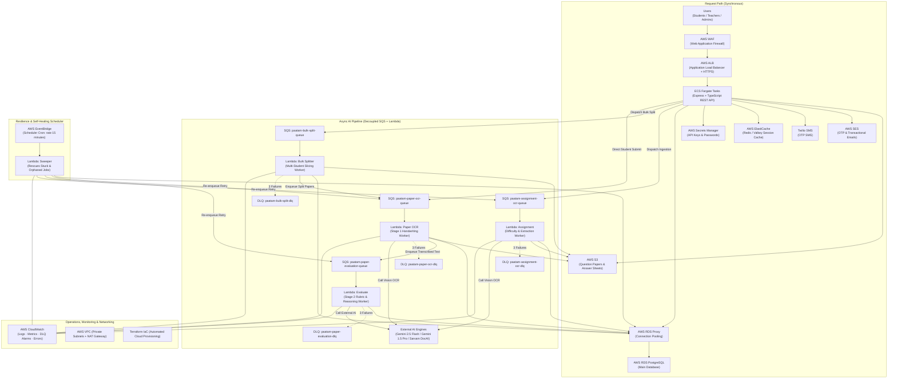

# Paatam Architecture & Asynchronous AI Evaluation Pipeline

## 1. High-Level Architecture Overview

This document details the production architecture for the **Paatam Backend**, implementing the High-Level Design (HLD) comprising an Express/TypeScript REST API on AWS ECS Fargate, coupled with a serverless, decoupled **AWS SQS + AWS Lambda** asynchronous AI pipeline.



---

## 2. Why Asynchronous (SQS + Lambda) vs. Synchronous API

### The Synchronous Bottleneck (Why Synchronous Processing Fails in Production)
1. **ALB 60-Second Gateway Timeout (`HTTP 504`)**:
   * Multi-page student answer sheets or 15-page exam question papers take **25 to 50 seconds** to download from S3, send to Gemini Multimodal Vision / Sarvam Document AI, parse JSON, and evaluate against complex rubrics.
   * AWS Application Load Balancers (ALB) enforce an idle timeout (default 60s). If network latency or LLM token generation exceeds 60s, the ALB terminates the TCP connection and returns `504 Gateway Timeout` to the client.
2. **Node.js Event Loop Blocking & Socket Starvation**:
   * Slicing a 100-page bulk master PDF or parsing dense multipart payloads on the main ECS Express container blocks the V8 single-threaded event loop, degrading API response times for all other users.
3. **Bursty Traffic Spikes (Classroom Exams)**:
   * When a school exam finishes at 4:00 PM, 60 to 500 students submit their papers simultaneously.
   * In a synchronous design, the ECS containers are overwhelmed by hundreds of concurrent long-running HTTP connections, exhausting CPU and memory.
   * In an asynchronous design, SQS buffers all 500 messages instantly. AWS Lambda automatically scales out 500 isolated worker instances in parallel, grading every paper simultaneously in under 35 seconds without straining the web API.
4. **Decoupled Failure Domains**:
   * If Stage 1 (Handwriting OCR) succeeds in 12 seconds, the raw transcribed text is permanently stored in PostgreSQL.
   * If Stage 2 (Rubric Evaluation) subsequently experiences an external Gemini 503 rate limit, Stage 1 does not need to be re-run! Only Stage 2 retries, saving substantial API compute and money.

---

## 3. EventBridge Scheduler & Sweeper Lambda Explained

### Why Stuck / Zombie Jobs Occur in Cloud Systems
Even with reliable queues and retries, edge cases can cause jobs to become orphaned:
* An unhandled Lambda timeout or container crash before database commit.
* An external AI provider rate limit causing the SQS message to exhaust its `maxReceiveCount: 3` and land in the Dead-Letter Queue (DLQ).
* A network failure during RDS commit leaving the database record in `status = 'processing'` or `evaluation_status = 'pending_ocr'` indefinitely.
* **Result for the user:** The teacher or student sees an infinite loading spinner.

### How EventBridge Helps
* **AWS EventBridge** provides serverless, cron-based scheduling (`rate(15 minutes)` or `cron(0/15 * * * ? *)`).
* It wakes up the **Sweeper Lambda** on schedule without requiring a dedicated virtual machine or EC2 instance running 24/7.

### What the Sweeper Lambda Does ([`src/workers/sweeper.worker.ts`](file:///home/phani/My/paatam_application/paatam_backend/src/workers/sweeper.worker.ts))
Every 15 minutes, the Sweeper Lambda executes the following self-healing routines:
1. **Scans Stuck Submissions (`> 30 minutes old`)**:
   * If `ocr_text` was already transcribed but evaluation stalled: Automatically re-dispatches the submission to `paatam-paper-evaluation-queue`.
   * If OCR never finished: Automatically re-dispatches the paper image URLs to `paatam-paper-ocr-queue`.
2. **Handles Hard Failures (`> 2 hours old` or unrecoverable DLQ items)**:
   * Marks `Submission.status = 'failed'`, `evaluation_status = 'failed'`.
   * Sets `fallback_reason = 'Automated evaluation timed out. Please contact teacher or re-upload.'`.
   * Emits an in-app `Notification` record so the student and teacher are alerted immediately with instructions on how to proceed.
3. **Rescues Stuck Batch Jobs (`> 30 minutes old`)**:
   * Updates abandoned bulk PDF jobs to `status = 'failed'` with clear error messages.
4. **Rescues Stuck Assignments (`> 30 minutes old`)**:
   * Re-enqueues question paper ingestion or resets assignment to `draft` so the teacher can re-trigger extraction without re-uploading files.

---

## 4. Dead-Letter Queues (DLQ) Demystified

### Is DLQ a Separate AWS Service?
**No. A Dead-Letter Queue is simply a standard AWS SQS queue.**
* It is created using the standard Terraform resource `aws_sqs_queue`.
* It is designated as a "dead-letter" queue by referencing its ARN in the source queue's `redrive_policy`:
  ```hcl
  resource "aws_sqs_queue" "paper_ocr_queue" {
    name                       = "paatam-paper-ocr-queue-prod"
    visibility_timeout_seconds = 900 # 15 min

    redrive_policy = jsonencode({
      deadLetterTargetArn = aws_sqs_queue.paper_ocr_dlq.arn
      maxReceiveCount     = 3
    })
  }
  ```
* **Why it is drawn as a separate box in HLD diagrams:**
  System architects draw DLQs as an independent entity to highlight the fault-tolerance pattern—proving to stakeholders that "poison pill" messages are quarantined and never lost.
* **Retention:** Our DLQs are configured with a **14-day retention window** (`1209600 seconds`), giving engineering ample time to inspect, debug, and redrive failed messages.
* **Monitoring:** CloudWatch metric alarms trigger an alert as soon as `ApproximateNumberOfMessagesVisible >= 1` in any DLQ.

---

## 5. API Keys Configuration Guide

### Do you need to manually add Gemini and Sarvam API Keys?
**Yes, you need to provide your API keys, but where you add them depends on the environment:**

### A. Local Development & Testing (`.env`)
Add the following keys to your local [`.env`](file:///home/phani/My/paatam_application/paatam_backend/.env) file:
```bash
# ----------------------------------------------------
# AI Gateway & Provider Keys
# ----------------------------------------------------
GEMINI_API_KEY="AIzaSy..."
SARVAM_API_KEY="sarvam_api_key_here" # Optional (only if using Sarvam for Indic)

# Model Selection Defaults
GEMINI_MODEL="gemini-2.5-flash"
ADVANCED_REASONING_MODEL="gemini-1.5-pro"
PRIMARY_AI_PROVIDER="gemini" # or "sarvam"

# AWS S3 & SQS Configuration
AWS_REGION="ap-south-2"
AWS_S3_BUCKET_NAME="paatam-uploads-dev"
AWS_SQS_REGION="ap-south-2"
```

### B. Production Environment (AWS Secrets Manager)
In production, **never commit API keys into source control**.
* Store them in **AWS Secrets Manager** under the secret managed by [`terraform/secrets.tf`](file:///home/phani/My/paatam_application/paatam_backend/terraform/secrets.tf):
  ```bash
  aws secretsmanager put-secret-value \
    --secret-id paatam-secrets-prod \
    --secret-string '{"GEMINI_API_KEY":"AIzaSy...","SARVAM_API_KEY":"..."}' \
    --region ap-south-2
  ```
* The ECS Task Execution Role and Lambda IAM Role automatically pull these secrets at container launch and inject them as secure environment variables.

---

## 6. Prompt Engineering & Core AI Logic Integration

### What is Already Implemented in `paatam_backend`
All the core prompts, normalization routines, and boundary logic from Module 1 through Module 7 are already implemented in production-ready TypeScript:
1. **Question Paper Ingestion Prompts** ([`src/services/questionPaper.service.ts`](file:///home/phani/My/paatam_application/paatam_backend/src/services/questionPaper.service.ts)):
   * English / STEM multimodal extraction prompt.
   * Devanagari Hindi and Telugu translation & localization prompts.
   * Hierarchy normalizer: preserves parent passages/stems and branches sub-parts `(a)`, `(b)` without repeating stem text.
2. **Handwriting OCR Transcription Prompts** ([`src/services/ocr.service.ts`](file:///home/phani/My/paatam_application/paatam_backend/src/services/ocr.service.ts)):
   * Answer box parsing rules: `[Box: <text>]`, `[Tick: <opt>]`, `[Box: EMPTY]`.
   * GitHub markdown tables for tabular answers.
   * Diagram descriptions: `[Diagram / Drawing: <description>]`.
3. **Dynamic Model Routing** ([`src/services/aiGateway.service.ts`](file:///home/phani/My/paatam_application/paatam_backend/src/services/aiGateway.service.ts)):
   * STEM / LaTeX derivations $\rightarrow$ `gemini-1.5-pro`.
   * Indic scripts (Hindi/Telugu) $\rightarrow$ `sarvam-105b` / Sarvam DocAI.
   * General humanities / MCQs $\rightarrow$ `gemini-2.5-flash`.
4. **Rubric Evaluation & Anti-Boilerplate Refiner** ([`src/services/evaluation.service.ts`](file:///home/phani/My/paatam_application/paatam_backend/src/services/evaluation.service.ts)):
   * Partial credit deduction rules.
   * Anti-hallucination guards.
   * Anti-boilerplate reasoning refiner: generates contextual explanations rather than generic "Student answered correctly".
   * Socratic hint generator for incorrect answers.
5. **Bulk Stack Splitting** ([`src/services/studentBoundary.service.ts`](file:///home/phani/My/paatam_application/paatam_backend/src/services/studentBoundary.service.ts)):
   * Multi-student boundary detection via thumbnail batching.
   * Levenshtein distance student roster matching.

### Integrating Your Friend's Codebase
**Yes! Please share his source code / repo.**
Specifically, if his codebase contains:
* **AI Question Paper Generation Engine**: Generating fresh exams from curriculum topics, difficulty levels, and Bloom's Taxonomy.
* **Textbook Knowledge Graph / RAG**: Generating vector embeddings from textbooks for curriculum-aligned question generation.
* **Enhanced Evaluation Rubrics**: Subject-specific rubrics for complex grading.

We can take his raw algorithms, wrap them inside our enterprise architecture (SQS queues, Lambda workers, Prisma models, and CloudWatch metrics), and ensure they run asynchronously and reliably.

---

## 7. Checklist of Remaining Items for Production Launch

| Item | Status | Action Required |
| :--- | :--- | :--- |
| **Prisma Migration for `submission_mode`** | ✅ Complete | Migration file generated in `prisma/migrations/20261020080000_add_submission_mode_to_assignment/`. Run `npx prisma migrate deploy` during deployment. |
| **SQS Queues & DLQs** | ✅ Complete | Declared in `terraform/sqs.tf` with 15-minute timeouts, 3-retry redrive policies, and 14-day retention. |
| **Lambda Workers** | ✅ Complete | Declared in `terraform/lambdas.tf` with VPC private subnets, RDS Proxy access, and SQS event mappings. |
| **CloudWatch Logs & Alarms** | ✅ Complete | Declared in `terraform/cloudwatch.tf` with log retention, DLQ depth alarms, and Lambda error alarms. |
| **EventBridge Sweeper Scheduler** | ✅ Complete | Declared in `terraform/cloudwatch.tf` (`rate(15 minutes)`), worker in `src/workers/sweeper.worker.ts`. |
| **API Keys Provisioning** | ⏳ Pending User | Add `GEMINI_API_KEY` and `SARVAM_API_KEY` to local `.env` and AWS Secrets Manager. |
| **Question Paper Generation / Knowledge Graph** | ⏳ Awaiting Code | Send friend's source code for Question Paper Generation and Knowledge Graph integration. |
| **Terraform Deployment** | ⏳ Pending Run | Execute `terraform plan` and `terraform apply` in target AWS environment. |
