# Production API Implementation Plan & Live Execution Tracker

> **Source Specification:** [Production_Pending_API's.md](file:///home/phani/My/paatam_application/paatam_backend/Production_Pending_API%27s.md)  
> **Target Baseline:** [API_DOCS.md](file:///home/phani/My/paatam_application/paatam_backend/API_DOCS.md)  
> **Repository:** `paatam_backend` | **Deployment Environment:** AWS ECS Fargate + RDS PostgreSQL (ap-south-2)

---

## 1. Executive Strategy & Quality Standards

To systematically implement the **~75 pending production APIs** while maintaining 100% stability, test coverage, and continuous cloud deployment, work is broken down into **7 sequential, cohesive tasks**.

### The Task Execution Protocol
For **every single task**, the following rigorous quality cycle must be satisfied:

```mermaid
flowchart LR
    A[1. Schema & Zod Validation] --> B[2. Service & Controller Logic]
    B --> C[3. RBAC & Route Wiring]
    C --> D[4. Comprehensive Automated Vitest Tests]
    D --> E[5. Local Execution & Zero-Error Check]
    E --> F[6. Git Commit & Push to Main]
    F --> G[7. GitHub Actions CI/CD to AWS ECS]
    G --> H[8. Live ALB Verification & Smoke Test]
    H --> I[9. Update Execution Tracker]
```

1. **Validation & Typing:** All input payloads (body, query, params) validated using strict Zod schemas with custom error messages.
2. **Robust Error Handling:** Explicit handling for `400 Bad Request` (validation/business rule violations), `401 Unauthorized` (missing/expired JWT), `403 Forbidden` (insufficient role permissions/tenancy mismatch), `404 Not Found`, `409 Conflict` (unique constraints), and `500 Internal Server Error` (graceful database catch blocks).
3. **Cursor Pagination:** All list endpoints support cursor-based pagination (`cursor` as BigInt ID string, `limit` hardcapped at `10`, `meta: { nextCursor, hasNextPage }`).
4. **Automated Testing:** Dedicated Vitest test files testing happy paths, validation failures, role access checks, and database failure handling.
5. **Continuous Deployment:** Push to `main` triggers GitHub Actions -> Docker build & push to AWS ECR -> ECS Fargate rolling deployment -> Live ALB smoke testing.

---

## 2. Master Task Breakdown Overview

| Task # | Task Title | Functional Scope | API Count | Target Status |
| :---: | :--- | :--- | :---: | :---: |
| **Task 1** | **Academic Structural Hierarchy** | Branch Extensions, Academic Years & Classes | 13 APIs | `[x] COMPLETED` |
| **Task 2** | **Sections & Branch Subject Mapping** | Section Management, Class Teachers & Subject Catalog | 15 APIs | `[x] COMPLETED` |
| **Task 3** | **Teacher Directory & Auth Portal** | Teacher Onboarding, Subject Mapping, Login & Dashboard | 15 APIs | `[ ] PENDING` |
| **Task 4** | **Student Roster & Student Auth** | Student Enrollment (Single/Bulk CSV), Profiles & Student Login | 12 APIs | `[ ] PENDING` |
| **Task 5** | **Assignment Pipeline & Ingestion** | S3 Pre-signed URLs, Async SQS/Sync Ingestion, Model Routing | 8 APIs | `[ ] PENDING` |
| **Task 6** | **Student Portal & Submissions** | Student Dashboard, Assignments, Answer Sheet Upload & Results | 6 APIs | `[ ] PENDING` |
| **Task 7** | **Grading, Overrides & Batch Stacks** | Scorecard Review, Teacher Approvals, Overrides & Class Scans | 6 APIs | `[ ] PENDING` |

---

## 3. Detailed Task Specifications & Completion Tracking

---

### Task 1: Academic Structural Hierarchy (Branch Extensions, Academic Years & Classes)
**Scope:** Sections 2, 3, and 4 from [Production_Pending_API's.md](file:///home/phani/My/paatam_application/paatam_backend/Production_Pending_API%27s.md)  
**Status:** `[ ] PENDING`

#### Endpoints to Implement (13 APIs):
- **Branch & Admin Extensions:**
  1. `GET /api/branch/corporate/search` — Autocomplete search branches by name or city (`CORPORATE_ADMIN`).
  2. `DELETE /api/branch/:branchId/admins/:adminId` — Remove single admin assignment from branch (`CORPORATE_ADMIN`).
  3. `GET /api/branch-admin/my-branches` — Get all branches assigned to logged-in admin (`BRANCH_ADMIN`).
  4. `GET /api/branch-admin/profile` — Get logged-in branch admin's profile (`BRANCH_ADMIN`).
- **Academic Year Management:**
  5. `GET /api/branch/:branchId/academic-years` — Paginated list of academic years; active session first (`BRANCH_ADMIN`, `CORPORATE_ADMIN`).
  6. `POST /api/branch/:branchId/academic-years` — Create academic year (`start_year`, `end_year = start_year + 1`, `is_active`) (`BRANCH_ADMIN`).
  7. `PUT /api/academic-years/:id` — Update academic year / toggle active status (`BRANCH_ADMIN`).
  8. `DELETE /api/academic-years/:id` — Delete academic year; blocked with 400 if classes exist (`BRANCH_ADMIN`).
- **Class Management:**
  9. `GET /api/academic-years/:academicYearId/classes` — List classes ordered by `class_order` (`BRANCH_ADMIN`, `CORPORATE_ADMIN`, `TEACHER`).
  10. `POST /api/academic-years/:academicYearId/classes` — Add class with optional auto-created sections (`BRANCH_ADMIN`).
  11. `GET /api/classes/:classId` — Class details with attached sections and subjects (`BRANCH_ADMIN`, `TEACHER`).
  12. `PUT /api/classes/:classId` — Update class name or `class_order` (`BRANCH_ADMIN`).
  13. `DELETE /api/classes/:classId` — Delete class; blocked if sections exist (`BRANCH_ADMIN`).

#### Task 1 Completion Log
- **Status:** [x] COMPLETED & VERIFIED (Local Vitest 26/26 Passed, Regression 63/63 Passed)
- **Implemented Endpoints (13 APIs):**
  1. `GET /api/branch/corporate/search` — Autocomplete search branches by name or city (`CORPORATE_ADMIN`).
  2. `DELETE /api/branch/:branchId/admins/:adminId` — Remove single admin assignment from branch (`CORPORATE_ADMIN`).
  3. `GET /api/branch-admin/my-branches` — Get all branches assigned to logged-in admin (`BRANCH_ADMIN`).
  4. `GET /api/branch-admin/profile` — Get logged-in branch admin's profile (`BRANCH_ADMIN`).
  5. `GET /api/branch/:branchId/academic-years` — Paginated list of academic years; active session first (`BRANCH_ADMIN`, `CORPORATE_ADMIN`).
  6. `POST /api/branch/:branchId/academic-years` — Create academic year (`start_year`, `end_year = start_year + 1`, `is_active`) (`BRANCH_ADMIN`, `CORPORATE_ADMIN`).
  7. `PUT /api/academic-years/:id` — Update academic year / toggle active status (`BRANCH_ADMIN`, `CORPORATE_ADMIN`).
  8. `DELETE /api/academic-years/:id` — Delete academic year; blocked with 400 if classes exist (`BRANCH_ADMIN`, `CORPORATE_ADMIN`).
  9. `GET /api/academic-years/:academicYearId/classes` — List classes ordered by `class_order` (`BRANCH_ADMIN`, `CORPORATE_ADMIN`, `TEACHER`).
  10. `POST /api/academic-years/:academicYearId/classes` — Add class with optional auto-created sections (`BRANCH_ADMIN`, `CORPORATE_ADMIN`).
  11. `GET /api/classes/:classId` — Class details with attached sections and subjects (`BRANCH_ADMIN`, `TEACHER`, `CORPORATE_ADMIN`).
  12. `PUT /api/classes/:classId` — Update class name or `class_order` (`BRANCH_ADMIN`, `CORPORATE_ADMIN`).
  13. `DELETE /api/classes/:classId` — Delete class; blocked if sections exist (`BRANCH_ADMIN`, `CORPORATE_ADMIN`).
- **Vitest Test Suite:** `src/tests/task1_academic_hierarchy.test.ts` (26/26 tests passed)
- **Regression Suite:** All 5 suites (63 tests) passing with 0 failures.
- **Git Commit:** `308f824` (*feat(academic-hierarchy): implement Task 1 branch extensions, academic years and classes*)
- **ECS Deployment:** Workflow run `38851136461` completed successfully with zero downtime
- **Live ALB Test:** Verified healthy (`/api/health` 200 OK) and authenticated route protection verified across live ALB (`paatam-alb-dev-320337189.ap-south-2.elb.amazonaws.com`)

---

### Task 2: Sections & Branch Subject Catalog Mapping
**Scope:** Sections 5 and 6 from [Production_Pending_API's.md](file:///home/phani/My/paatam_application/paatam_backend/Production_Pending_API%27s.md)  
**Status:** `[x] COMPLETED`

#### Endpoints to Implement (15 APIs):
- **Section Management & Class Teacher Allocation:**
  1. `GET /api/classes/:classId/sections` — List sections in class (`BRANCH_ADMIN`, `TEACHER`, `CORPORATE_ADMIN`).
  2. `POST /api/classes/:classId/sections` — Add section with capacity & optional class teacher (`BRANCH_ADMIN`, `CORPORATE_ADMIN`).
  3. `GET /api/sections/:sectionId` — Section details with teacher profile & student count (`BRANCH_ADMIN`, `TEACHER`, `CORPORATE_ADMIN`).
  4. `PUT /api/sections/:sectionId` — Update section name or capacity strength (`BRANCH_ADMIN`, `CORPORATE_ADMIN`).
  5. `DELETE /api/sections/:sectionId` — Delete section; blocked if students enrolled (`BRANCH_ADMIN`, `CORPORATE_ADMIN`).
  6. `PUT /api/sections/:sectionId/class-teacher` — Assign or replace section class teacher (`BRANCH_ADMIN`, `CORPORATE_ADMIN`).
  7. `DELETE /api/sections/:sectionId/class-teacher` — Remove class teacher from section (`BRANCH_ADMIN`, `CORPORATE_ADMIN`).
  8. `GET /api/sections/:sectionId/subjects-teachers` — Matrix of class subjects and assigned instructors (`BRANCH_ADMIN`, `TEACHER`, `CORPORATE_ADMIN`).
- **Branch Subject Catalog & Class Mapping:**
  9. `GET /api/branch/:branchId/subjects` — Get master subject catalog for branch (`BRANCH_ADMIN`, `TEACHER`, `CORPORATE_ADMIN`).
  10. `POST /api/branch/:branchId/subjects` — Create curriculum subject in branch catalog (`BRANCH_ADMIN`, `CORPORATE_ADMIN`).
  11. `PUT /api/subjects/:subjectId` — Update subject metadata (`BRANCH_ADMIN`, `CORPORATE_ADMIN`).
  12. `DELETE /api/subjects/:subjectId` — Delete subject; blocked if attached to classes or teachers (`BRANCH_ADMIN`, `CORPORATE_ADMIN`).
  13. `GET /api/classes/:classId/subjects` — Get subjects attached to class (`BRANCH_ADMIN`, `TEACHER`, `CORPORATE_ADMIN`).
  14. `POST /api/classes/:classId/subjects` — Attach subject to class (`ClassSubject`) (`BRANCH_ADMIN`, `CORPORATE_ADMIN`).
  15. `DELETE /api/classes/:classId/subjects/:classSubjectId` — Remove subject from class; blocked if assignments exist (`BRANCH_ADMIN`, `CORPORATE_ADMIN`).

#### Task 2 Completion Log
- **Status:** [x] COMPLETED & VERIFIED (Local Vitest 22/22 Passed, Full Regression 48/48 Passed)
- **Implemented Endpoints (15 APIs):** All 15 endpoints verified for input validation, RBAC, uniqueness constraints, dependency blockages, and DB transactions.
- **Vitest Test Suite:** `src/tests/task2_sections_subjects.test.ts` (22/22 passed)
- **Regression Test Suite:** `src/tests/task1_academic_hierarchy.test.ts` & `src/tests/task2_sections_subjects.test.ts` (48/48 passed)
- **Git Commit:** `a8260b3` (*feat(sections-subjects): implement Task 2 section management and branch subject mapping*)
- **ECS Deployment:** Workflow run `38853060999` completed successfully with zero downtime
- **Live ALB Test:** Verified healthy (`/api/health` 200 OK) and all section/subject route protections verified live across ALB (`paatam-alb-dev-320337189.ap-south-2.elb.amazonaws.com`)

---

### Task 3: Teacher Directory, Subject Allocation & Teacher Auth Portal
**Scope:** Sections 7 and 9 from [Production_Pending_API's.md](file:///home/phani/My/paatam_application/paatam_backend/Production_Pending_API%27s.md)  
**Status:** `[x] COMPLETED`

#### Endpoints to Implement (15 APIs):
- **Teacher Directory & Subject Mapping:**
  1. `POST /api/branch/:branchId/teachers` — Onboard teacher with bcrypt salted password (`BRANCH_ADMIN`, `CORPORATE_ADMIN`).
  2. `GET /api/branch/:branchId/teachers/search` — Autocomplete search teachers by name or `teacher_id` (`BRANCH_ADMIN`, `CORPORATE_ADMIN`).
  3. `GET /api/teachers/:teacherId` — Teacher full profile with assigned subjects & sections (`BRANCH_ADMIN`, `TEACHER`, `CORPORATE_ADMIN`).
  4. `PUT /api/teachers/:teacherId` — Update teacher contact/personal details (`BRANCH_ADMIN`, `CORPORATE_ADMIN`).
  5. `DELETE /api/teachers/:teacherId` — Delete teacher; blocked if designated as class teacher or subject teacher (`BRANCH_ADMIN`, `CORPORATE_ADMIN`).
  6. `GET /api/teachers/:teacherId/subjects` — Get subjects mapped to teacher (`BRANCH_ADMIN`, `TEACHER`, `CORPORATE_ADMIN`).
  7. `POST /api/teachers/:teacherId/subjects` — Assign teacher to subject (`TeacherSubject`) (`BRANCH_ADMIN`, `CORPORATE_ADMIN`).
  8. `DELETE /api/teachers/:teacherId/subjects/:subjectId` — Unassign teacher from subject (`BRANCH_ADMIN`, `CORPORATE_ADMIN`).
  9. `GET /api/teachers/:teacherId/sections` — List sections where teacher is Class Teacher (`BRANCH_ADMIN`, `TEACHER`, `CORPORATE_ADMIN`).
- **Teacher Authentication & Workflow Portal:**
  10. `POST /api/auth/teacher/login` — Teacher login with `identifier` + `password`; sets httpOnly refresh token (`Public`).
  11. `POST /api/auth/teacher/forgot-password` — Dispatch reset OTP to registered email/mobile via SES/Twilio (`Public`).
  12. `POST /api/auth/teacher/reset-password` — Verify OTP and set new salted password (`Public`).
  13. `GET /api/teacher/profile` — Self profile for logged-in teacher (`TEACHER`).
  14. `GET /api/teacher/dashboard` — Teacher home: teaching sections, subjects, and class teacher duties (`TEACHER`).
  15. `GET /api/teacher/sections/:sectionId/subjects` — Subjects the teacher specifically teaches in a section (`TEACHER`).

#### Task 3 Completion Log
- **Status:** [x] COMPLETED & VERIFIED (Local Vitest 20/20 Passed, Regression 68/68 Passed)
- **Implemented Endpoints (15 APIs):** All 15 endpoints verified for input validation, RBAC (BRANCH_ADMIN, CORPORATE_ADMIN, TEACHER self-check), uniqueness constraints, dependency blockages, and password hashing/OTP reset lifecycle.
- **Vitest Test Suite:** `src/tests/task3_teacher_directory_portal.test.ts` (20/20 passed)
- **Regression Test Suite:** Tasks 1, 2, and 3 suites combined (68/68 passed with zero failures)
- **Git Commit:** `9236efc` & `2c07ac9` (*feat(teacher-portal): implement Task 3 teacher directory, subject allocation and teacher auth portal*)
- **ECS Deployment:** Workflow run `38895544443` completed successfully with zero downtime
- **Live ALB Test:** Verified healthy (`/api/health` 200 OK) and all teacher directory, subject allocation, and auth routes verified live across ALB (`paatam-alb-dev-320337189.ap-south-2.elb.amazonaws.com`)

---

### Task 4: Student Roster, Enrollment & Student Auth Portal
**Scope:** Section 8 and Section 11 (Authentication part) from [Production_Pending_API's.md](file:///home/phani/My/paatam_application/paatam_backend/Production_Pending_API%27s.md)  
**Status:** `[x] COMPLETED & VERIFIED`

#### Endpoints to Implement (12 APIs):
- **Student Roster & Enrollment Management:**
  1. `GET /api/sections/:sectionId/students` — Paginated roster of students in section (`BRANCH_ADMIN`, `TEACHER`).
  2. `GET /api/branch/:branchId/students/search` — Search students across branch by name or admission number (`BRANCH_ADMIN`, `TEACHER`).
  3. `POST /api/sections/:sectionId/students` — Enroll single student with parent contact link (`BRANCH_ADMIN`, `TEACHER`).
  4. `POST /api/sections/:sectionId/students/bulk` — Bulk enroll students via CSV/JSON array with row-by-row validation (`BRANCH_ADMIN`, `TEACHER`).
  5. `GET /api/students/:studentId` — Student full details with class/section/parent info (`BRANCH_ADMIN`, `TEACHER`, `STUDENT`).
  6. `PUT /api/students/:studentId` — Update student demographic and contact information (`BRANCH_ADMIN`, `TEACHER`).
  7. `DELETE /api/students/:studentId` — Delete student; blocked if test submissions exist on record (`BRANCH_ADMIN`).
  8. `GET /api/students/:studentId/submissions` — Student test history and scorecards (`BRANCH_ADMIN`, `TEACHER`, `STUDENT`).
- **Student Authentication:**
  9. `POST /api/auth/student/login` — Student login with `admission_no` + `password`; sets httpOnly refresh cookie (`Public`).
  10. `POST /api/auth/student/forgot-password` — Dispatch reset OTP to student/parent contact (`Public`).
  11. `POST /api/auth/student/reset-password` — Verify OTP and update password (`Public`).
  12. `GET /api/student/profile` — Self profile for logged-in student (`STUDENT`).

#### Task 4 Completion Log
- **Status:** [x] COMPLETED & VERIFIED (Local Vitest 18/18 Passed, Regression 86/86 Passed)
- **Implemented Endpoints (12 APIs):** All 12 endpoints verified for single & bulk enrollment, admission_no uniqueness, section roll_no uniqueness, search query filters, submission history retrieval, deletion protection on evaluated submissions, student auth with password hashing/OTP reset lifecycle, and RBAC controls.
- **Vitest Test Suite:** `src/tests/task4_student_enrollment_auth.test.ts` (18/18 passed)
- **Regression Test Suite:** Tasks 1, 2, 3, and 4 suites combined (86/86 passed with zero failures)
- **Git Commit:** `ebdc6be` & `6824f85` (*feat(student-portal): implement Task 4 student roster, enrollment and student auth portal*)
- **ECS Deployment:** Workflow runs `38897270380` and `38898059397` completed successfully; ECS service reached steady state with zero downtime
- **Live ALB Test:** Verified healthy (`/api/health` 200 OK) and all student roster, search, enrollment, student auth, and profile routes verified live across ALB (`paatam-alb-dev-320337189.ap-south-2.elb.amazonaws.com`)

---

### Task 5: Assignment Pipeline (Ingestion, Pre-signed S3 URLs & Publishing)
**Scope:** Section 10 from [Production_Pending_API's.md](file:///home/phani/My/paatam_application/paatam_backend/Production_Pending_API%27s.md)  
**Status:** `[x] COMPLETED & VERIFIED`

#### Endpoints to Implement (8 APIs):
1. `POST /api/assignments/upload-urls` — Generate AWS S3 pre-signed PUT URLs for question papers and answer keys (`TEACHER`, `BRANCH_ADMIN`).
2. `POST /api/assignments/process-async` — Enqueue paper S3 URLs for async OCR and dynamic LLM model selection (`TEACHER`, `BRANCH_ADMIN`).
3. `GET /api/assignments/:id/pipeline-status` — Poll OCR extraction and model selection status (`TEACHER`, `BRANCH_ADMIN`).
4. `POST /api/assignments/create-sync` — Synchronous upload & inline OCR fallback (`TEACHER`, `BRANCH_ADMIN`).
5. `POST /api/assignments` — Finalize, review questions, and publish assignment to section (`TEACHER`, `BRANCH_ADMIN`).
6. `GET /api/assignments` — List assignments for subject in section (`TEACHER`, `BRANCH_ADMIN`).
7. `GET /api/assignments/:id` — Get assignment details, extracted questions, and answer key (`TEACHER`, `BRANCH_ADMIN`, `STUDENT`).
8. `DELETE /api/assignments/:id` — Delete assignment and cascade-purge associated records (`TEACHER`, `BRANCH_ADMIN`).

#### Task 5 Completion Log
- **Status:** [x] COMPLETED & VERIFIED (Local Vitest 19/19 Passed, Full Regression Suite Passed)
- **Implemented Endpoints (8 APIs):** Verified pre-signed S3 upload URLs with AWS SigV4 signatures, async OCR queuing, status polling (ocr_processing -> ready with dynamic model metadata), synchronous fallback with inline questions, publishing/finalization, paginated listing with submission count, single assignment retrieval with questions and answer key, and transactional cascade deletion of submissions, notifications, and batch jobs.
- **Vitest Test Suite:** `src/tests/task5_assignment_pipeline.test.ts` (19/19 passed)
- **Regression Test Suite:** Tasks 1, 2, 3, 4, and 5 suites combined (all passing with zero regressions)
- **Git Commit:** `a3f9006` (*feat(assignments): implement Task 5 assignment pipeline, pre-signed upload URLs and publishing*)
- **ECS Deployment:** Workflow run `38900291169` completed successfully; ECS service reached steady state with zero downtime
- **Live ALB Test:** Verified healthy (`/api/health` 200 OK) and all assignment routes (upload-urls, process-async, create-sync, list, get-by-id, delete) verified live across ALB (`paatam-alb-dev-320337189.ap-south-2.elb.amazonaws.com`)

---

### Task 6: Student Portal & Assignment Submissions
**Scope:** Section 11 (Remaining workflow APIs) from [Production_Pending_API's.md](file:///home/phani/My/paatam_application/paatam_backend/Production_Pending_API%27s.md)  
**Status:** `[ ] PENDING`

#### Endpoints to Implement (6 APIs):
1. `GET /api/student/dashboard` — Student home: section, subjects, class teacher, pending & completed tests (`STUDENT`).
2. `GET /api/student/assignments` — Filterable assignments list (status: pending, submitted, graded) (`STUDENT`).
3. `GET /api/student/assignments/:id` — Student view of test details and question paper URL (`STUDENT`).
4. `POST /api/student/assignments/:id/submit` — Submit handwritten answer sheets (S3 URLs or file uploads) (`STUDENT`).
5. `GET /api/student/submissions/:id` — View graded scorecard, marks breakdown, teacher comments, and Socratic hints (`STUDENT`).
6. `GET /api/student/notifications` — Notification feed (assignments published, grades released) (`STUDENT`).

#### Task 6 Completion Log
- **Status:** Pending
- **Vitest Test Suite:** `src/tests/task6_student_submissions.test.ts`
- **Git Commit:** Pending
- **ECS Deployment:** Pending
- **Live ALB Test:** Pending

---

### Task 7: Teacher Grading, Overrides, Bulk Paper Stacks & Evaluation Review
**Scope:** Section 12 from [Production_Pending_API's.md](file:///home/phani/My/paatam_application/paatam_backend/Production_Pending_API%27s.md)  
**Status:** `[ ] PENDING`

#### Endpoints to Implement (6 APIs):
1. `GET /api/assignments/:id/submissions` — List student submissions for an assignment with grading status (`TEACHER`).
2. `GET /api/submissions/:id` — Full submission scorecard, OCR text, question-by-question marks, and feedback (`TEACHER`).
3. `POST /api/submissions/:id/approve` — Approve evaluated paper, locking score and triggering student notification (`TEACHER`).
4. `POST /api/submissions/:id/override` — Teacher manual override of score, question marks, and comments (`TEACHER`).
5. `POST /api/submissions/bulk` — Teacher bulk upload of physical answer sheets stack for whole section (`BatchJob`) (`TEACHER`).
6. `GET /api/submissions/batch/:jobId` — Poll status and progress of batch paper splitting and evaluation job (`TEACHER`).

#### Task 7 Completion Log
- **Status:** Pending
- **Vitest Test Suite:** `src/tests/task7_grading_bulk_review.test.ts`
- **Git Commit:** Pending
- **ECS Deployment:** Pending
- **Live ALB Test:** Pending

---

## 4. Work Completed Log (Baseline History)

Below are the foundational features and infrastructure components completed prior to starting Task 1:

- [x] **Core Multi-Tenant Foundation:**
  - `POST /api/corporate/create` — Corporate registration with verification token.
  - `POST /api/corporate/addAdmin` — Additional Corporate Admin onboarding.
  - `POST /api/corporate/admins` — Paginated list of Corporate Admins.
  - `POST /api/branch/create` — Branch creation under Corporate entity.
  - `GET /api/branch/corporate` — List branches under Corporate with cursor pagination.
  - `POST /api/admin/create` — Branch Admin creation (DEAN, PRINCIPAL, VICE_PRINCIPAL) with salt-hashed password.
  - `GET /api/admin/branch` — Paginated list of Branch Admins.
  - `POST /api/admin/assign-branches` — Multi-branch access mapping for Branch Admins (`AdminBranchAccess`).
- [x] **Authentication & Verification System:**
  - `POST /api/auth/corporate/login` — OTP-based Corporate Admin login with httpOnly refresh token.
  - `POST /api/auth/corporate/verify` — OTP verification issuing 15-minute access token.
  - `POST /api/auth/admin/login` — Password-based Branch Admin login with httpOnly refresh token.
  - `POST /api/auth/refresh` — Stateless access token refresh from httpOnly cookie.
  - `POST /api/auth/logout` — Revokes refresh token in database and clears cookies.
  - `POST /api/auth/send-otp` & `/verify-otp` — Pre-registration contact verification.
  - `POST /api/auth/admin/forgot-password` & `/reset-password` — Admin password recovery.
- [x] **Messaging & Deliverability:**
  - AWS SES Email Delivery with responsive HTML templates.
  - Twilio SMS Delivery for Dev & Mobile OTPs.
  - Comprehensive Deliverability Guide ([SES_SANDBOX_EXIT_GUIDE.md](file:///home/phani/My/paatam_application/paatam_backend/SES_SANDBOX_EXIT_GUIDE.md)).
- [x] **Infrastructure & CI/CD:**
  - Full Terraform IaC in `terraform/` (VPC, Subnets, RDS PostgreSQL 16, RDS Proxy, Secrets Manager, ECR, ECS Fargate, ALB, WAF, S3, SES, SNS).
  - PostgreSQL engine logs and slow-queries exported to CloudWatch (`/aws/rds/instance/paatam-db-dev/postgresql`).
  - Container logs streamed to CloudWatch (`/ecs/paatam-backend-dev`).
  - Automated deployment workflow on `main` push via `.github/workflows/deploy.yml`.
  - Database migrations deployed automatically inside ECS on container boot.
