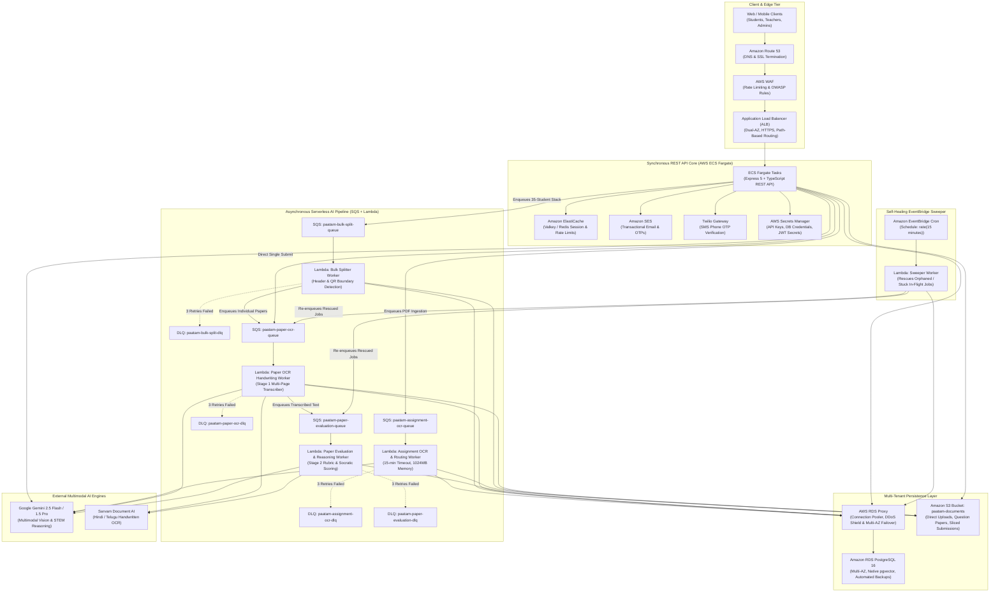
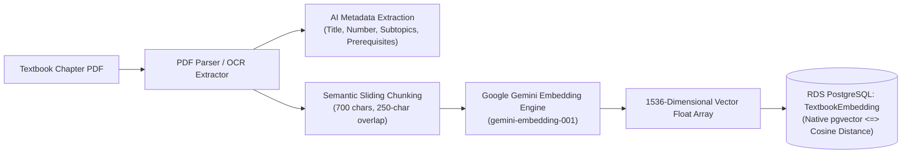
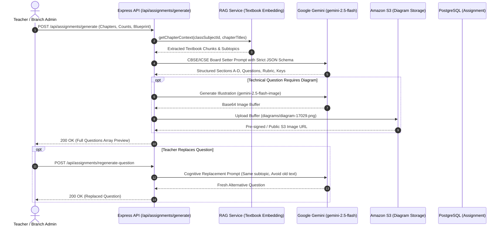
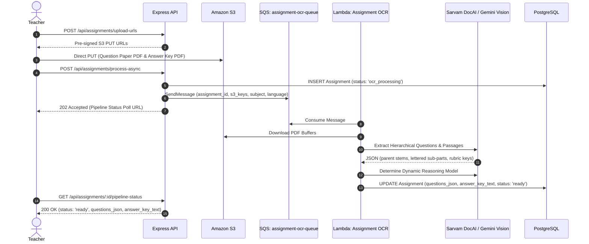
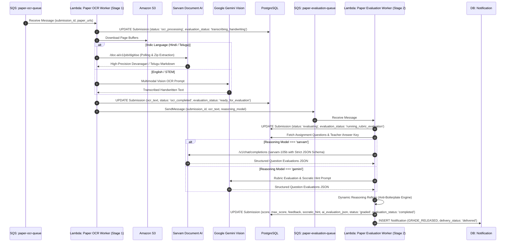
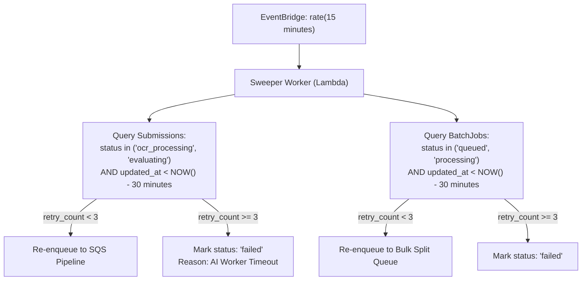
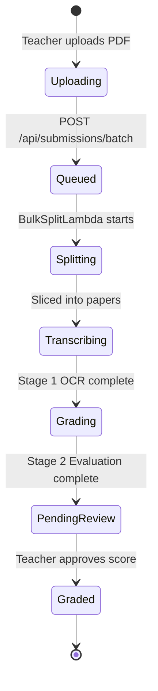

# Paatam Application — End-to-End Master Architecture & Technical Deep-Dive

This document provides a comprehensive, top-to-bottom technical specification of the entire **Paatam** enterprise education platform. It details the High-Level Design (HLD), infrastructure topology, asynchronous serverless worker architecture, Retrieval-Augmented Generation (RAG) vector engine, question paper generation, bulk scanning and slicing, two-stage evaluation pipeline, and frontend state synchronization mechanics.

---

## 1. High-Level Design (HLD) & Infrastructure Topology

The Paatam platform adopts a hybrid architecture designed for enterprise multi-tenancy, high-throughput synchronous REST API interactions, and asynchronous, long-running AI workloads.



### The Architectural Problem: Synchronous Bottlenecks
Traditional monolithic web apps attempt to run PDF rasterization, handwriting OCR, and LLM reasoning inside the synchronous HTTP request handler. 
1. **ALB Hard Timeout**: AWS Application Load Balancers disconnect clients after 30–60 seconds of idle connection. OCR and rubric grading for a 4-page handwritten student paper takes 15–45 seconds; grading a bulk stack of 35 students takes 10–25 minutes. Holding an open HTTP socket guarantees `504 Gateway Timeout` errors.
2. **Container Memory Exhaustion**: Rasterizing high-resolution PDFs (300 DPI) consumes 200MB–800MB of RAM per document. Running multiple concurrent uploads on an ECS web container causes out-of-memory (OOM) kernel crashes.
3. **The Solution**: Paatam uses **Amazon SQS + AWS Lambda**. The ECS web API accepts requests in `< 100ms`, issues pre-signed S3 upload URLs, records a `queued` row in PostgreSQL, and enqueues a job message. Serverless Lambda workers process jobs with 15-minute execution limits, leaving the web API responsive and lightweight.

---

## 2. Multi-Tenant Enterprise Data Model

All database operations enforce tenant isolation through foreign keys and row-level authorization.

```mermaid
erDiagram
    Corporate ||--o{ Branch : "owns"
    Branch ||--o{ AcademicYear : "manages"
    Branch ||--o{ Admin : "employs"
    AcademicYear ||--o{ Class : "defines"
    Class ||--o{ Section : "contains"
    Class ||--o{ ClassSubject : "maps curriculum"
    Section ||--o{ Student : "enrolls"
    ClassSubject ||--o{ CurriculumChapter : "indexes"
    ClassSubject ||--o{ CurriculumTopic : "structures"
    ClassSubject ||--o{ TextbookEmbedding : "vectorizes"
    Section ||--o{ Assignment : "assigns"
    Assignment ||--o{ Submission : "receives"
    Assignment ||--o{ BatchJob : "processes bulk"
    Submission ||--o{ Notification : "alerts"
```

### Isolation Guarantees
* **Corporate Admin**: Access to corporate-wide analytics and cross-branch auditing.
* **Branch Admin**: Scoped strictly to `branch_id`. Cannot inspect or mutate data from other branches.
* **Teacher**: Authorized only for assigned `Section` and `ClassSubject` combinations via `TeacherSubject`.
* **Student**: Bound strictly to their enrolled `section_id` and personal `student_id`.

---

## 3. Retrieval-Augmented Generation (RAG) & Vector Architecture

The RAG engine converts physical textbooks and syllabus documents into high-dimensional semantic search vectors in AWS RDS PostgreSQL.



### Implementation Details
1. **Semantic Sliding-Window Chunking**:
   * Text is split into paragraphs at double line breaks.
   * Chunks are accumulated up to **700 characters** with a **250-character overlap**.
   * Sentence boundaries are preserved to ensure mathematical formulas and grammatical context are never sliced mid-phrase.
2. **Vector Dimension Normalization**:
   * Google Gemini embedding vectors are normalized to exactly **1536 dimensions** to match the PostgreSQL `vector(1536)` column definition.
3. **High-Performance Cosine Search**:
   * Vector similarity queries run natively using the PostgreSQL `<=>` cosine distance operator:
   ```sql
   SELECT id, content_chunk, 1 - (embedding <=> $1::vector) AS similarity
   FROM "TextbookEmbedding"
   WHERE class_subject_id = $2 AND embedding IS NOT NULL
   ORDER BY embedding <=> $1::vector ASC
   LIMIT $3;
   ```
4. **RDS pgvector Parameter Group**:
   * AWS RDS PostgreSQL 16 natively supports `pgvector`.
   * Terraform declares `aws_db_parameter_group.main` (`family = "postgres16"`) and database migrations execute `CREATE EXTENSION IF NOT EXISTS "vector";`.

---

## 4. AI Question Paper Generation Engine

Teachers can generate board-aligned exam question papers or regenerate individual questions on demand.



### Cognitive Distribution & Blueprinting
* **Sections**:
  * **Section A**: Multiple Choice Questions (1 mark each).
  * **Section B**: Very Short Answer questions (2 marks each).
  * **Section C**: Short Answer questions (3 marks each).
  * **Section D**: Long / Case-based Descriptive questions (5 marks each).
* **Bloom's Taxonomy Tagging**: Questions are classified with cognitive depth (`remember`, `understand`, `apply`, `analyze`).
* **Technical Diagram Generation**: If a question requires visual apparatus (e.g. concave mirror ray diagrams, electrical circuits), the system attempts high-resolution image generation via Gemini and saves the binary directly to S3. If image generation is constrained, it generates an inline responsive SVG vector diagram as fallback.

---

## 5. Question Paper & Answer Key Upload / Ingestion

When teachers upload existing printed question papers and answer keys:



### Hierarchy Preservation Rules
1. **Passage De-duplication**: Reading passages, instructions, and shared figures belong in the parent `stem` field once. Sub-parts `(a)`, `(b)`, `(c)` contain only their sub-question wording.
2. **Dynamic Routing Engine**:
   * Regional Indian Languages (Hindi, Telugu, Bengali, Tamil, etc.) $\rightarrow$ **Sarvam AI**.
   * Advanced STEM / Derivations / LaTeX $\rightarrow$ **Gemini 1.5 Pro**.
   * General Objective / Humanities $\rightarrow$ **Gemini 2.5 Flash**.

---

## 6. Student Submission & Bulk Stack Splitting

Paatam supports two submission workflows:

```mermaid
flowchart TD
    subgraph Mode_A["Mode A: Individual Student Upload"]
        S_Upload["Student uploads homework / test PDF"] --> S_S3["S3: paatam-documents/submissions/"]
        S_S3 --> S_Record["DB: Submission (status: 'submitted')"]
        S_Record --> S_Queue["SQS: paatam-paper-ocr-queue"]
    end

    subgraph Mode_B["Mode B: Teacher Bulk Class Stack Scan"]
        T_Upload["Teacher uploads 35-student combined PDF"] --> T_S3["S3: paatam-documents/bulk_stacks/"]
        T_S3 --> T_Record["DB: BatchJob (status: 'queued', stage: 'splitting')"]
        T_Record --> T_Queue["SQS: paatam-bulk-split-queue"]
        
        T_Queue --> Split_Lambda["Lambda: Bulk Splitter Worker"]
        Split_Lambda --> Header_OCR["Scan Page Headers (Name, Roll No, QR, Barcode)"]
        Header_OCR --> Slicing["Slice Master PDF into Individual Student PDFs"]
        Slicing --> Upload_Sliced["S3: Upload student_101.pdf, student_102.pdf..."]
        Upload_Sliced --> Create_Subs["DB: INSERT Submissions (for each student)"]
        Create_Subs --> Enqueue_OCR["SQS: paatam-paper-ocr-queue (35 messages)"]
    end
```



### Header Classification & Fuzzy Matching
* The Bulk Splitter examines the top 20% of each page for student identifiers (e.g. `Name: Aarav Sharma`, `Roll: 12`).
* Recognizes continuation pages without headers by tracking question numbering sequences.
* Uses Levenshtein distance matching against the enrolled class roster (`Student` table) to resolve handwriting variations.

---

## 7. Two-Stage Asynchronous Evaluation Pipeline

Evaluation is decoupled into two independent SQS-driven stages:



### Anti-Hallucination & Transcribing Protections
1. **Unanswered / Empty Box Detection**:
   * If an answer box or blank line has nothing written, it is transcribed as `[Box: EMPTY]`.
   * Evaluator automatically assigns `scorePercent: 0`, `status: 'Unrelated / No Credit'`, and reasoning: `"Question was left blank by the student."`
2. **Indic Numeral Normalization**:
   * Devanagari numerals (१, २, ३) and Telugu numerals (౧, ౨, ౩) are normalized to Arabic numerals (1, 2, 3) to prevent question alignment failures.
3. **Objective / MCQ Robust Matching**:
   * Supports tick marks (`[Box: ✓]`), circled letters (`[Circled: B]`), crossed-out corrections (`[Crossed-out: A] [Box: B]`), and verbatim option text matches.
4. **Dynamic Reasoning Refiner (`refineOrSynthesizeReasoning`)**:
   * Inspects model outputs for generic repeating phrases (e.g. *"Correct answer extracted from paper"*).
   * Automatically replaces generic boilerplate with concrete, question-specific explanations based on the student's handwritten answer snippet.

---

## 8. Dead Letter Queues (DLQs) & The Self-Healing Sweeper

### DLQ Architecture Demystified
Dead Letter Queues are not separate services; they are standard AWS SQS queues configured with extended message retention:
* **Standard Queues**: `visibility_timeout = 900s` (15 mins), `message_retention = 86400s` (1 day).
* **DLQs**: `message_retention = 1209600s` (14 days).
* **Redrive Policy**: `maxReceiveCount = 3`. If a Lambda worker crashes or times out 3 consecutive times, SQS moves the poison message into the DLQ.
* **CloudWatch Alarm**: `ApproximateNumberOfMessagesVisible > 0` triggers an alert to engineering.

### Self-Healing Sweeper Worker
When external AI APIs experience global outages or network dropouts, messages can exceed retries or leave rows in an intermediate state (`ocr_processing` or `evaluating`).



---

## 9. Frontend State Synchronization & Polling Strategy

To provide users with real-time feedback without websockets or server-sent events overhead, Paatam uses **predictive polling intervals** tied to entity status fields.



### Status Polling Reference Table

| Entity | Polling Endpoint | In-Flight States | Terminal States | Recommended Interval |
| :--- | :--- | :--- | :--- | :--- |
| **Assignment Question Paper** | `GET /api/assignments/:id/pipeline-status` | `ocr_processing` | `ready`, `failed` | 3 seconds (Exponential backoff up to 10s) |
| **Bulk Batch Job** | `GET /api/submissions/batch/:jobId` | `queued`, `splitting`, `grading` | `completed`, `failed` | 5 seconds |
| **Student Submission** | `GET /api/submissions/:id` | `submitted`, `ocr_processing`, `evaluating` | `graded`, `pending_review`, `failed` | 4 seconds |

### Frontend UX Behavior
1. **Assignment Creation**:
   * While `pipeline_status === 'ocr_processing'`, show a progress bar at 45% with message: *"Extracting questions and answer key..."*.
   * When `pipeline_status === 'ready'`, unlock the questions editor with pre-filled questions, marks, and benchmark keys.
2. **Bulk Stack Upload**:
   * Display live counters: `processed_count / total_files`.
   * As each student paper is sliced, it dynamically appears in the submissions table.
3. **Scorecard Inspection**:
   * Split-screen view: Left pane displays high-res scanned student paper pages from S3; right pane displays question-by-question marks, reasoning, and Socratic hints.

---

## 10. Security & Secrets Architecture

1. **AWS Secrets Manager**:
   * `paatam/database/credentials`: Database username, host, and auto-generated secure password.
   * `paatam/app/secrets`: `JWT_SECRET`, `JWT_REFRESH_SECRET`, `GEMINI_API_KEY`, `SARVAM_API_KEY`.
2. **Network Isolation**:
   * **Public Subnets**: Internet-facing ALB and NAT Gateways.
   * **Private Subnets**: ECS Fargate containers and RDS Proxy.
   * **Isolated Subnets**: Amazon RDS PostgreSQL instance (zero inbound or outbound route to the internet).
3. **Authentication Token Lifecycle**:
   * **Access Token**: Short-lived (15 minutes), signed with HMAC SHA-256, transmitted in `Authorization: Bearer <token>`.
   * **Refresh Token**: Long-lived (7 days), stored in an `httpOnly`, `Secure`, `SameSite=Strict` cookie, persisted in PostgreSQL `RefreshToken` table with instant revocation on logout.
